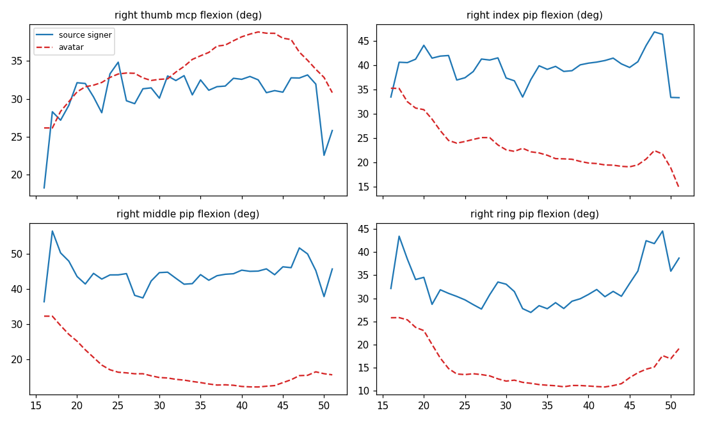
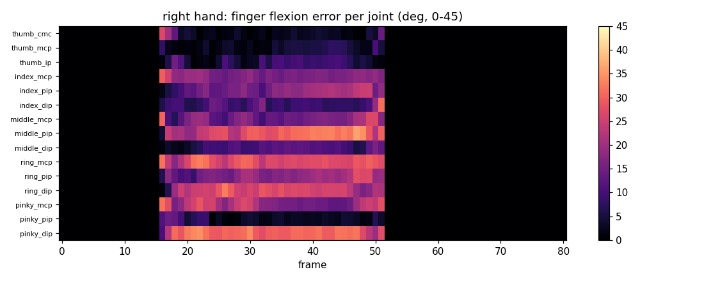
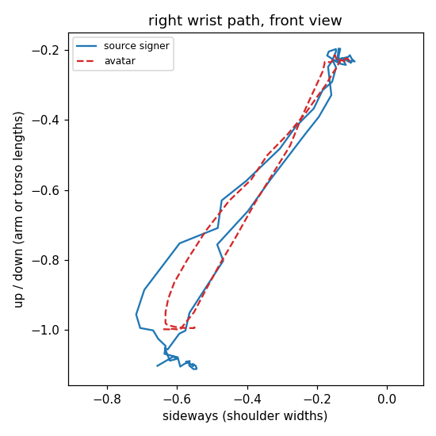

# Motion fidelity report: food

Source video: `references/dict_Food.mp4` · 81 frames at 25.00 fps

> **Geometric similarity only.** These numbers compare the avatar with the landmarks extracted from
> the source video. They cannot show whether the signing is correct ISL. Only a qualified ISL
> interpreter can approve a sign.

## Status

| Check | Result |
| --- | --- |
| license_status | granted |
| motion_qc | pass |
| interpreter_review | not_reviewed |

## Geometric check: FAIL

Each limit is checked on its own; there is no overall percentage.

| Check | Value | Limit | Result |
| --- | --- | --- | --- |
| right finger flexion median (deg) | 15.265 | ≤ 5.0 | FAIL |
| right finger flexion p90 (deg) | 29.264 | ≤ 15.0 | FAIL |
| right palm orientation median (deg) | 25.575 | ≤ 10.0 | FAIL |
| right palm orientation p90 (deg) | 29.524 | ≤ 25.0 | FAIL |
| right wrist position median | 0.087 | ≤ 0.1 | pass |

## Hands

### Right hand (36 frames tracked, data: world)

| Measure | Median | 90th percentile | Max |
| --- | --- | --- | --- |
| Finger joint flexion error | 15.265° | 29.264° | 36.266° |
| Finger spread error | 4.119° | 14.276° | 35.509° |
| Palm orientation error (vs chest) | 25.575° | 29.524° | 33.52° |
| Wrist position error (body-relative) | 0.087 | 0.208 | 0.387 |
| Elbow position error (body-relative) | 0.074 | 0.137 | 0.166 |

Hand shape overall: **noticeable** (median joint error 15.265°).

| Joint | Median error | 90th percentile |
| --- | --- | --- |
| thumb_cmc | 2.624° | 13.058° |
| thumb_mcp | 3.661° | 7.558° |
| thumb_ip | 7.11° | 10.539° |
| index_mcp | 16.488° | 19.409° |
| index_pip | 17.7° | 22.048° |
| index_dip | 9.145° | 14.488° |
| middle_mcp | 15.702° | 21.542° |
| middle_pip | 28.76° | 33.024° |
| middle_dip | 10.791° | 12.897° |
| ring_mcp | 27.185° | 31.665° |
| ring_pip | 17.961° | 21.989° |
| ring_dip | 25.5° | 28.65° |
| pinky_mcp | 19.796° | 27.847° |
| pinky_pip | 3.353° | 10.16° |
| pinky_dip | 30.506° | 32.433° |

Wrist speed correlation (original timing): 0.766
DTW diagnostic: original-time mean wrist error 0.093, time-aligned 0.054, median shift 2 frames (the original timing is kept; DTW is for diagnosis only).

## Contact between the hands

Source frames with fingertip contact: 0; avatar: 0; matching: 0; avatar contact not in the source: 0; source contact missing on the avatar: 0.

## Face

Shape-key values vs source expression scores: median difference 0.0 (this checks the baking path; whether each expression LOOKS right needs the face renders from `tools/facial_validator.py` and the interpreter).

## Images

