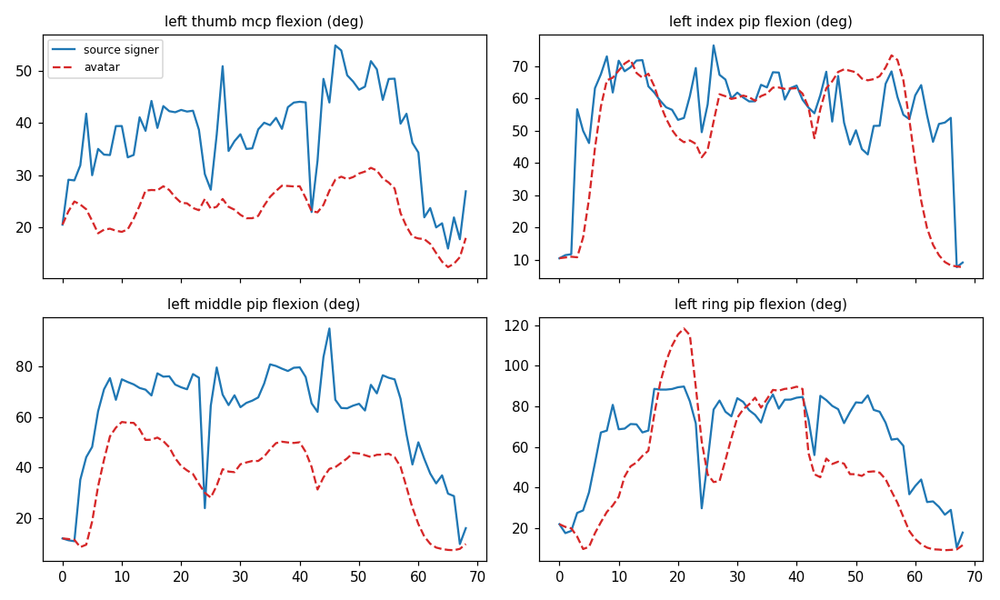
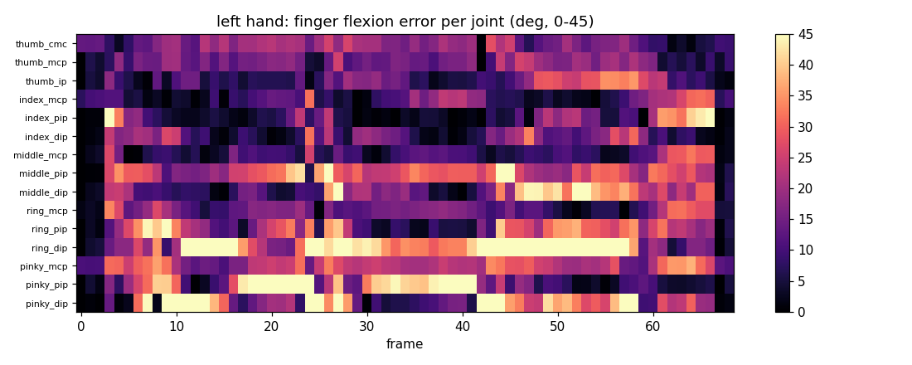
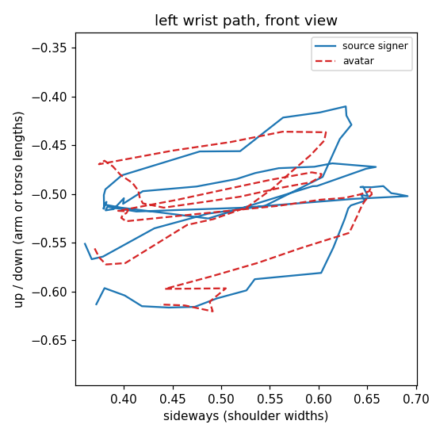
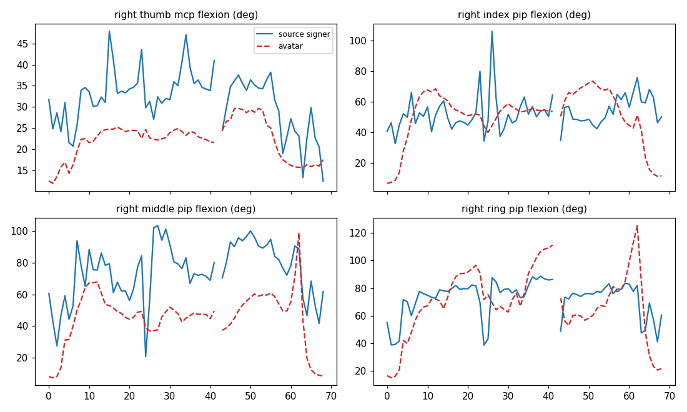
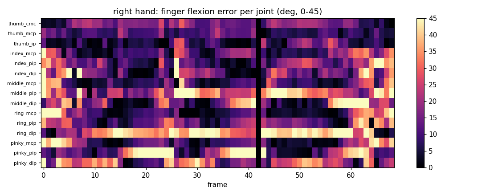
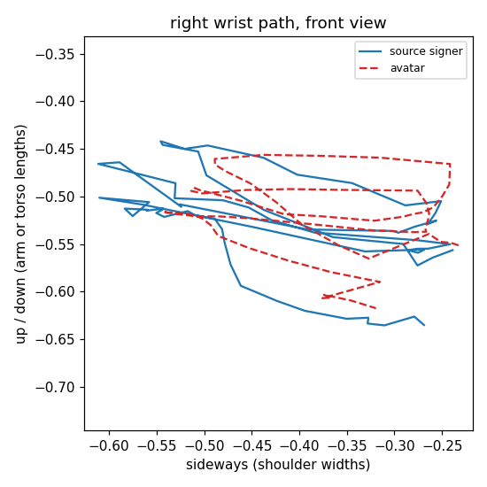
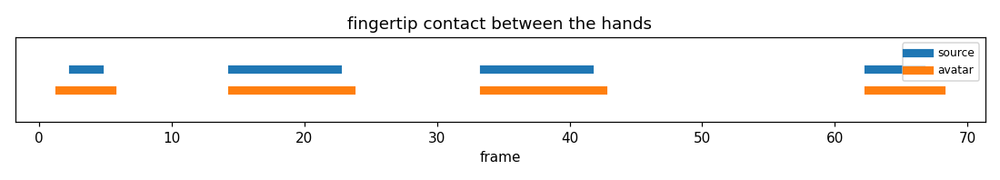

# Motion fidelity report: magnet_sign_2

Source video: `references/dict_Magnet_(Sign_2).mp4` · 69 frames at 25.00 fps

> **Geometric similarity only.** These numbers compare the avatar with the landmarks extracted from
> the source video. They cannot show whether the signing is correct ISL. Only a qualified ISL
> interpreter can approve a sign.

## Status

| Check | Result |
| --- | --- |
| license_status | granted |
| motion_qc | pass |
| interpreter_review | not_reviewed |

## Geometric check: FAIL

Each limit is checked on its own; there is no overall percentage.

| Check | Value | Limit | Result |
| --- | --- | --- | --- |
| left finger flexion median (deg) | 15.434 | ≤ 5.0 | FAIL |
| left finger flexion p90 (deg) | 35.919 | ≤ 15.0 | FAIL |
| left palm orientation median (deg) | 28.429 | ≤ 10.0 | FAIL |
| left palm orientation p90 (deg) | 34.696 | ≤ 25.0 | FAIL |
| left wrist position median | 0.086 | ≤ 0.1 | pass |
| right finger flexion median (deg) | 13.572 | ≤ 5.0 | FAIL |
| right finger flexion p90 (deg) | 39.775 | ≤ 15.0 | FAIL |
| right palm orientation median (deg) | 24.403 | ≤ 10.0 | FAIL |
| right palm orientation p90 (deg) | 47.024 | ≤ 25.0 | FAIL |
| right wrist position median | 0.069 | ≤ 0.1 | pass |
| contact frames missing on avatar (fraction) | 0.0 | ≤ 0.25 | pass |

## Hands

### Left hand (69 frames tracked, data: image, world)

| Measure | Median | 90th percentile | Max |
| --- | --- | --- | --- |
| Finger joint flexion error | 15.434° | 35.919° | 83.992° |
| Finger spread error | 5.973° | 22.218° | 58.315° |
| Palm orientation error (vs chest) | 28.429° | 34.696° | 39.541° |
| Wrist position error (body-relative) | 0.086 | 0.12 | 0.143 |
| Elbow position error (body-relative) | 0.144 | 0.182 | 0.212 |

Hand shape overall: **noticeable** (median joint error 15.434°).

| Joint | Median error | 90th percentile |
| --- | --- | --- |
| thumb_cmc | 16.571° | 22.487° |
| thumb_mcp | 15.337° | 20.419° |
| thumb_ip | 9.457° | 28.492° |
| index_mcp | 8.7° | 23.295° |
| index_pip | 5.166° | 33.02° |
| index_dip | 10.605° | 23.954° |
| middle_mcp | 8.611° | 25.616° |
| middle_pip | 26.688° | 34.634° |
| middle_dip | 16.159° | 39.841° |
| ring_mcp | 13.223° | 26.805° |
| ring_pip | 20.833° | 36.01° |
| ring_dip | 35.014° | 62.444° |
| pinky_mcp | 23.326° | 32.267° |
| pinky_pip | 14.524° | 47.453° |
| pinky_dip | 22.324° | 57.537° |

Wrist speed correlation (original timing): 0.591
DTW diagnostic: original-time mean wrist error 0.072, time-aligned 0.054, median shift 1 frames (the original timing is kept; DTW is for diagnosis only).

### Right hand (68 frames tracked, data: image, world)

| Measure | Median | 90th percentile | Max |
| --- | --- | --- | --- |
| Finger joint flexion error | 13.572° | 39.775° | 113.817° |
| Finger spread error | 7.757° | 30.496° | 78.934° |
| Palm orientation error (vs chest) | 24.403° | 47.024° | 64.463° |
| Wrist position error (body-relative) | 0.069 | 0.118 | 0.189 |
| Elbow position error (body-relative) | 0.11 | 0.135 | 0.167 |

Hand shape overall: **noticeable** (median joint error 13.572°).

| Joint | Median error | 90th percentile |
| --- | --- | --- |
| thumb_cmc | 16.565° | 22.15° |
| thumb_mcp | 9.007° | 16.364° |
| thumb_ip | 5.835° | 21.245° |
| index_mcp | 9.365° | 29.561° |
| index_pip | 13.424° | 35.102° |
| index_dip | 14.866° | 35.545° |
| middle_mcp | 8.109° | 32.331° |
| middle_pip | 27.963° | 51.896° |
| middle_dip | 14.411° | 44.189° |
| ring_mcp | 8.19° | 36.925° |
| ring_pip | 14.835° | 33.956° |
| ring_dip | 37.164° | 53.822° |
| pinky_mcp | 10.786° | 40.979° |
| pinky_pip | 16.17° | 46.746° |
| pinky_dip | 24.405° | 39.622° |

Wrist speed correlation (original timing): 0.665
DTW diagnostic: original-time mean wrist error 0.071, time-aligned 0.052, median shift 1 frames (the original timing is kept; DTW is for diagnosis only).

## Contact between the hands

Source frames with fingertip contact: 22; avatar: 28; matching: 22; avatar contact not in the source: 6; source contact missing on the avatar: 0.

## Face

Shape-key values vs source expression scores: median difference 0.0 (this checks the baking path; whether each expression LOOKS right needs the face renders from `tools/facial_validator.py` and the interpreter).

## Images

