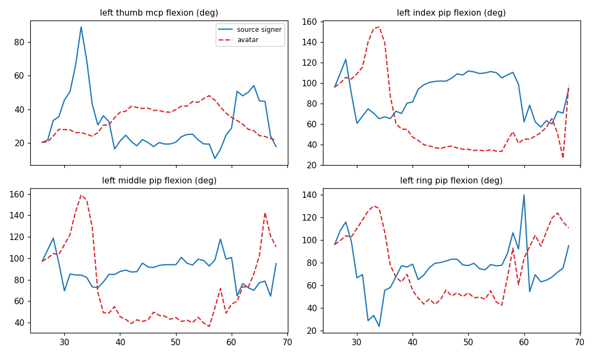
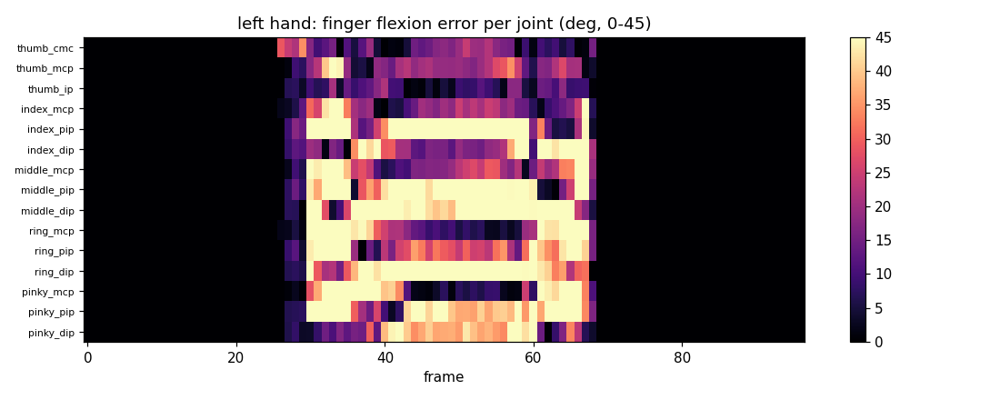
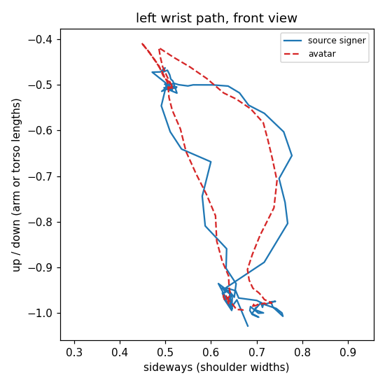
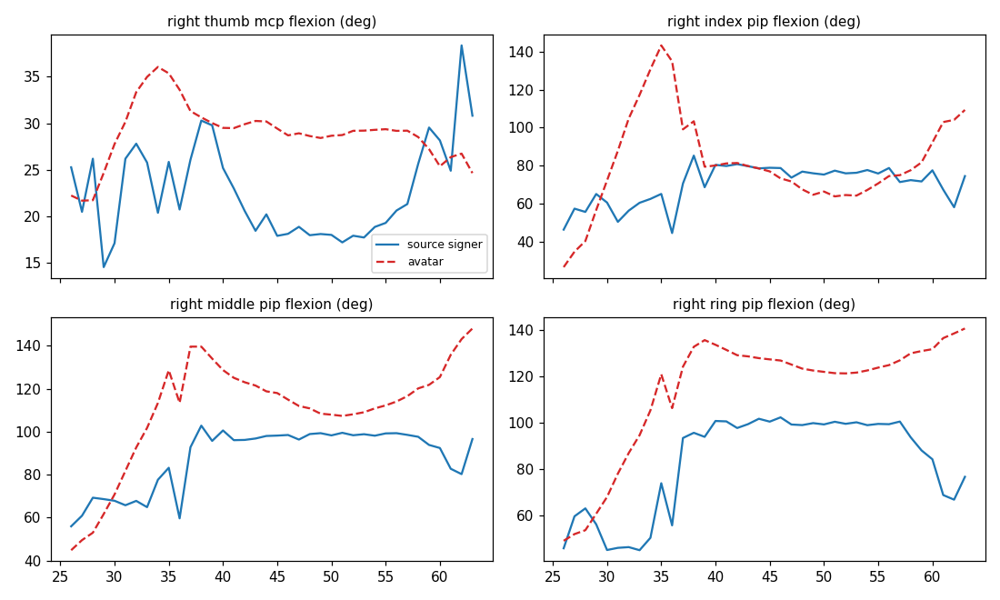
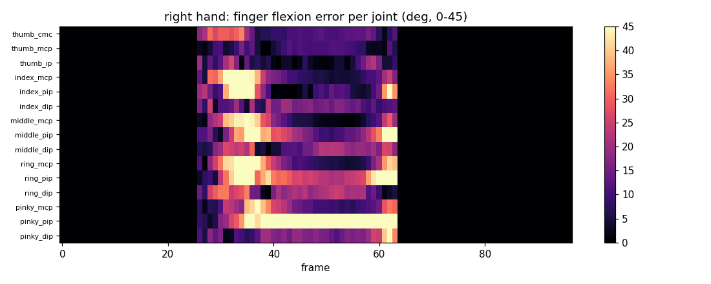
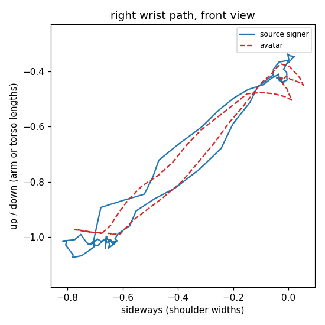
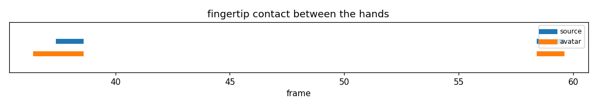

# Motion fidelity report: make

Source video: `references/dict_Make.mp4` · 97 frames at 25.00 fps

> **Geometric similarity only.** These numbers compare the avatar with the landmarks extracted from
> the source video. They cannot show whether the signing is correct ISL. Only a qualified ISL
> interpreter can approve a sign.

## Status

| Check | Result |
| --- | --- |
| license_status | granted |
| motion_qc | pass |
| interpreter_review | not_reviewed |

## Geometric check: FAIL

Each limit is checked on its own; there is no overall percentage.

| Check | Value | Limit | Result |
| --- | --- | --- | --- |
| left finger flexion median (deg) | 22.221 | ≤ 5.0 | FAIL |
| left finger flexion p90 (deg) | 59.831 | ≤ 15.0 | FAIL |
| left palm orientation median (deg) | 23.568 | ≤ 10.0 | FAIL |
| left palm orientation p90 (deg) | 48.785 | ≤ 25.0 | FAIL |
| left wrist position median | 0.036 | ≤ 0.1 | pass |
| right finger flexion median (deg) | 15.01 | ≤ 5.0 | FAIL |
| right finger flexion p90 (deg) | 47.139 | ≤ 15.0 | FAIL |
| right palm orientation median (deg) | 19.827 | ≤ 10.0 | FAIL |
| right palm orientation p90 (deg) | 44.736 | ≤ 25.0 | FAIL |
| right wrist position median | 0.054 | ≤ 0.1 | pass |
| contact frames missing on avatar (fraction) | 0.0 | ≤ 0.25 | pass |

## Hands

### Left hand (43 frames tracked, data: image, world)

| Measure | Median | 90th percentile | Max |
| --- | --- | --- | --- |
| Finger joint flexion error | 22.221° | 59.831° | 135.165° |
| Finger spread error | 7.064° | 40.119° | 157.765° |
| Palm orientation error (vs chest) | 23.568° | 48.785° | 179.613° |
| Wrist position error (body-relative) | 0.036 | 0.144 | 0.292 |
| Elbow position error (body-relative) | 0.146 | 0.338 | 0.353 |

Hand shape overall: **large** (median joint error 22.221°).

| Joint | Median error | 90th percentile |
| --- | --- | --- |
| thumb_cmc | 13.052° | 22.321° |
| thumb_mcp | 18.895° | 28.747° |
| thumb_ip | 8.648° | 17.805° |
| index_mcp | 17.987° | 32.814° |
| index_pip | 57.474° | 76.562° |
| index_dip | 19.161° | 57.093° |
| middle_mcp | 21.872° | 47.404° |
| middle_pip | 46.009° | 58.963° |
| middle_dip | 49.315° | 71.681° |
| ring_mcp | 19.487° | 61.265° |
| ring_pip | 29.495° | 52.118° |
| ring_dip | 46.192° | 60.873° |
| pinky_mcp | 11.704° | 58.493° |
| pinky_pip | 39.929° | 62.633° |
| pinky_dip | 33.741° | 44.005° |

Wrist speed correlation (original timing): 0.673
DTW diagnostic: original-time mean wrist error 0.062, time-aligned 0.036, median shift 2 frames (the original timing is kept; DTW is for diagnosis only).

### Right hand (38 frames tracked, data: image, world)

| Measure | Median | 90th percentile | Max |
| --- | --- | --- | --- |
| Finger joint flexion error | 15.01° | 47.139° | 90.091° |
| Finger spread error | 10.345° | 29.0° | 50.033° |
| Palm orientation error (vs chest) | 19.827° | 44.736° | 54.539° |
| Wrist position error (body-relative) | 0.054 | 0.186 | 0.218 |
| Elbow position error (body-relative) | 0.052 | 0.124 | 0.19 |

Hand shape overall: **noticeable** (median joint error 15.01°).

| Joint | Median error | 90th percentile |
| --- | --- | --- |
| thumb_cmc | 11.849° | 29.839° |
| thumb_mcp | 9.513° | 11.616° |
| thumb_ip | 4.916° | 19.982° |
| index_mcp | 12.744° | 62.194° |
| index_pip | 11.376° | 56.601° |
| index_dip | 14.803° | 19.962° |
| middle_mcp | 11.905° | 43.557° |
| middle_pip | 20.764° | 51.451° |
| middle_dip | 18.95° | 25.828° |
| ring_mcp | 16.156° | 47.891° |
| ring_pip | 29.196° | 54.903° |
| ring_dip | 20.864° | 29.687° |
| pinky_mcp | 14.082° | 38.619° |
| pinky_pip | 52.298° | 61.645° |
| pinky_dip | 16.066° | 25.512° |

Wrist speed correlation (original timing): 0.828
DTW diagnostic: original-time mean wrist error 0.08, time-aligned 0.045, median shift 1 frames (the original timing is kept; DTW is for diagnosis only).

## Contact between the hands

Source frames with fingertip contact: 2; avatar: 3; matching: 2; avatar contact not in the source: 1; source contact missing on the avatar: 0.

## Face

Shape-key values vs source expression scores: median difference 0.0 (this checks the baking path; whether each expression LOOKS right needs the face renders from `tools/facial_validator.py` and the interpreter).

## Images

