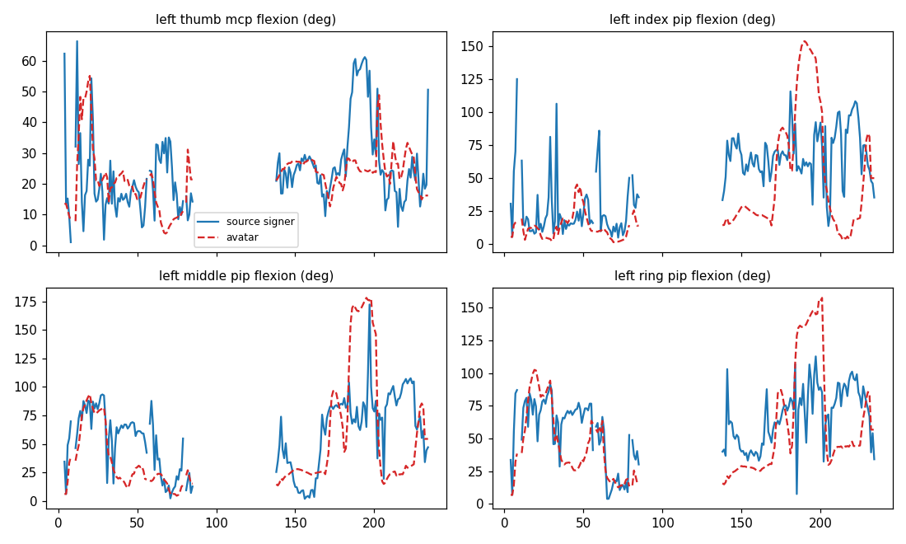
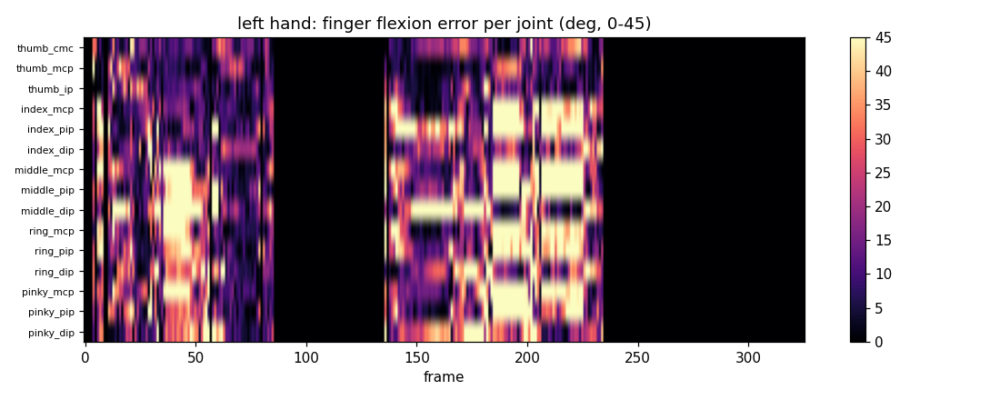
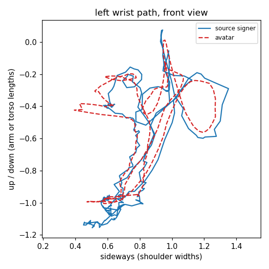
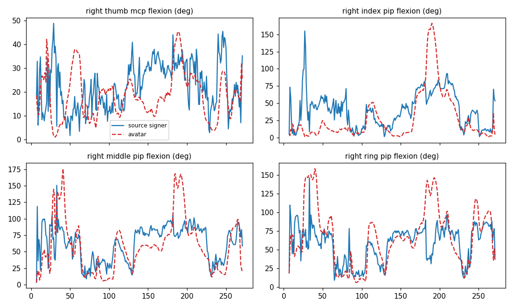
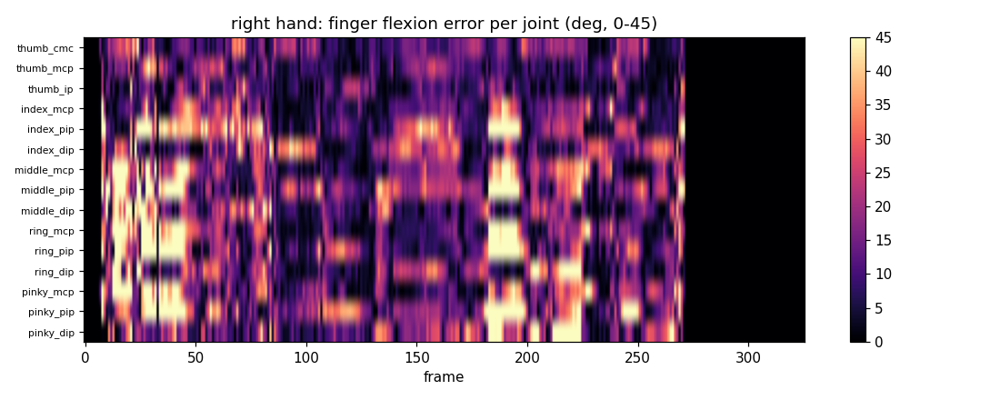
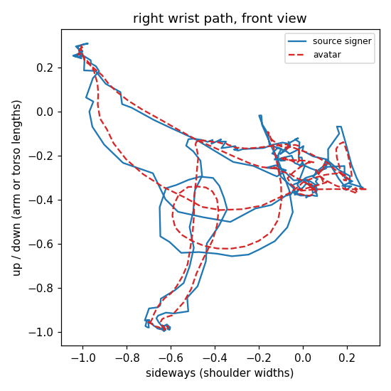
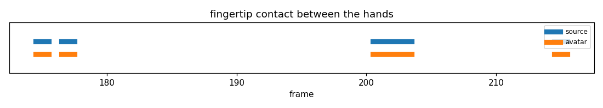

# Motion fidelity report: photosynthesis

Source video: `references/dict_Photosynthesis.mp4` · 326 frames at 24.00 fps

> **Geometric similarity only.** These numbers compare the avatar with the landmarks extracted from
> the source video. They cannot show whether the signing is correct ISL. Only a qualified ISL
> interpreter can approve a sign.

## Status

| Check | Result |
| --- | --- |
| license_status | granted |
| motion_qc | pass |
| interpreter_review | not_reviewed |

## Geometric check: FAIL

Each limit is checked on its own; there is no overall percentage.

| Check | Value | Limit | Result |
| --- | --- | --- | --- |
| left finger flexion median (deg) | 16.902 | ≤ 5.0 | FAIL |
| left finger flexion p90 (deg) | 57.137 | ≤ 15.0 | FAIL |
| left palm orientation median (deg) | 31.68 | ≤ 10.0 | FAIL |
| left palm orientation p90 (deg) | 94.621 | ≤ 25.0 | FAIL |
| left wrist position median | 0.072 | ≤ 0.1 | pass |
| right finger flexion median (deg) | 13.388 | ≤ 5.0 | FAIL |
| right finger flexion p90 (deg) | 37.633 | ≤ 15.0 | FAIL |
| right palm orientation median (deg) | 29.608 | ≤ 10.0 | FAIL |
| right palm orientation p90 (deg) | 44.344 | ≤ 25.0 | FAIL |
| right wrist position median | 0.054 | ≤ 0.1 | pass |
| contact frames missing on avatar (fraction) | 0.0 | ≤ 0.25 | pass |

## Hands

### Left hand (176 frames tracked, data: image, world)

| Measure | Median | 90th percentile | Max |
| --- | --- | --- | --- |
| Finger joint flexion error | 16.902° | 57.137° | 136.25° |
| Finger spread error | 9.479° | 57.68° | 165.454° |
| Palm orientation error (vs chest) | 31.68° | 94.621° | 172.786° |
| Wrist position error (body-relative) | 0.072 | 0.16 | 0.285 |
| Elbow position error (body-relative) | 0.114 | 0.249 | 0.312 |

Hand shape overall: **noticeable** (median joint error 16.902°).

| Joint | Median error | 90th percentile |
| --- | --- | --- |
| thumb_cmc | 14.338° | 29.789° |
| thumb_mcp | 7.089° | 29.161° |
| thumb_ip | 9.141° | 24.322° |
| index_mcp | 13.509° | 54.483° |
| index_pip | 25.109° | 85.881° |
| index_dip | 15.676° | 33.192° |
| middle_mcp | 22.545° | 75.267° |
| middle_pip | 21.601° | 75.499° |
| middle_dip | 28.716° | 69.628° |
| ring_mcp | 18.58° | 54.755° |
| ring_pip | 22.652° | 52.803° |
| ring_dip | 21.189° | 47.451° |
| pinky_mcp | 19.454° | 63.839° |
| pinky_pip | 18.998° | 69.038° |
| pinky_dip | 24.351° | 46.905° |

Wrist speed correlation (original timing): 0.688
DTW diagnostic: original-time mean wrist error 0.081, time-aligned 0.051, median shift 2 frames (the original timing is kept; DTW is for diagnosis only).

### Right hand (265 frames tracked, data: image, world)

| Measure | Median | 90th percentile | Max |
| --- | --- | --- | --- |
| Finger joint flexion error | 13.388° | 37.633° | 153.462° |
| Finger spread error | 10.271° | 36.875° | 155.473° |
| Palm orientation error (vs chest) | 29.608° | 44.344° | 159.377° |
| Wrist position error (body-relative) | 0.054 | 0.169 | 0.389 |
| Elbow position error (body-relative) | 0.106 | 0.195 | 0.314 |

Hand shape overall: **noticeable** (median joint error 13.388°).

| Joint | Median error | 90th percentile |
| --- | --- | --- |
| thumb_cmc | 12.267° | 23.928° |
| thumb_mcp | 9.313° | 22.107° |
| thumb_ip | 7.257° | 19.856° |
| index_mcp | 11.158° | 28.806° |
| index_pip | 19.397° | 45.071° |
| index_dip | 14.367° | 33.284° |
| middle_mcp | 15.235° | 39.672° |
| middle_pip | 19.942° | 54.468° |
| middle_dip | 11.894° | 34.587° |
| ring_mcp | 13.824° | 49.118° |
| ring_pip | 13.55° | 63.687° |
| ring_dip | 12.52° | 34.218° |
| pinky_mcp | 14.835° | 40.701° |
| pinky_pip | 18.857° | 56.801° |
| pinky_dip | 15.737° | 40.675° |

Wrist speed correlation (original timing): 0.741
DTW diagnostic: original-time mean wrist error 0.074, time-aligned 0.037, median shift 2 frames (the original timing is kept; DTW is for diagnosis only).

## Contact between the hands

Source frames with fingertip contact: 6; avatar: 6; matching: 6; avatar contact not in the source: 0; source contact missing on the avatar: 0.

## Face

Shape-key values vs source expression scores: median difference 0.0 (this checks the baking path; whether each expression LOOKS right needs the face renders from `tools/facial_validator.py` and the interpreter).

## Images

