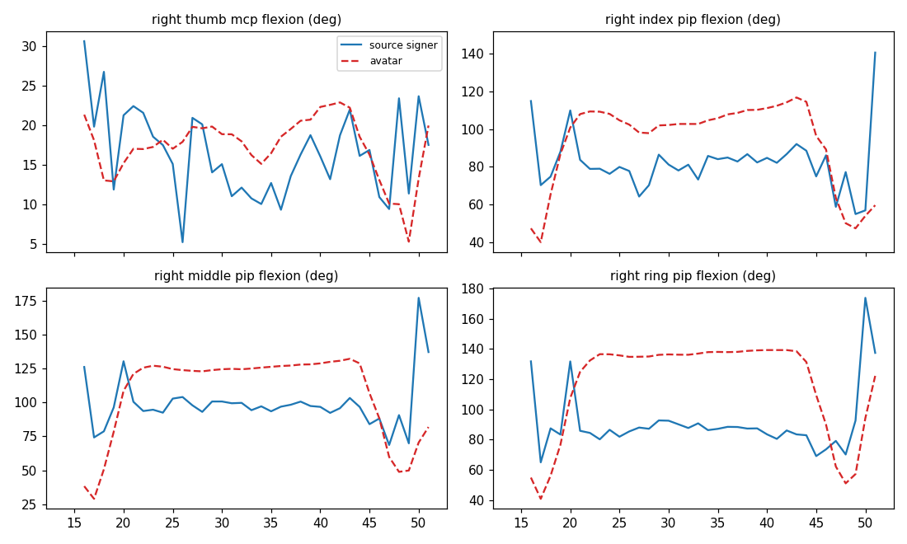
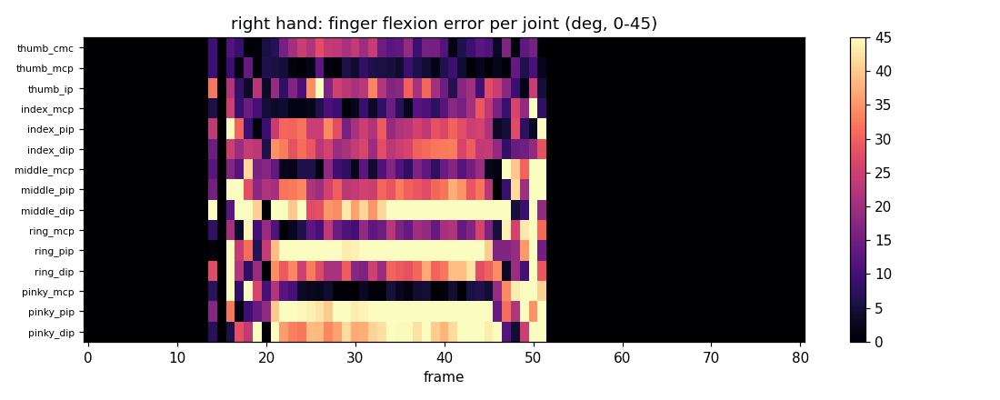
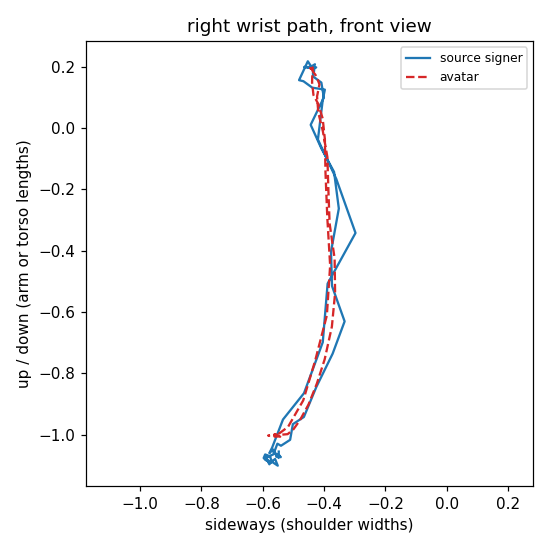

# Motion fidelity report: water

Source video: `references/dict_Water.mp4` · 81 frames at 25.00 fps

> **Geometric similarity only.** These numbers compare the avatar with the landmarks extracted from
> the source video. They cannot show whether the signing is correct ISL. Only a qualified ISL
> interpreter can approve a sign.

## Status

| Check | Result |
| --- | --- |
| license_status | granted |
| motion_qc | pass |
| interpreter_review | not_reviewed |

## Geometric check: FAIL

Each limit is checked on its own; there is no overall percentage.

| Check | Value | Limit | Result |
| --- | --- | --- | --- |
| right finger flexion median (deg) | 22.14 | ≤ 5.0 | FAIL |
| right finger flexion p90 (deg) | 48.895 | ≤ 15.0 | FAIL |
| right palm orientation median (deg) | 14.462 | ≤ 10.0 | FAIL |
| right palm orientation p90 (deg) | 64.713 | ≤ 25.0 | FAIL |
| right wrist position median | 0.079 | ≤ 0.1 | pass |

## Hands

### Right hand (37 frames tracked, data: image, world)

| Measure | Median | 90th percentile | Max |
| --- | --- | --- | --- |
| Finger joint flexion error | 22.14° | 48.895° | 110.233° |
| Finger spread error | 3.55° | 40.386° | 120.728° |
| Palm orientation error (vs chest) | 14.462° | 64.713° | 76.578° |
| Wrist position error (body-relative) | 0.079 | 0.265 | 0.364 |
| Elbow position error (body-relative) | 0.082 | 0.145 | 0.203 |

Hand shape overall: **large** (median joint error 22.14°).

| Joint | Median error | 90th percentile |
| --- | --- | --- |
| thumb_cmc | 13.028° | 24.007° |
| thumb_mcp | 4.587° | 10.437° |
| thumb_ip | 20.359° | 32.326° |
| index_mcp | 8.938° | 25.092° |
| index_pip | 24.72° | 31.838° |
| index_dip | 24.752° | 32.451° |
| middle_mcp | 12.379° | 41.386° |
| middle_pip | 28.827° | 45.179° |
| middle_dip | 46.882° | 52.654° |
| ring_mcp | 16.225° | 42.922° |
| ring_pip | 47.858° | 56.263° |
| ring_dip | 28.893° | 39.02° |
| pinky_mcp | 4.433° | 50.232° |
| pinky_pip | 45.089° | 51.368° |
| pinky_dip | 40.388° | 47.764° |

Wrist speed correlation (original timing): 0.862
DTW diagnostic: original-time mean wrist error 0.108, time-aligned 0.062, median shift 2 frames (the original timing is kept; DTW is for diagnosis only).

## Contact between the hands

Source frames with fingertip contact: 0; avatar: 0; matching: 0; avatar contact not in the source: 0; source contact missing on the avatar: 0.

## Face

Shape-key values vs source expression scores: median difference 0.0 (this checks the baking path; whether each expression LOOKS right needs the face renders from `tools/facial_validator.py` and the interpreter).

## Images

