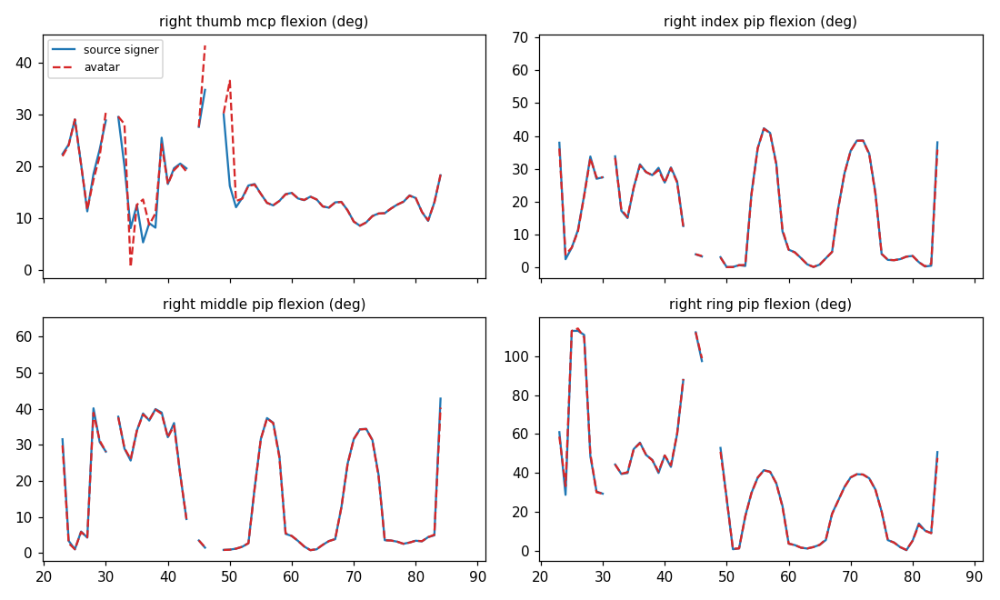
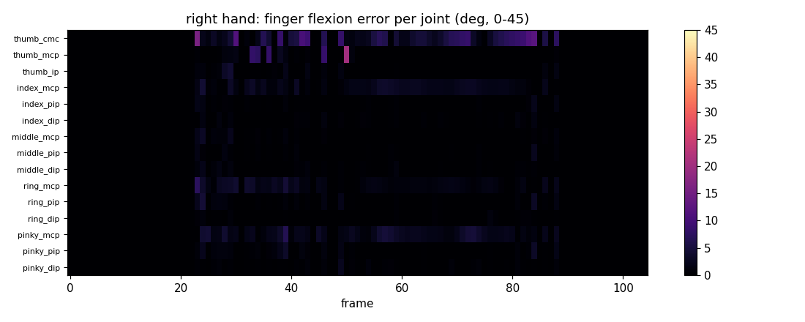
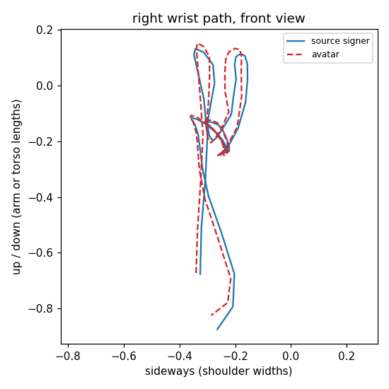

# Motion fidelity report: breathe

Source video: `references/dict_Breathe.mp4` · 105 frames at 25.00 fps

> **Geometric similarity only.** These numbers compare the avatar with the landmarks extracted from
> the source video. They cannot show whether the signing is correct ISL. Only a qualified ISL
> interpreter can approve a sign.

## Status

| Check | Result |
| --- | --- |
| license_status | granted |
| motion_qc | pass |
| interpreter_review | not_reviewed |

## Geometric check: PASS

Each limit is checked on its own; there is no overall percentage.

| Check | Value | Limit | Result |
| --- | --- | --- | --- |
| right finger flexion median (deg) | 0.204 | ≤ 5.0 | pass |
| right finger flexion p90 (deg) | 2.715 | ≤ 15.0 | pass |
| right palm orientation median (deg) | 0.181 | ≤ 10.0 | pass |
| right palm orientation p90 (deg) | 0.828 | ≤ 25.0 | pass |
| right wrist position median | 0.01 | ≤ 0.1 | pass |

## Hands

### Right hand (60 frames compared, data: world)

Left out of the hand-shape comparison: 3 rest pose, 5 image only, 1 impossible bend (frames the avatar deliberately does not copy; see MOTION_VALIDATION.md).

| Measure | Median | 90th percentile | Max |
| --- | --- | --- | --- |
| Finger joint flexion error | 0.204° | 2.715° | 20.321° |
| Finger spread error | 0.323° | 2.514° | 14.909° |
| Palm orientation error (vs chest) | 0.181° | 0.828° | 8.497° |
| Wrist position error (body-relative) | 0.01 | 0.033 | 0.071 |
| Elbow position error (body-relative) | 0.08 | 0.105 | 0.247 |

Hand shape overall: **close** (median joint error 0.204°).

| Joint | Median error | 90th percentile |
| --- | --- | --- |
| thumb_cmc | 4.675° | 9.226° |
| thumb_mcp | 0.058° | 2.78° |
| thumb_ip | 0.045° | 1.346° |
| index_mcp | 1.917° | 3.222° |
| index_pip | 0.063° | 0.625° |
| index_dip | 0.103° | 0.903° |
| middle_mcp | 0.05° | 0.89° |
| middle_pip | 0.049° | 0.655° |
| middle_dip | 0.108° | 0.913° |
| ring_mcp | 1.424° | 3.388° |
| ring_pip | 0.092° | 1.424° |
| ring_dip | 0.048° | 0.578° |
| pinky_mcp | 2.086° | 4.072° |
| pinky_pip | 0.118° | 1.597° |
| pinky_dip | 0.207° | 0.727° |

Wrist speed correlation (original timing): 0.994
DTW diagnostic: original-time mean wrist error 0.015, time-aligned 0.015, median shift 0 frames (the original timing is kept; DTW is for diagnosis only).

## Contact between the hands

Source frames with fingertip contact: 0; avatar: 0; matching: 0; avatar contact not in the source: 0; source contact missing on the avatar: 0.

## Face

Shape-key values vs source expression scores: median difference 0.0 (this checks the baking path; whether each expression LOOKS right needs the face renders from `tools/facial_validator.py` and the interpreter).

## Images

