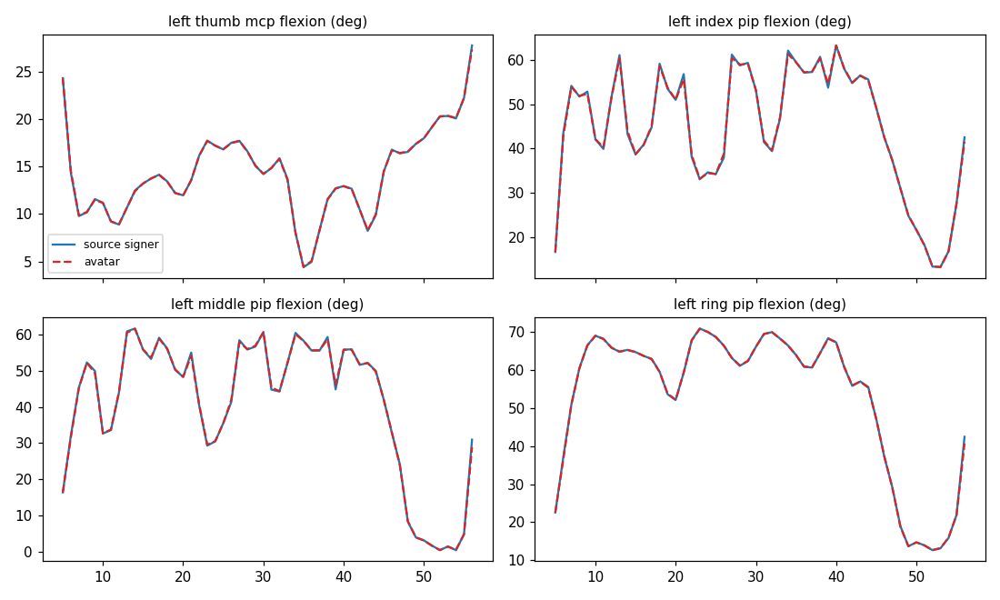
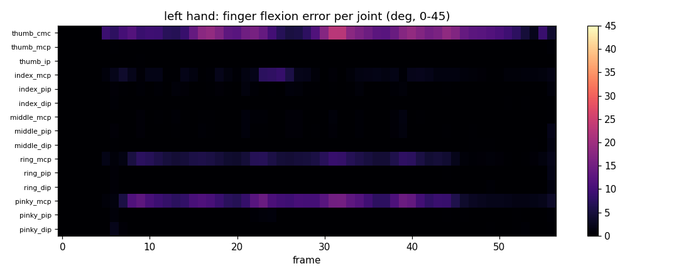
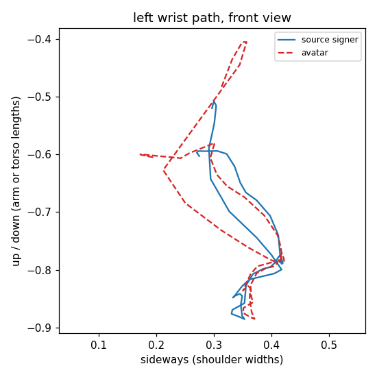
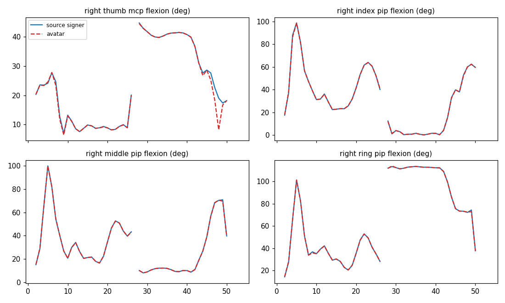
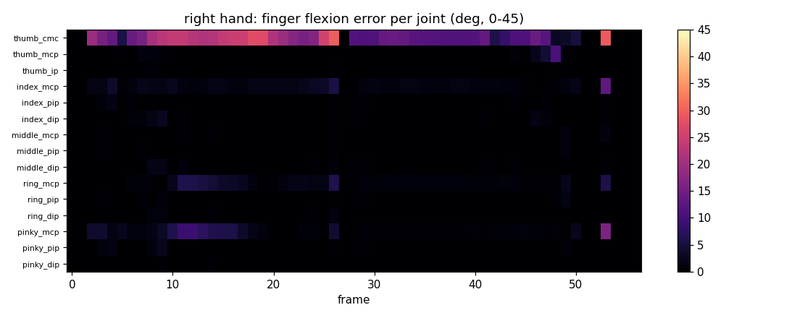
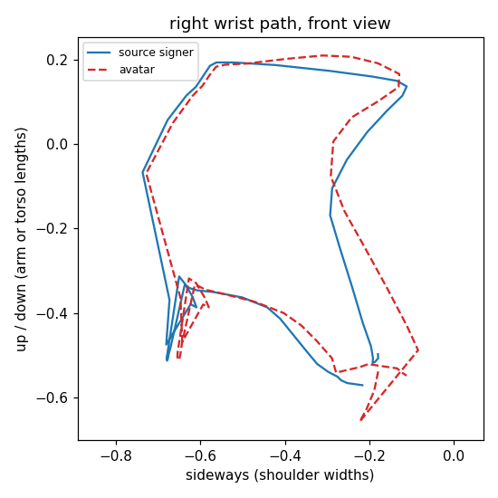
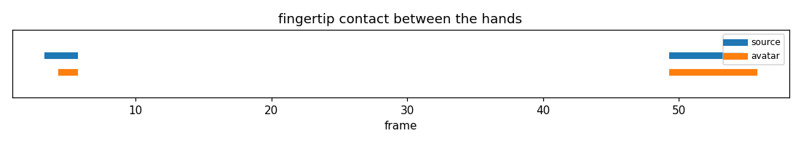

# Motion fidelity report: carbon_dioxide_sign_2

Source video: `references/dict_Carbon_Dioxide_(Sign_2).mp4` · 57 frames at 25.00 fps

> **Geometric similarity only.** These numbers compare the avatar with the landmarks extracted from
> the source video. They cannot show whether the signing is correct ISL. Only a qualified ISL
> interpreter can approve a sign.

## Status

| Check | Result |
| --- | --- |
| license_status | granted |
| motion_qc | pass |
| interpreter_review | not_reviewed |

## Geometric check: PASS

Each limit is checked on its own; there is no overall percentage.

| Check | Value | Limit | Result |
| --- | --- | --- | --- |
| left finger flexion median (deg) | 0.064 | ≤ 5.0 | pass |
| left finger flexion p90 (deg) | 7.841 | ≤ 15.0 | pass |
| left palm orientation median (deg) | 0.399 | ≤ 10.0 | pass |
| left palm orientation p90 (deg) | 0.703 | ≤ 25.0 | pass |
| left wrist position median | 0.02 | ≤ 0.1 | pass |
| right finger flexion median (deg) | 0.13 | ≤ 5.0 | pass |
| right finger flexion p90 (deg) | 3.234 | ≤ 15.0 | pass |
| right palm orientation median (deg) | 0.424 | ≤ 10.0 | pass |
| right palm orientation p90 (deg) | 0.702 | ≤ 25.0 | pass |
| right wrist position median | 0.032 | ≤ 0.1 | pass |
| contact frames missing on avatar (fraction) | 0.143 | ≤ 0.25 | pass |

## Hands

### Left hand (52 frames compared, data: world)

Left out of the hand-shape comparison: 5 image only (frames the avatar deliberately does not copy; see MOTION_VALIDATION.md).

| Measure | Median | 90th percentile | Max |
| --- | --- | --- | --- |
| Finger joint flexion error | 0.064° | 7.841° | 22.892° |
| Finger spread error | 1.397° | 11.637° | 66.421° |
| Palm orientation error (vs chest) | 0.399° | 0.703° | 0.81° |
| Wrist position error (body-relative) | 0.02 | 0.172 | 0.225 |
| Elbow position error (body-relative) | 0.109 | 0.144 | 0.241 |

Hand shape overall: **close** (median joint error 0.064°).

| Joint | Median error | 90th percentile |
| --- | --- | --- |
| thumb_cmc | 12.215° | 17.843° |
| thumb_mcp | 0.028° | 0.095° |
| thumb_ip | 0.023° | 0.071° |
| index_mcp | 1.397° | 2.327° |
| index_pip | 0.129° | 0.785° |
| index_dip | 0.018° | 0.099° |
| middle_mcp | 0.054° | 0.614° |
| middle_pip | 0.118° | 0.593° |
| middle_dip | 0.031° | 0.181° |
| ring_mcp | 4.847° | 7.067° |
| ring_pip | 0.04° | 0.128° |
| ring_dip | 0.021° | 0.084° |
| pinky_mcp | 8.932° | 12.971° |
| pinky_pip | 0.035° | 0.228° |
| pinky_dip | 0.031° | 0.206° |

Wrist speed correlation (original timing): 0.648
DTW diagnostic: original-time mean wrist error 0.052, time-aligned 0.049, median shift 0 frames (the original timing is kept; DTW is for diagnosis only).

### Right hand (49 frames compared, data: world)

Left out of the hand-shape comparison: 4 impossible bend, 3 image only (frames the avatar deliberately does not copy; see MOTION_VALIDATION.md).

| Measure | Median | 90th percentile | Max |
| --- | --- | --- | --- |
| Finger joint flexion error | 0.13° | 3.234° | 29.658° |
| Finger spread error | 0.352° | 3.002° | 16.081° |
| Palm orientation error (vs chest) | 0.424° | 0.702° | 1.858° |
| Wrist position error (body-relative) | 0.032 | 0.176 | 0.229 |
| Elbow position error (body-relative) | 0.153 | 0.245 | 0.279 |

Hand shape overall: **close** (median joint error 0.13°).

| Joint | Median error | 90th percentile |
| --- | --- | --- |
| thumb_cmc | 14.057° | 25.499° |
| thumb_mcp | 0.038° | 0.975° |
| thumb_ip | 0.038° | 0.196° |
| index_mcp | 1.411° | 2.913° |
| index_pip | 0.078° | 0.627° |
| index_dip | 0.102° | 0.762° |
| middle_mcp | 0.026° | 0.518° |
| middle_pip | 0.071° | 0.327° |
| middle_dip | 0.122° | 0.678° |
| ring_mcp | 0.918° | 5.297° |
| ring_pip | 0.078° | 0.445° |
| ring_dip | 0.048° | 0.398° |
| pinky_mcp | 0.934° | 6.295° |
| pinky_pip | 0.051° | 0.832° |
| pinky_dip | 0.084° | 0.231° |

Wrist speed correlation (original timing): 0.947
DTW diagnostic: original-time mean wrist error 0.067, time-aligned 0.06, median shift 0 frames (the original timing is kept; DTW is for diagnosis only).

## Contact between the hands

Source frames with fingertip contact: 7; avatar: 7; matching: 6; avatar contact not in the source: 1; source contact missing on the avatar: 1.

## Face

Shape-key values vs source expression scores: median difference 0.0 (this checks the baking path; whether each expression LOOKS right needs the face renders from `tools/facial_validator.py` and the interpreter).

## Images

