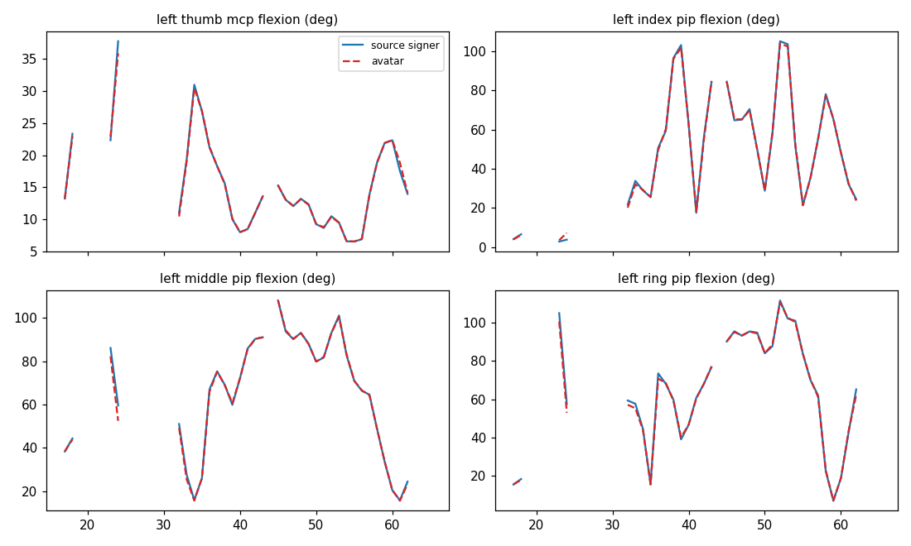
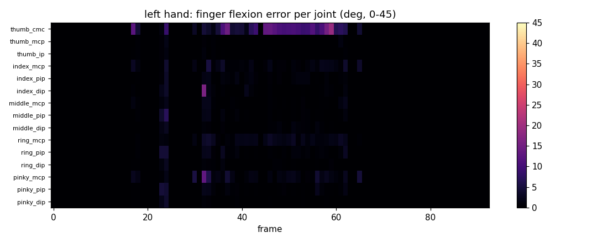
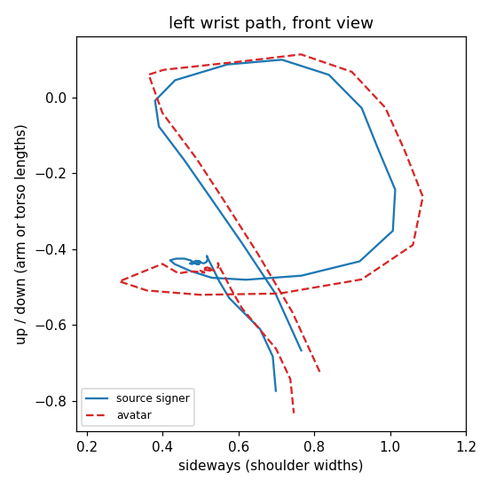
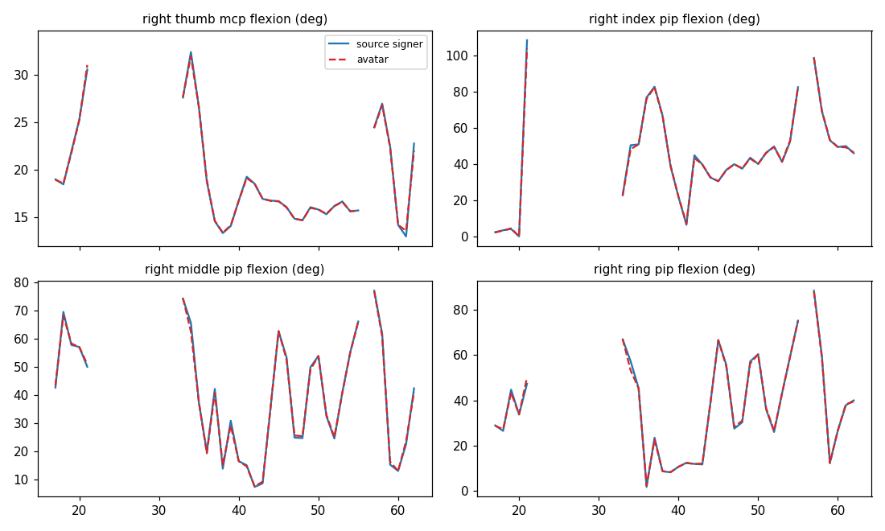
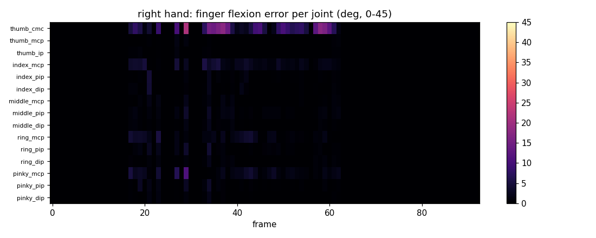
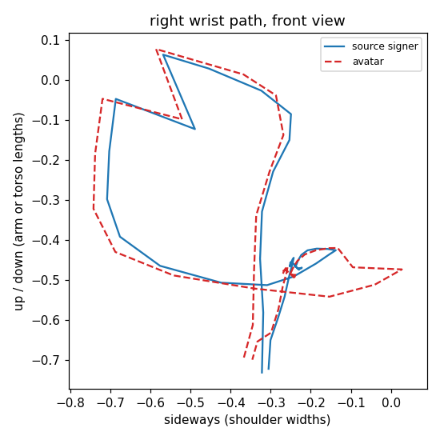
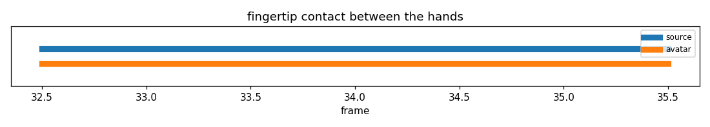

# Motion fidelity report: computer

Source video: `references/dict_Computer.mp4` · 93 frames at 25.00 fps

> **Geometric similarity only.** These numbers compare the avatar with the landmarks extracted from
> the source video. They cannot show whether the signing is correct ISL. Only a qualified ISL
> interpreter can approve a sign.

## Status

| Check | Result |
| --- | --- |
| license_status | granted |
| motion_qc | pass |
| interpreter_review | not_reviewed |

## Geometric check: PASS

Each limit is checked on its own; there is no overall percentage.

| Check | Value | Limit | Result |
| --- | --- | --- | --- |
| left finger flexion median (deg) | 0.329 | ≤ 5.0 | pass |
| left finger flexion p90 (deg) | 3.364 | ≤ 15.0 | pass |
| left palm orientation median (deg) | 0.272 | ≤ 10.0 | pass |
| left palm orientation p90 (deg) | 1.435 | ≤ 25.0 | pass |
| left wrist position median | 0.042 | ≤ 0.1 | pass |
| right finger flexion median (deg) | 0.353 | ≤ 5.0 | pass |
| right finger flexion p90 (deg) | 3.332 | ≤ 15.0 | pass |
| right palm orientation median (deg) | 0.364 | ≤ 10.0 | pass |
| right palm orientation p90 (deg) | 0.716 | ≤ 25.0 | pass |
| right wrist position median | 0.026 | ≤ 0.1 | pass |
| contact frames missing on avatar (fraction) | 0.0 | ≤ 0.25 | pass |

## Hands

### Left hand (36 frames compared, data: world)

Left out of the hand-shape comparison: 3 rest pose, 5 image only, 6 impossible bend (frames the avatar deliberately does not copy; see MOTION_VALIDATION.md).

| Measure | Median | 90th percentile | Max |
| --- | --- | --- | --- |
| Finger joint flexion error | 0.329° | 3.364° | 19.248° |
| Finger spread error | 0.632° | 6.653° | 81.978° |
| Palm orientation error (vs chest) | 0.272° | 1.435° | 3.634° |
| Wrist position error (body-relative) | 0.042 | 0.076 | 0.202 |
| Elbow position error (body-relative) | 0.16 | 0.231 | 1.111 |

Hand shape overall: **close** (median joint error 0.329°).

| Joint | Median error | 90th percentile |
| --- | --- | --- |
| thumb_cmc | 8.795° | 13.457° |
| thumb_mcp | 0.045° | 0.554° |
| thumb_ip | 0.075° | 0.521° |
| index_mcp | 0.824° | 3.534° |
| index_pip | 0.601° | 1.421° |
| index_dip | 0.153° | 2.091° |
| middle_mcp | 0.217° | 2.089° |
| middle_pip | 0.187° | 1.857° |
| middle_dip | 0.139° | 1.196° |
| ring_mcp | 1.804° | 2.903° |
| ring_pip | 0.473° | 2.741° |
| ring_dip | 0.115° | 0.818° |
| pinky_mcp | 1.489° | 4.659° |
| pinky_pip | 0.271° | 2.244° |
| pinky_dip | 0.072° | 0.553° |

Wrist speed correlation (original timing): 0.97
DTW diagnostic: original-time mean wrist error 0.054, time-aligned 0.049, median shift -1 frames (the original timing is kept; DTW is for diagnosis only).

### Right hand (37 frames compared, data: world)

Left out of the hand-shape comparison: 5 rest pose, 4 image only, 6 impossible bend (frames the avatar deliberately does not copy; see MOTION_VALIDATION.md).

| Measure | Median | 90th percentile | Max |
| --- | --- | --- | --- |
| Finger joint flexion error | 0.353° | 3.332° | 21.464° |
| Finger spread error | 1.214° | 4.198° | 15.518° |
| Palm orientation error (vs chest) | 0.364° | 0.716° | 1.002° |
| Wrist position error (body-relative) | 0.026 | 0.085 | 0.225 |
| Elbow position error (body-relative) | 0.122 | 0.244 | 0.302 |

Hand shape overall: **close** (median joint error 0.353°).

| Joint | Median error | 90th percentile |
| --- | --- | --- |
| thumb_cmc | 7.738° | 16.047° |
| thumb_mcp | 0.042° | 0.58° |
| thumb_ip | 0.041° | 0.499° |
| index_mcp | 1.933° | 4.592° |
| index_pip | 0.248° | 1.019° |
| index_dip | 0.103° | 0.803° |
| middle_mcp | 0.114° | 1.51° |
| middle_pip | 0.583° | 1.447° |
| middle_dip | 0.179° | 0.992° |
| ring_mcp | 1.33° | 3.726° |
| ring_pip | 0.399° | 2.207° |
| ring_dip | 0.112° | 1.015° |
| pinky_mcp | 1.707° | 4.25° |
| pinky_pip | 0.237° | 1.673° |
| pinky_dip | 0.087° | 0.919° |

Wrist speed correlation (original timing): 0.988
DTW diagnostic: original-time mean wrist error 0.045, time-aligned 0.044, median shift 0 frames (the original timing is kept; DTW is for diagnosis only).

## Contact between the hands

Source frames with fingertip contact: 3; avatar: 3; matching: 3; avatar contact not in the source: 0; source contact missing on the avatar: 0.

## Face

Shape-key values vs source expression scores: median difference 0.0 (this checks the baking path; whether each expression LOOKS right needs the face renders from `tools/facial_validator.py` and the interpreter).

## Images

