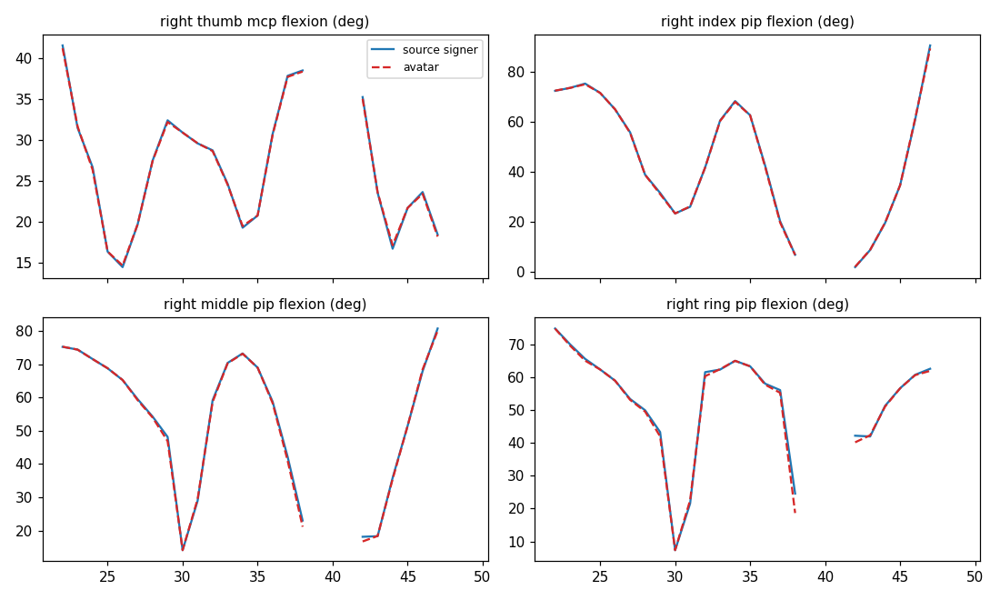
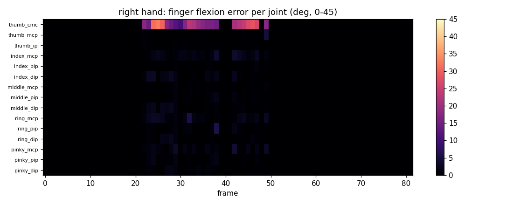
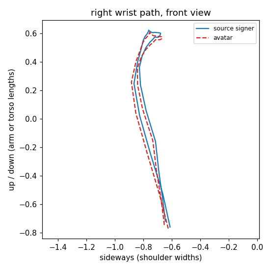

# Motion fidelity report: electricity

Source video: `references/dict_Electricity.mp4` · 82 frames at 25.00 fps

> **Geometric similarity only.** These numbers compare the avatar with the landmarks extracted from
> the source video. They cannot show whether the signing is correct ISL. Only a qualified ISL
> interpreter can approve a sign.

## Status

| Check | Result |
| --- | --- |
| license_status | granted |
| motion_qc | pass |
| interpreter_review | not_reviewed |

## Geometric check: PASS

Each limit is checked on its own; there is no overall percentage.

| Check | Value | Limit | Result |
| --- | --- | --- | --- |
| right finger flexion median (deg) | 0.36 | ≤ 5.0 | pass |
| right finger flexion p90 (deg) | 2.907 | ≤ 15.0 | pass |
| right palm orientation median (deg) | 0.242 | ≤ 10.0 | pass |
| right palm orientation p90 (deg) | 0.705 | ≤ 25.0 | pass |
| right wrist position median | 0.02 | ≤ 0.1 | pass |

## Hands

### Right hand (24 frames compared, data: world)

Left out of the hand-shape comparison: 3 impossible bend, 2 image only, 1 rest pose (frames the avatar deliberately does not copy; see MOTION_VALIDATION.md).

| Measure | Median | 90th percentile | Max |
| --- | --- | --- | --- |
| Finger joint flexion error | 0.36° | 2.907° | 32.725° |
| Finger spread error | 0.491° | 3.757° | 9.709° |
| Palm orientation error (vs chest) | 0.242° | 0.705° | 1.976° |
| Wrist position error (body-relative) | 0.02 | 0.026 | 0.034 |
| Elbow position error (body-relative) | 0.09 | 0.108 | 0.15 |

Hand shape overall: **close** (median joint error 0.36°).

| Joint | Median error | 90th percentile |
| --- | --- | --- |
| thumb_cmc | 18.829° | 30.273° |
| thumb_mcp | 0.136° | 0.352° |
| thumb_ip | 0.197° | 0.399° |
| index_mcp | 1.423° | 2.915° |
| index_pip | 0.168° | 0.532° |
| index_dip | 0.587° | 2.889° |
| middle_mcp | 0.267° | 0.666° |
| middle_pip | 0.284° | 1.279° |
| middle_dip | 0.501° | 2.128° |
| ring_mcp | 1.344° | 2.907° |
| ring_pip | 0.304° | 1.323° |
| ring_dip | 0.252° | 1.728° |
| pinky_mcp | 1.327° | 3.018° |
| pinky_pip | 0.234° | 1.511° |
| pinky_dip | 0.201° | 1.175° |

Wrist speed correlation (original timing): 0.999
DTW diagnostic: original-time mean wrist error 0.02, time-aligned 0.02, median shift 0 frames (the original timing is kept; DTW is for diagnosis only).

## Contact between the hands

Source frames with fingertip contact: 0; avatar: 0; matching: 0; avatar contact not in the source: 0; source contact missing on the avatar: 0.

## Face

Shape-key values vs source expression scores: median difference 0.0 (this checks the baking path; whether each expression LOOKS right needs the face renders from `tools/facial_validator.py` and the interpreter).

## Images

