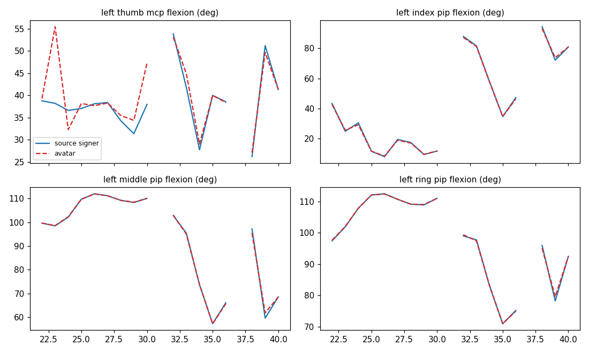
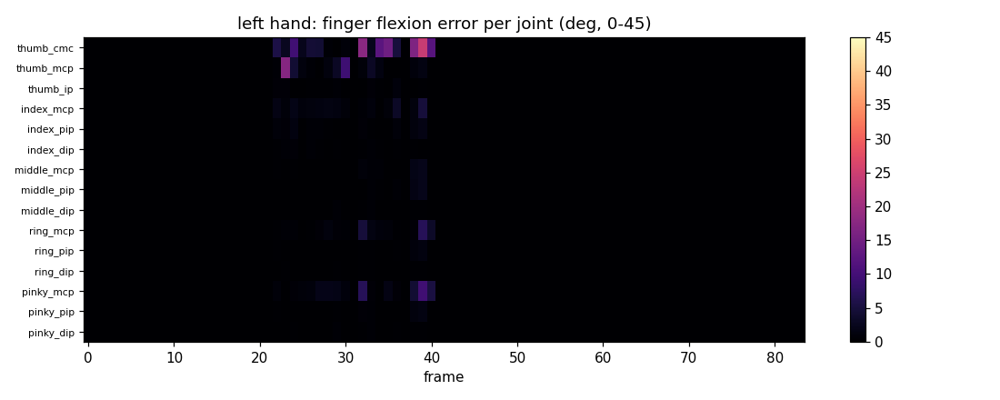
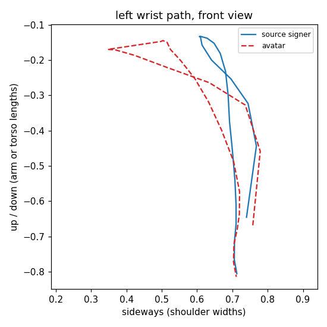
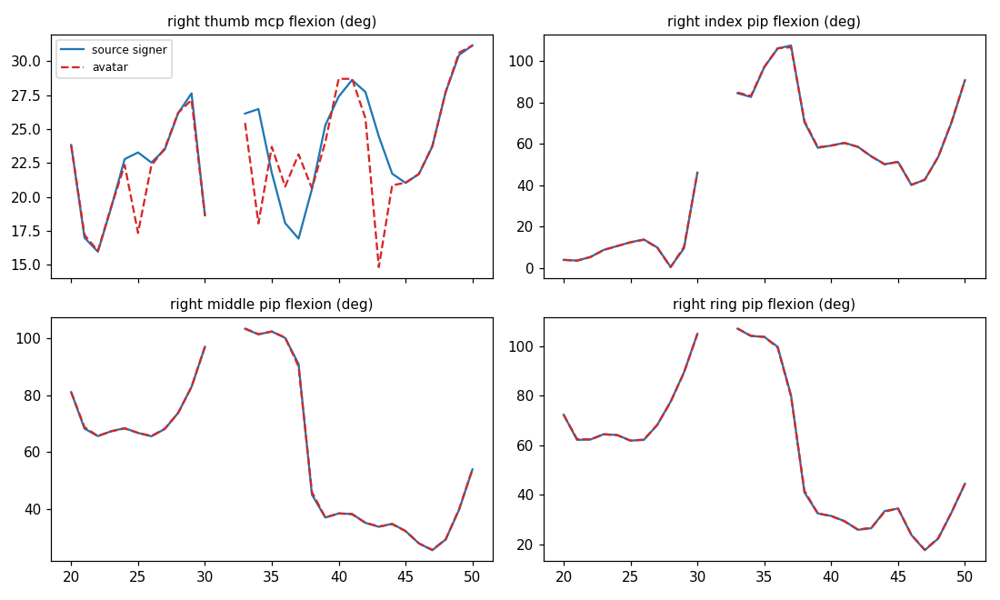
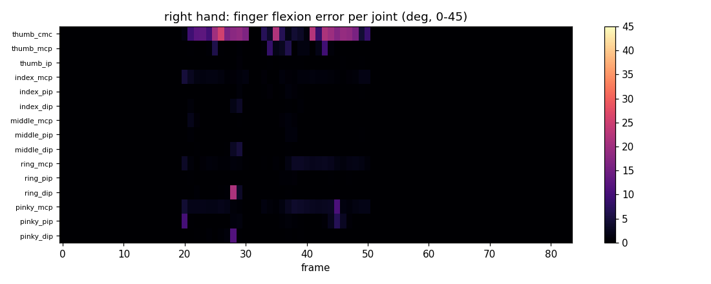
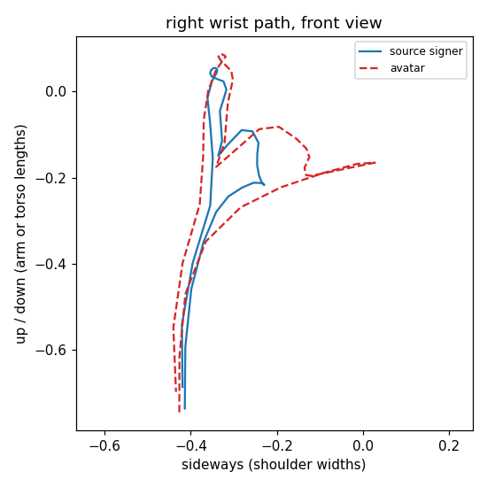
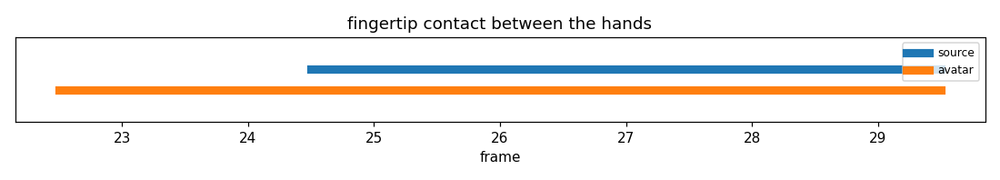

# Motion fidelity report: energy

Source video: `references/dict_Energy_(Sign).mp4` · 84 frames at 25.00 fps

> **Geometric similarity only.** These numbers compare the avatar with the landmarks extracted from
> the source video. They cannot show whether the signing is correct ISL. Only a qualified ISL
> interpreter can approve a sign.

## Status

| Check | Result |
| --- | --- |
| license_status | granted |
| motion_qc | pass |
| interpreter_review | not_reviewed |

## Geometric check: PASS

Each limit is checked on its own; there is no overall percentage.

| Check | Value | Limit | Result |
| --- | --- | --- | --- |
| left finger flexion median (deg) | 0.271 | ≤ 5.0 | pass |
| left finger flexion p90 (deg) | 2.69 | ≤ 15.0 | pass |
| left palm orientation median (deg) | 0.371 | ≤ 10.0 | pass |
| left palm orientation p90 (deg) | 0.892 | ≤ 25.0 | pass |
| left wrist position median | 0.059 | ≤ 0.1 | pass |
| right finger flexion median (deg) | 0.131 | ≤ 5.0 | pass |
| right finger flexion p90 (deg) | 3.134 | ≤ 15.0 | pass |
| right palm orientation median (deg) | 0.254 | ≤ 10.0 | pass |
| right palm orientation p90 (deg) | 0.526 | ≤ 25.0 | pass |
| right wrist position median | 0.035 | ≤ 0.1 | pass |
| contact frames missing on avatar (fraction) | 0.0 | ≤ 0.25 | pass |

## Hands

### Left hand (17 frames compared, data: world)

Left out of the hand-shape comparison: 1 depth flip, 1 impossible bend, 1 image only, 13 rest pose (frames the avatar deliberately does not copy; see MOTION_VALIDATION.md).

| Measure | Median | 90th percentile | Max |
| --- | --- | --- | --- |
| Finger joint flexion error | 0.271° | 2.69° | 24.342° |
| Finger spread error | 0.356° | 6.647° | 23.051° |
| Palm orientation error (vs chest) | 0.371° | 0.892° | 1.206° |
| Wrist position error (body-relative) | 0.059 | 0.204 | 0.278 |
| Elbow position error (body-relative) | 0.111 | 0.16 | 0.175 |

Hand shape overall: **close** (median joint error 0.271°).

| Joint | Median error | 90th percentile |
| --- | --- | --- |
| thumb_cmc | 5.043° | 17.752° |
| thumb_mcp | 1.118° | 9.346° |
| thumb_ip | 0.269° | 0.648° |
| index_mcp | 1.105° | 3.304° |
| index_pip | 0.395° | 1.234° |
| index_dip | 0.228° | 0.49° |
| middle_mcp | 0.105° | 1.796° |
| middle_pip | 0.117° | 1.758° |
| middle_dip | 0.097° | 0.352° |
| ring_mcp | 0.631° | 4.82° |
| ring_pip | 0.077° | 0.912° |
| ring_dip | 0.069° | 0.323° |
| pinky_mcp | 1.04° | 6.892° |
| pinky_pip | 0.093° | 1.103° |
| pinky_dip | 0.13° | 0.365° |

Wrist speed correlation (original timing): 0.807
DTW diagnostic: original-time mean wrist error 0.082, time-aligned 0.082, median shift 0 frames (the original timing is kept; DTW is for diagnosis only).

### Right hand (29 frames compared, data: world)

Left out of the hand-shape comparison: 2 impossible bend (frames the avatar deliberately does not copy; see MOTION_VALIDATION.md).

| Measure | Median | 90th percentile | Max |
| --- | --- | --- | --- |
| Finger joint flexion error | 0.131° | 3.134° | 25.37° |
| Finger spread error | 0.626° | 7.527° | 20.405° |
| Palm orientation error (vs chest) | 0.254° | 0.526° | 1.556° |
| Wrist position error (body-relative) | 0.035 | 0.132 | 0.279 |
| Elbow position error (body-relative) | 0.118 | 0.167 | 0.21 |

Hand shape overall: **close** (median joint error 0.131°).

| Joint | Median error | 90th percentile |
| --- | --- | --- |
| thumb_cmc | 12.757° | 21.836° |
| thumb_mcp | 0.206° | 6.212° |
| thumb_ip | 0.062° | 0.294° |
| index_mcp | 0.968° | 1.726° |
| index_pip | 0.065° | 0.544° |
| index_dip | 0.066° | 0.814° |
| middle_mcp | 0.068° | 0.599° |
| middle_pip | 0.069° | 0.499° |
| middle_dip | 0.042° | 0.313° |
| ring_mcp | 1.016° | 2.994° |
| ring_pip | 0.074° | 0.352° |
| ring_dip | 0.057° | 0.414° |
| pinky_mcp | 1.895° | 3.792° |
| pinky_pip | 0.128° | 2.898° |
| pinky_dip | 0.065° | 0.388° |

Wrist speed correlation (original timing): 0.938
DTW diagnostic: original-time mean wrist error 0.061, time-aligned 0.059, median shift 0 frames (the original timing is kept; DTW is for diagnosis only).

## Contact between the hands

Source frames with fingertip contact: 5; avatar: 7; matching: 5; avatar contact not in the source: 2; source contact missing on the avatar: 0.

## Face

Shape-key values vs source expression scores: median difference 0.0 (this checks the baking path; whether each expression LOOKS right needs the face renders from `tools/facial_validator.py` and the interpreter).

## Images

