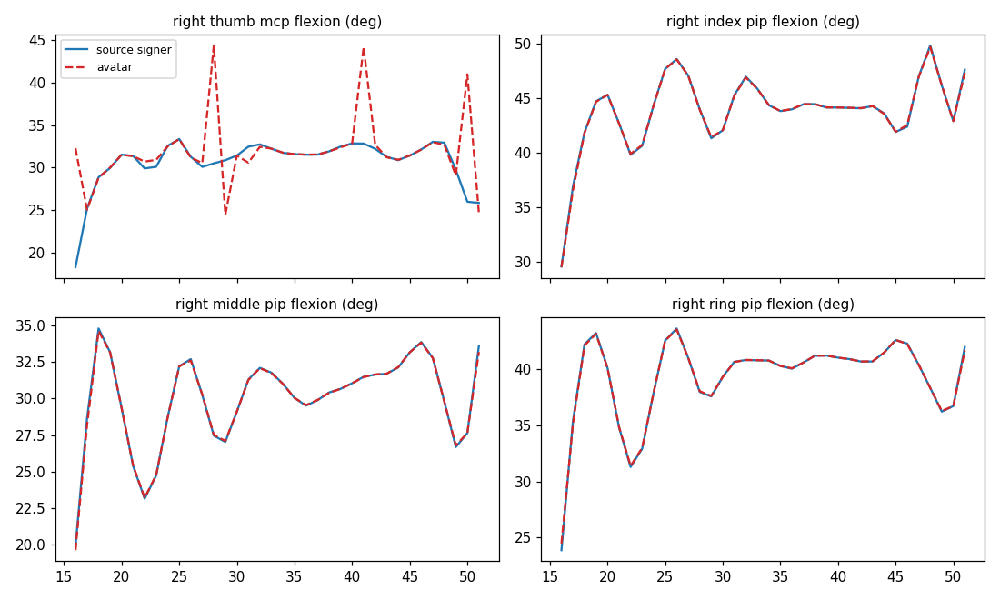
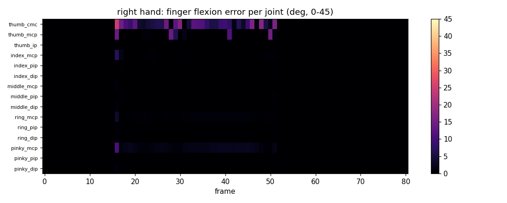
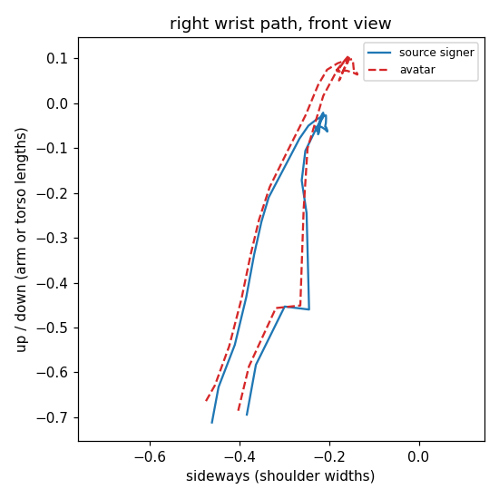

# Motion fidelity report: food

Source video: `references/dict_Food.mp4` · 81 frames at 25.00 fps

> **Geometric similarity only.** These numbers compare the avatar with the landmarks extracted from
> the source video. They cannot show whether the signing is correct ISL. Only a qualified ISL
> interpreter can approve a sign.

## Status

| Check | Result |
| --- | --- |
| license_status | granted |
| motion_qc | pass |
| interpreter_review | not_reviewed |

## Geometric check: FAIL

Each limit is checked on its own; there is no overall percentage.

| Check | Value | Limit | Result |
| --- | --- | --- | --- |
| right finger flexion median (deg) | 0.041 | ≤ 5.0 | pass |
| right finger flexion p90 (deg) | 2.008 | ≤ 15.0 | pass |
| right palm orientation median (deg) | 0.32 | ≤ 10.0 | pass |
| right palm orientation p90 (deg) | 0.385 | ≤ 25.0 | pass |
| right wrist position median | 0.134 | ≤ 0.1 | FAIL |

## Hands

### Right hand (36 frames compared, data: world)

| Measure | Median | 90th percentile | Max |
| --- | --- | --- | --- |
| Finger joint flexion error | 0.041° | 2.008° | 24.456° |
| Finger spread error | 0.068° | 5.317° | 16.593° |
| Palm orientation error (vs chest) | 0.32° | 0.385° | 2.66° |
| Wrist position error (body-relative) | 0.134 | 0.143 | 0.146 |
| Elbow position error (body-relative) | 0.307 | 0.344 | 0.372 |

Hand shape overall: **close** (median joint error 0.041°).

| Joint | Median error | 90th percentile |
| --- | --- | --- |
| thumb_cmc | 7.912° | 16.325° |
| thumb_mcp | 0.06° | 11.387° |
| thumb_ip | 0.016° | 0.099° |
| index_mcp | 0.183° | 0.622° |
| index_pip | 0.024° | 0.151° |
| index_dip | 0.017° | 0.088° |
| middle_mcp | 0.015° | 0.085° |
| middle_pip | 0.024° | 0.178° |
| middle_dip | 0.023° | 0.143° |
| ring_mcp | 0.545° | 0.769° |
| ring_pip | 0.014° | 0.103° |
| ring_dip | 0.015° | 0.051° |
| pinky_mcp | 1.841° | 2.591° |
| pinky_pip | 0.021° | 0.108° |
| pinky_dip | 0.028° | 0.097° |

Wrist speed correlation (original timing): 0.977
DTW diagnostic: original-time mean wrist error 0.104, time-aligned 0.095, median shift 1 frames (the original timing is kept; DTW is for diagnosis only).

## Contact between the hands

Source frames with fingertip contact: 0; avatar: 0; matching: 0; avatar contact not in the source: 0; source contact missing on the avatar: 0.

## Face

Shape-key values vs source expression scores: median difference 0.0 (this checks the baking path; whether each expression LOOKS right needs the face renders from `tools/facial_validator.py` and the interpreter).

## Images

