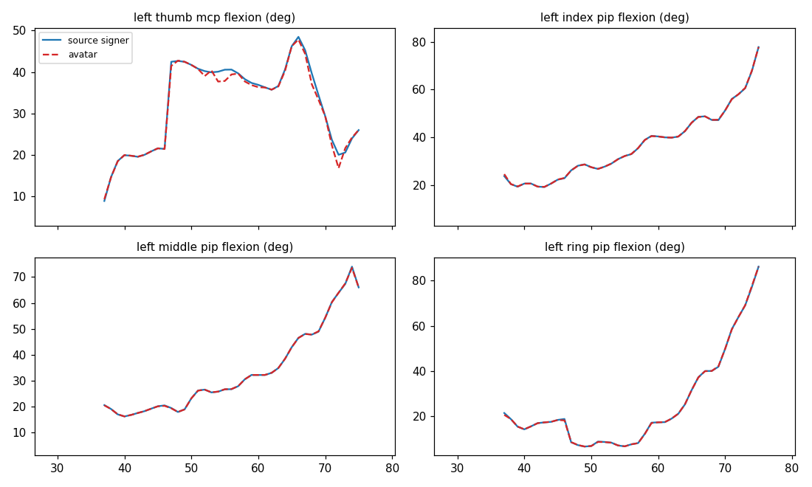
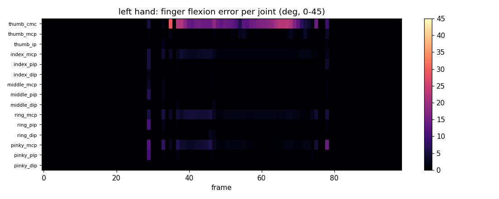
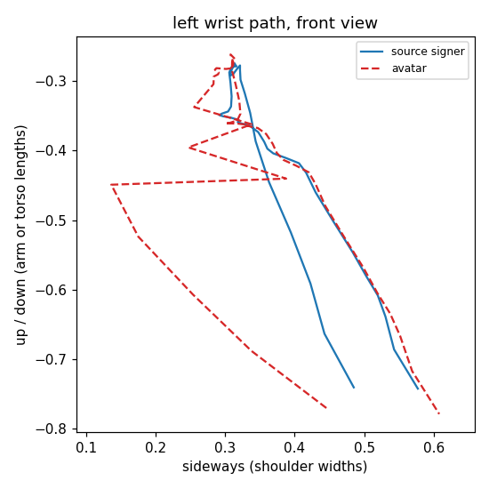
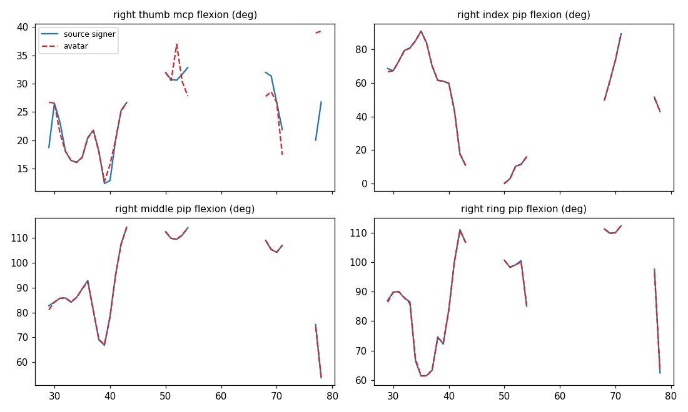
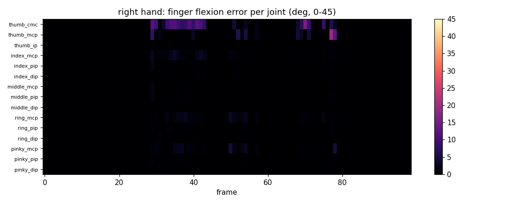
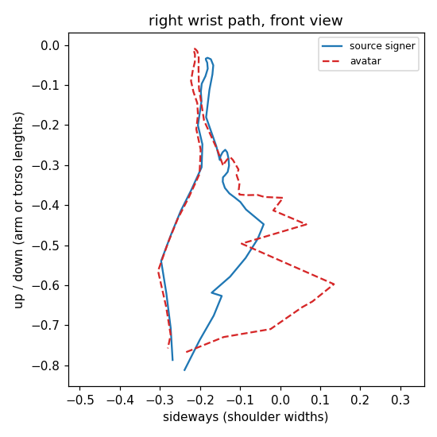
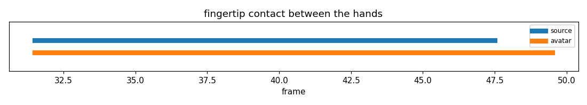

# Motion fidelity report: grow_plants

Source video: `references/dict_Grow_(Plants).mp4` · 99 frames at 25.00 fps

> **Geometric similarity only.** These numbers compare the avatar with the landmarks extracted from
> the source video. They cannot show whether the signing is correct ISL. Only a qualified ISL
> interpreter can approve a sign.

## Status

| Check | Result |
| --- | --- |
| license_status | granted |
| motion_qc | pass |
| interpreter_review | not_reviewed |

## Geometric check: PASS

Each limit is checked on its own; there is no overall percentage.

| Check | Value | Limit | Result |
| --- | --- | --- | --- |
| left finger flexion median (deg) | 0.061 | ≤ 5.0 | pass |
| left finger flexion p90 (deg) | 4.103 | ≤ 15.0 | pass |
| left palm orientation median (deg) | 0.474 | ≤ 10.0 | pass |
| left palm orientation p90 (deg) | 1.351 | ≤ 25.0 | pass |
| left wrist position median | 0.021 | ≤ 0.1 | pass |
| right finger flexion median (deg) | 0.097 | ≤ 5.0 | pass |
| right finger flexion p90 (deg) | 2.359 | ≤ 15.0 | pass |
| right palm orientation median (deg) | 0.587 | ≤ 10.0 | pass |
| right palm orientation p90 (deg) | 1.097 | ≤ 25.0 | pass |
| right wrist position median | 0.036 | ≤ 0.1 | pass |
| contact frames missing on avatar (fraction) | 0.0 | ≤ 0.25 | pass |

## Hands

### Left hand (43 frames compared, data: image, world)

Left out of the hand-shape comparison: 6 rest pose, 7 impossible bend (frames the avatar deliberately does not copy; see MOTION_VALIDATION.md).

| Measure | Median | 90th percentile | Max |
| --- | --- | --- | --- |
| Finger joint flexion error | 0.061° | 4.103° | 28.794° |
| Finger spread error | 0.609° | 4.547° | 13.673° |
| Palm orientation error (vs chest) | 0.474° | 1.351° | 7.345° |
| Wrist position error (body-relative) | 0.021 | 0.114 | 0.269 |
| Elbow position error (body-relative) | 0.157 | 0.193 | 0.209 |

Hand shape overall: **close** (median joint error 0.061°).

| Joint | Median error | 90th percentile |
| --- | --- | --- |
| thumb_cmc | 14.36° | 22.163° |
| thumb_mcp | 0.325° | 2.382° |
| thumb_ip | 0.026° | 0.234° |
| index_mcp | 1.32° | 3.369° |
| index_pip | 0.027° | 0.17° |
| index_dip | 0.032° | 0.514° |
| middle_mcp | 0.011° | 0.544° |
| middle_pip | 0.024° | 0.221° |
| middle_dip | 0.028° | 0.485° |
| ring_mcp | 1.941° | 4.786° |
| ring_pip | 0.034° | 0.631° |
| ring_dip | 0.038° | 0.448° |
| pinky_mcp | 1.57° | 5.842° |
| pinky_pip | 0.032° | 0.741° |
| pinky_dip | 0.024° | 0.251° |

Wrist speed correlation (original timing): 0.767
DTW diagnostic: original-time mean wrist error 0.043, time-aligned 0.037, median shift 0 frames (the original timing is kept; DTW is for diagnosis only).

### Right hand (28 frames compared, data: world)

Left out of the hand-shape comparison: 2 image only, 22 impossible bend, 2 rest pose (frames the avatar deliberately does not copy; see MOTION_VALIDATION.md).

| Measure | Median | 90th percentile | Max |
| --- | --- | --- | --- |
| Finger joint flexion error | 0.097° | 2.359° | 18.941° |
| Finger spread error | 0.23° | 4.406° | 14.361° |
| Palm orientation error (vs chest) | 0.587° | 1.097° | 1.203° |
| Wrist position error (body-relative) | 0.036 | 0.098 | 0.297 |
| Elbow position error (body-relative) | 0.193 | 0.262 | 0.316 |

Hand shape overall: **close** (median joint error 0.097°).

| Joint | Median error | 90th percentile |
| --- | --- | --- |
| thumb_cmc | 8.102° | 11.891° |
| thumb_mcp | 0.168° | 7.969° |
| thumb_ip | 0.032° | 0.346° |
| index_mcp | 0.747° | 2.526° |
| index_pip | 0.063° | 0.517° |
| index_dip | 0.045° | 0.464° |
| middle_mcp | 0.028° | 0.34° |
| middle_pip | 0.063° | 0.593° |
| middle_dip | 0.044° | 0.087° |
| ring_mcp | 0.964° | 2.359° |
| ring_pip | 0.095° | 0.666° |
| ring_dip | 0.031° | 0.084° |
| pinky_mcp | 0.82° | 2.858° |
| pinky_pip | 0.135° | 0.654° |
| pinky_dip | 0.078° | 0.192° |

Wrist speed correlation (original timing): 0.821
DTW diagnostic: original-time mean wrist error 0.055, time-aligned 0.054, median shift 0 frames (the original timing is kept; DTW is for diagnosis only).

## Contact between the hands

Source frames with fingertip contact: 16; avatar: 18; matching: 16; avatar contact not in the source: 2; source contact missing on the avatar: 0.

## Face

Shape-key values vs source expression scores: median difference 0.0 (this checks the baking path; whether each expression LOOKS right needs the face renders from `tools/facial_validator.py` and the interpreter).

## Images

