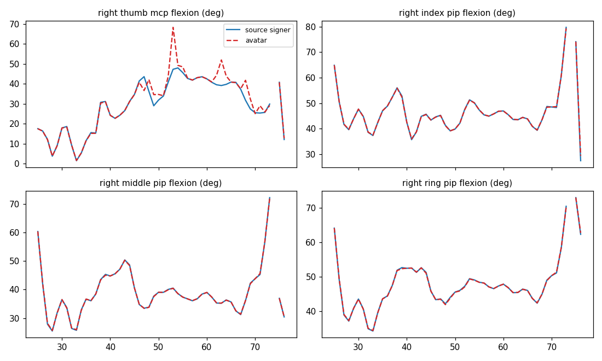
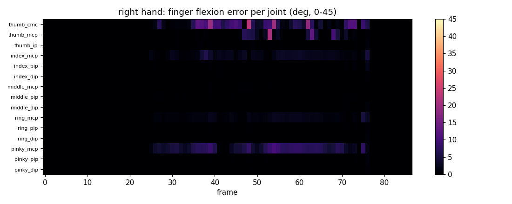
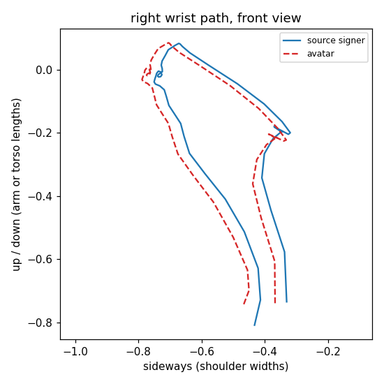

# Motion fidelity report: leaf

Source video: `references/dict_Leaf.mp4` · 87 frames at 25.00 fps

> **Geometric similarity only.** These numbers compare the avatar with the landmarks extracted from
> the source video. They cannot show whether the signing is correct ISL. Only a qualified ISL
> interpreter can approve a sign.

## Status

| Check | Result |
| --- | --- |
| license_status | granted |
| motion_qc | pass |
| interpreter_review | not_reviewed |

## Geometric check: PASS

Each limit is checked on its own; there is no overall percentage.

| Check | Value | Limit | Result |
| --- | --- | --- | --- |
| right finger flexion median (deg) | 0.083 | ≤ 5.0 | pass |
| right finger flexion p90 (deg) | 4.013 | ≤ 15.0 | pass |
| right palm orientation median (deg) | 0.149 | ≤ 10.0 | pass |
| right palm orientation p90 (deg) | 0.529 | ≤ 25.0 | pass |
| right wrist position median | 0.036 | ≤ 0.1 | pass |

## Hands

### Right hand (51 frames compared, data: world)

Left out of the hand-shape comparison: 8 rest pose, 3 image only, 1 depth flip (frames the avatar deliberately does not copy; see MOTION_VALIDATION.md).

| Measure | Median | 90th percentile | Max |
| --- | --- | --- | --- |
| Finger joint flexion error | 0.083° | 4.013° | 22.847° |
| Finger spread error | 0.172° | 3.244° | 14.964° |
| Palm orientation error (vs chest) | 0.149° | 0.529° | 0.909° |
| Wrist position error (body-relative) | 0.036 | 0.04 | 0.109 |
| Elbow position error (body-relative) | 0.106 | 0.156 | 0.294 |

Hand shape overall: **close** (median joint error 0.083°).

| Joint | Median error | 90th percentile |
| --- | --- | --- |
| thumb_cmc | 5.928° | 11.95° |
| thumb_mcp | 0.161° | 5.591° |
| thumb_ip | 0.046° | 0.291° |
| index_mcp | 1.987° | 3.178° |
| index_pip | 0.048° | 0.285° |
| index_dip | 0.031° | 0.117° |
| middle_mcp | 0.03° | 0.221° |
| middle_pip | 0.053° | 0.202° |
| middle_dip | 0.037° | 0.134° |
| ring_mcp | 1.158° | 2.371° |
| ring_pip | 0.056° | 0.232° |
| ring_dip | 0.022° | 0.072° |
| pinky_mcp | 5.392° | 7.762° |
| pinky_pip | 0.048° | 0.21° |
| pinky_dip | 0.029° | 0.099° |

Wrist speed correlation (original timing): 0.994
DTW diagnostic: original-time mean wrist error 0.037, time-aligned 0.037, median shift 0 frames (the original timing is kept; DTW is for diagnosis only).

## Contact between the hands

Source frames with fingertip contact: 0; avatar: 0; matching: 0; avatar contact not in the source: 0; source contact missing on the avatar: 0.

## Face

Shape-key values vs source expression scores: median difference 0.0 (this checks the baking path; whether each expression LOOKS right needs the face renders from `tools/facial_validator.py` and the interpreter).

## Images

