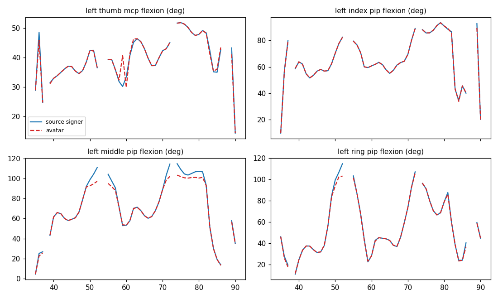
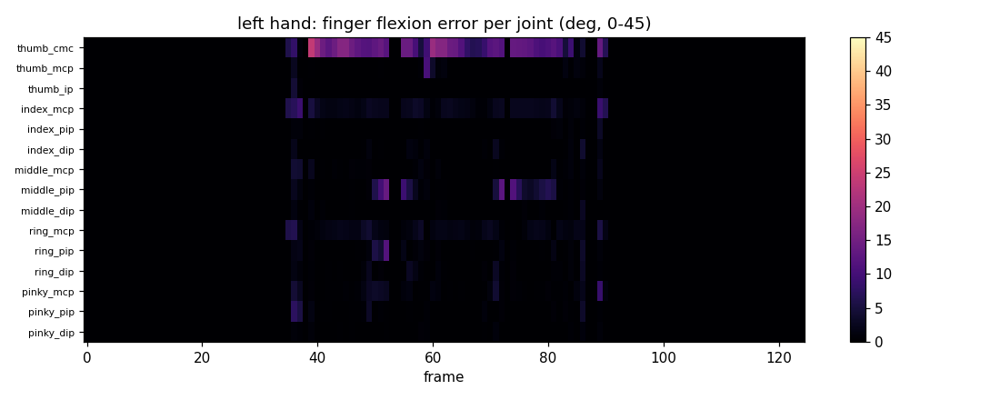
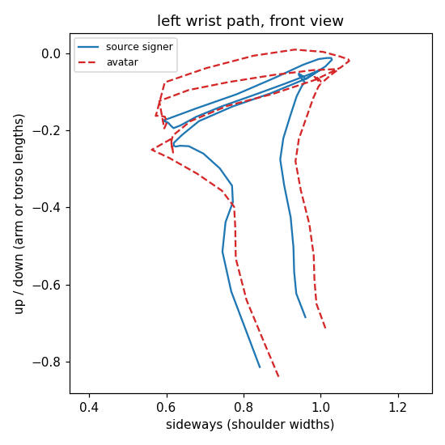
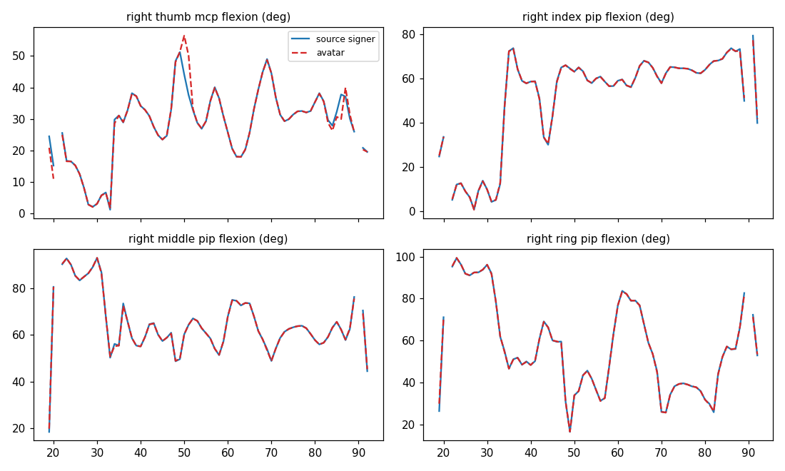
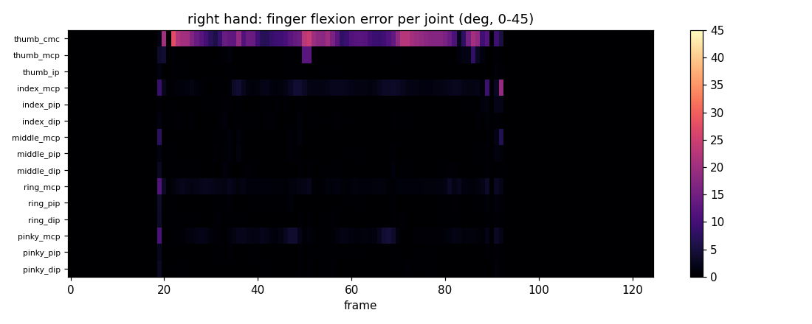
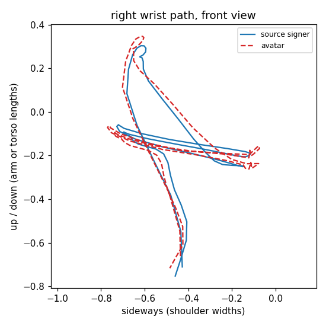
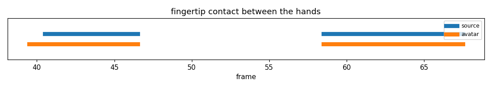

# Motion fidelity report: magnet

Source video: `references/dict_Magnet.mp4` · 125 frames at 25.00 fps

> **Geometric similarity only.** These numbers compare the avatar with the landmarks extracted from
> the source video. They cannot show whether the signing is correct ISL. Only a qualified ISL
> interpreter can approve a sign.

## Status

| Check | Result |
| --- | --- |
| license_status | granted |
| motion_qc | pass |
| interpreter_review | not_reviewed |

## Geometric check: PASS

Each limit is checked on its own; there is no overall percentage.

| Check | Value | Limit | Result |
| --- | --- | --- | --- |
| left finger flexion median (deg) | 0.163 | ≤ 5.0 | pass |
| left finger flexion p90 (deg) | 4.511 | ≤ 15.0 | pass |
| left palm orientation median (deg) | 0.079 | ≤ 10.0 | pass |
| left palm orientation p90 (deg) | 0.361 | ≤ 25.0 | pass |
| left wrist position median | 0.044 | ≤ 0.1 | pass |
| right finger flexion median (deg) | 0.106 | ≤ 5.0 | pass |
| right finger flexion p90 (deg) | 2.774 | ≤ 15.0 | pass |
| right palm orientation median (deg) | 0.092 | ≤ 10.0 | pass |
| right palm orientation p90 (deg) | 0.241 | ≤ 25.0 | pass |
| right wrist position median | 0.048 | ≤ 0.1 | pass |
| contact frames missing on avatar (fraction) | 0.0 | ≤ 0.25 | pass |

## Hands

### Left hand (50 frames compared, data: world)

Left out of the hand-shape comparison: 7 rest pose, 1 depth flip, 5 image only, 3 impossible bend (frames the avatar deliberately does not copy; see MOTION_VALIDATION.md).

| Measure | Median | 90th percentile | Max |
| --- | --- | --- | --- |
| Finger joint flexion error | 0.163° | 4.511° | 23.849° |
| Finger spread error | 0.695° | 4.01° | 116.022° |
| Palm orientation error (vs chest) | 0.079° | 0.361° | 2.455° |
| Wrist position error (body-relative) | 0.044 | 0.136 | 0.218 |
| Elbow position error (body-relative) | 0.146 | 0.303 | 0.446 |

Hand shape overall: **close** (median joint error 0.163°).

| Joint | Median error | 90th percentile |
| --- | --- | --- |
| thumb_cmc | 12.05° | 17.184° |
| thumb_mcp | 0.038° | 1.232° |
| thumb_ip | 0.041° | 0.15° |
| index_mcp | 2.363° | 6.169° |
| index_pip | 0.066° | 0.735° |
| index_dip | 0.043° | 1.251° |
| middle_mcp | 0.073° | 1.78° |
| middle_pip | 0.403° | 9.226° |
| middle_dip | 0.059° | 0.54° |
| ring_mcp | 1.728° | 3.309° |
| ring_pip | 0.114° | 1.944° |
| ring_dip | 0.102° | 1.737° |
| pinky_mcp | 0.382° | 3.053° |
| pinky_pip | 0.09° | 1.425° |
| pinky_dip | 0.047° | 0.772° |

Wrist speed correlation (original timing): 0.885
DTW diagnostic: original-time mean wrist error 0.064, time-aligned 0.063, median shift 0 frames (the original timing is kept; DTW is for diagnosis only).

### Right hand (72 frames compared, data: world)

Left out of the hand-shape comparison: 2 rest pose, 3 image only (frames the avatar deliberately does not copy; see MOTION_VALIDATION.md).

| Measure | Median | 90th percentile | Max |
| --- | --- | --- | --- |
| Finger joint flexion error | 0.106° | 2.774° | 27.303° |
| Finger spread error | 0.302° | 2.605° | 27.082° |
| Palm orientation error (vs chest) | 0.092° | 0.241° | 2.734° |
| Wrist position error (body-relative) | 0.048 | 0.139 | 0.208 |
| Elbow position error (body-relative) | 0.117 | 0.203 | 0.295 |

Hand shape overall: **close** (median joint error 0.106°).

| Joint | Median error | 90th percentile |
| --- | --- | --- |
| thumb_cmc | 13.265° | 20.568° |
| thumb_mcp | 0.047° | 1.553° |
| thumb_ip | 0.045° | 0.18° |
| index_mcp | 1.666° | 3.443° |
| index_pip | 0.068° | 0.431° |
| index_dip | 0.066° | 0.493° |
| middle_mcp | 0.021° | 0.306° |
| middle_pip | 0.06° | 0.521° |
| middle_dip | 0.071° | 0.42° |
| ring_mcp | 1.186° | 2.447° |
| ring_pip | 0.073° | 0.445° |
| ring_dip | 0.045° | 0.4° |
| pinky_mcp | 1.135° | 2.651° |
| pinky_pip | 0.058° | 0.316° |
| pinky_dip | 0.06° | 0.339° |

Wrist speed correlation (original timing): 0.972
DTW diagnostic: original-time mean wrist error 0.063, time-aligned 0.058, median shift 0 frames (the original timing is kept; DTW is for diagnosis only).

## Contact between the hands

Source frames with fingertip contact: 15; avatar: 16; matching: 15; avatar contact not in the source: 1; source contact missing on the avatar: 0.

## Face

Shape-key values vs source expression scores: median difference 0.0 (this checks the baking path; whether each expression LOOKS right needs the face renders from `tools/facial_validator.py` and the interpreter).

## Images

