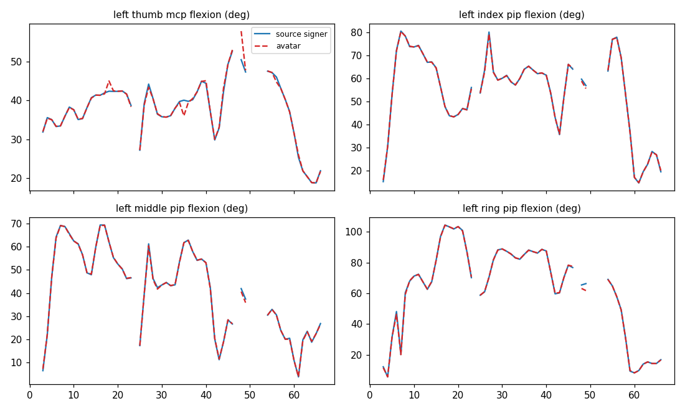
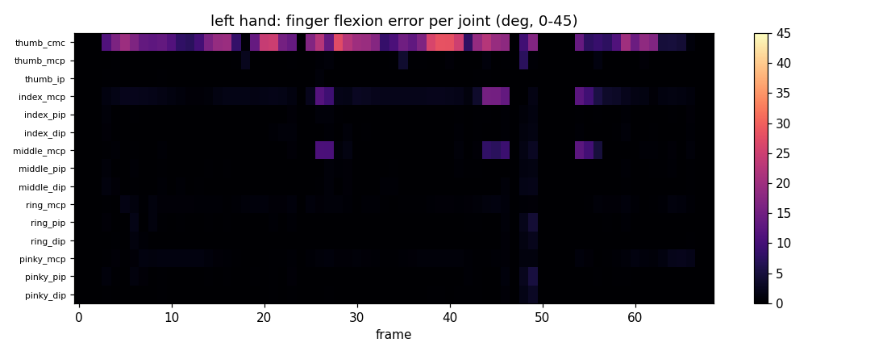
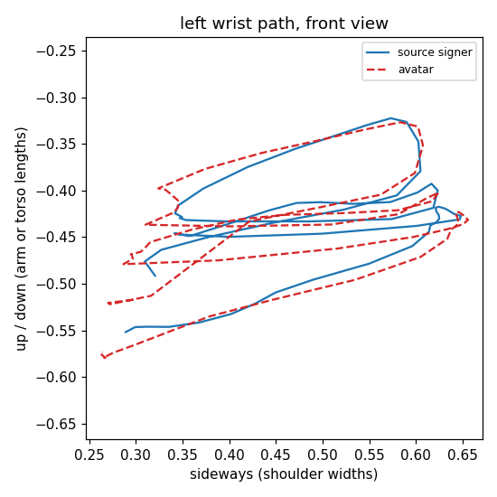
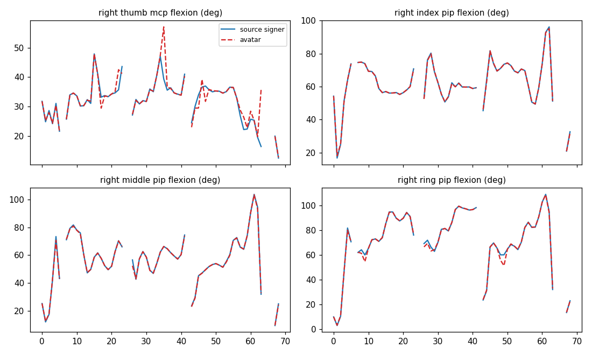
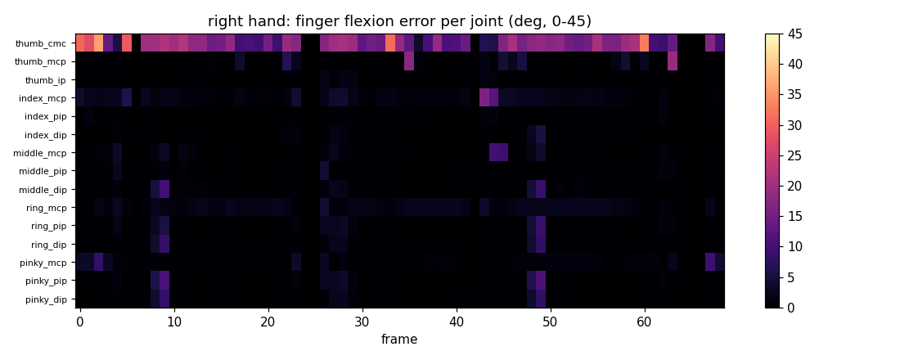
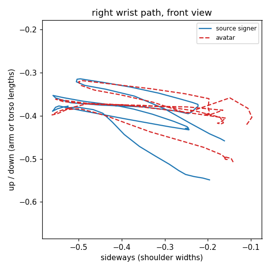
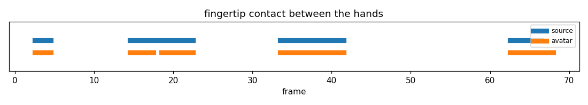

# Motion fidelity report: magnet_sign_2

Source video: `references/dict_Magnet_(Sign_2).mp4` · 69 frames at 25.00 fps

> **Geometric similarity only.** These numbers compare the avatar with the landmarks extracted from
> the source video. They cannot show whether the signing is correct ISL. Only a qualified ISL
> interpreter can approve a sign.

## Status

| Check | Result |
| --- | --- |
| license_status | granted |
| motion_qc | pass |
| interpreter_review | not_reviewed |

## Geometric check: FAIL

Each limit is checked on its own; there is no overall percentage.

| Check | Value | Limit | Result |
| --- | --- | --- | --- |
| left finger flexion median (deg) | 0.139 | ≤ 5.0 | pass |
| left finger flexion p90 (deg) | 2.44 | ≤ 15.0 | pass |
| left palm orientation median (deg) | 0.245 | ≤ 10.0 | pass |
| left palm orientation p90 (deg) | 0.434 | ≤ 25.0 | pass |
| left wrist position median | 0.098 | ≤ 0.1 | pass |
| right finger flexion median (deg) | 0.222 | ≤ 5.0 | pass |
| right finger flexion p90 (deg) | 4.197 | ≤ 15.0 | pass |
| right palm orientation median (deg) | 0.269 | ≤ 10.0 | pass |
| right palm orientation p90 (deg) | 0.573 | ≤ 25.0 | pass |
| right wrist position median | 0.102 | ≤ 0.1 | FAIL |
| contact frames missing on avatar (fraction) | 0.045 | ≤ 0.25 | pass |

## Hands

### Left hand (58 frames compared, data: world)

Left out of the hand-shape comparison: 6 image only, 5 impossible bend (frames the avatar deliberately does not copy; see MOTION_VALIDATION.md).

| Measure | Median | 90th percentile | Max |
| --- | --- | --- | --- |
| Finger joint flexion error | 0.139° | 2.44° | 28.357° |
| Finger spread error | 0.997° | 9.54° | 48.595° |
| Palm orientation error (vs chest) | 0.245° | 0.434° | 0.553° |
| Wrist position error (body-relative) | 0.098 | 0.147 | 0.177 |
| Elbow position error (body-relative) | 0.13 | 0.248 | 0.284 |

Hand shape overall: **close** (median joint error 0.139°).

| Joint | Median error | 90th percentile |
| --- | --- | --- |
| thumb_cmc | 15.335° | 24.839° |
| thumb_mcp | 0.055° | 0.809° |
| thumb_ip | 0.035° | 0.178° |
| index_mcp | 2.079° | 9.572° |
| index_pip | 0.112° | 0.591° |
| index_dip | 0.085° | 0.716° |
| middle_mcp | 0.069° | 7.968° |
| middle_pip | 0.109° | 0.498° |
| middle_dip | 0.044° | 0.651° |
| ring_mcp | 0.579° | 1.108° |
| ring_pip | 0.08° | 0.628° |
| ring_dip | 0.036° | 0.236° |
| pinky_mcp | 0.666° | 1.354° |
| pinky_pip | 0.075° | 0.546° |
| pinky_dip | 0.056° | 0.312° |

Wrist speed correlation (original timing): 0.87
DTW diagnostic: original-time mean wrist error 0.083, time-aligned 0.075, median shift 0 frames (the original timing is kept; DTW is for diagnosis only).

### Right hand (62 frames compared, data: world)

Left out of the hand-shape comparison: 2 image only, 4 impossible bend (frames the avatar deliberately does not copy; see MOTION_VALIDATION.md).

| Measure | Median | 90th percentile | Max |
| --- | --- | --- | --- |
| Finger joint flexion error | 0.222° | 4.197° | 36.059° |
| Finger spread error | 1.06° | 12.814° | 52.197° |
| Palm orientation error (vs chest) | 0.269° | 0.573° | 1.74° |
| Wrist position error (body-relative) | 0.102 | 0.16 | 0.189 |
| Elbow position error (body-relative) | 0.15 | 0.182 | 0.195 |

Hand shape overall: **close** (median joint error 0.222°).

| Joint | Median error | 90th percentile |
| --- | --- | --- |
| thumb_cmc | 17.168° | 22.207° |
| thumb_mcp | 0.218° | 3.736° |
| thumb_ip | 0.068° | 0.56° |
| index_mcp | 1.448° | 3.735° |
| index_pip | 0.079° | 0.491° |
| index_dip | 0.096° | 0.721° |
| middle_mcp | 0.218° | 1.556° |
| middle_pip | 0.16° | 0.648° |
| middle_dip | 0.079° | 0.998° |
| ring_mcp | 1.886° | 2.444° |
| ring_pip | 0.184° | 2.563° |
| ring_dip | 0.034° | 0.819° |
| pinky_mcp | 0.674° | 2.951° |
| pinky_pip | 0.147° | 2.837° |
| pinky_dip | 0.076° | 0.84° |

Wrist speed correlation (original timing): 0.896
DTW diagnostic: original-time mean wrist error 0.088, time-aligned 0.069, median shift 0 frames (the original timing is kept; DTW is for diagnosis only).

## Contact between the hands

Source frames with fingertip contact: 22; avatar: 23; matching: 21; avatar contact not in the source: 2; source contact missing on the avatar: 1.

## Face

Shape-key values vs source expression scores: median difference 0.0 (this checks the baking path; whether each expression LOOKS right needs the face renders from `tools/facial_validator.py` and the interpreter).

## Images

