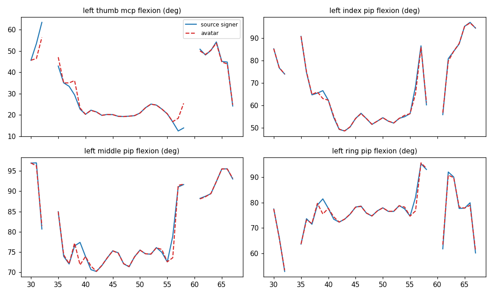
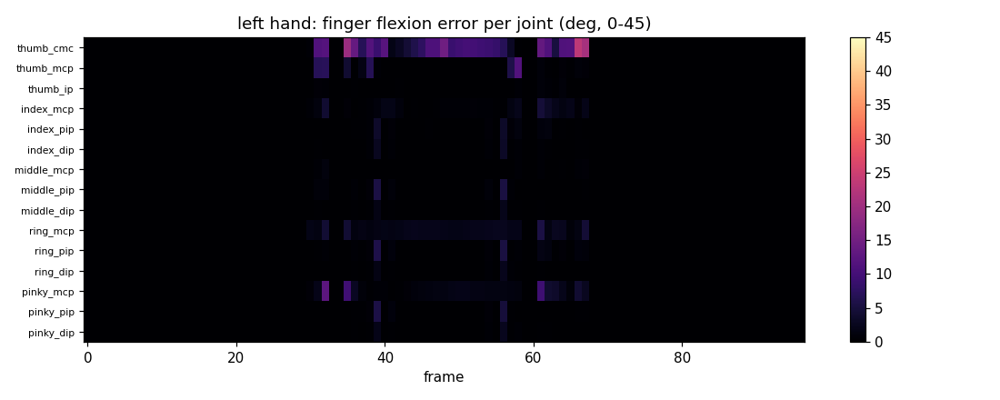
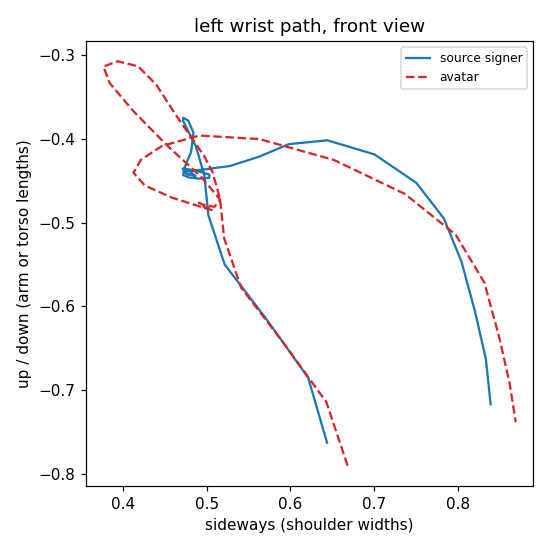
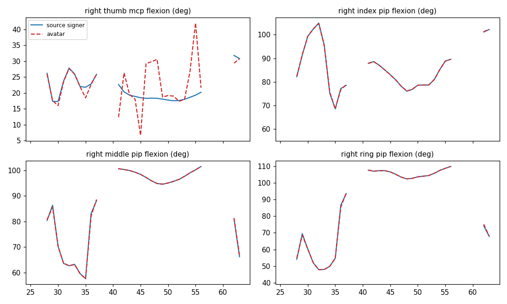
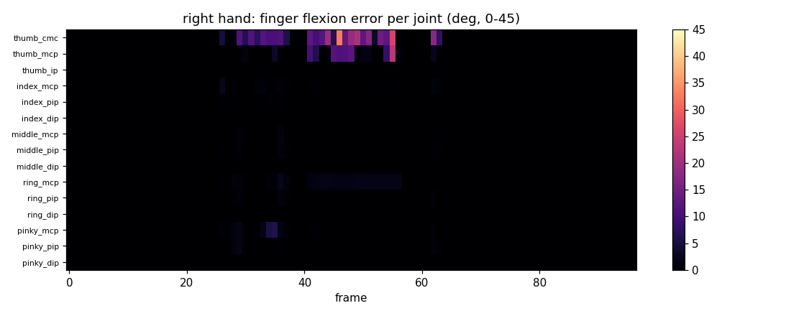
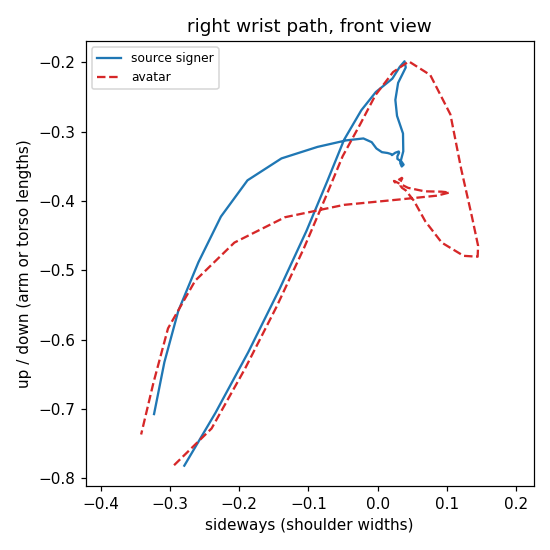
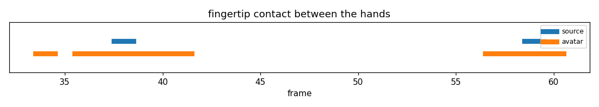

# Motion fidelity report: make

Source video: `references/dict_Make.mp4` · 97 frames at 25.00 fps

> **Geometric similarity only.** These numbers compare the avatar with the landmarks extracted from
> the source video. They cannot show whether the signing is correct ISL. Only a qualified ISL
> interpreter can approve a sign.

## Status

| Check | Result |
| --- | --- |
| license_status | granted |
| motion_qc | pass |
| interpreter_review | not_reviewed |

## Geometric check: PASS

Each limit is checked on its own; there is no overall percentage.

| Check | Value | Limit | Result |
| --- | --- | --- | --- |
| left finger flexion median (deg) | 0.173 | ≤ 5.0 | pass |
| left finger flexion p90 (deg) | 4.157 | ≤ 15.0 | pass |
| left palm orientation median (deg) | 0.338 | ≤ 10.0 | pass |
| left palm orientation p90 (deg) | 0.767 | ≤ 25.0 | pass |
| left wrist position median | 0.045 | ≤ 0.1 | pass |
| right finger flexion median (deg) | 0.07 | ≤ 5.0 | pass |
| right finger flexion p90 (deg) | 2.003 | ≤ 15.0 | pass |
| right palm orientation median (deg) | 0.362 | ≤ 10.0 | pass |
| right palm orientation p90 (deg) | 0.634 | ≤ 25.0 | pass |
| right wrist position median | 0.04 | ≤ 0.1 | pass |
| contact frames missing on avatar (fraction) | 0.0 | ≤ 0.25 | pass |

## Hands

### Left hand (34 frames compared, data: world)

Left out of the hand-shape comparison: 6 image only, 3 depth flip (frames the avatar deliberately does not copy; see MOTION_VALIDATION.md).

| Measure | Median | 90th percentile | Max |
| --- | --- | --- | --- |
| Finger joint flexion error | 0.173° | 4.157° | 23.241° |
| Finger spread error | 1.72° | 14.099° | 61.616° |
| Palm orientation error (vs chest) | 0.338° | 0.767° | 1.108° |
| Wrist position error (body-relative) | 0.045 | 0.119 | 0.157 |
| Elbow position error (body-relative) | 0.073 | 0.088 | 0.107 |

Hand shape overall: **close** (median joint error 0.173°).

| Joint | Median error | 90th percentile |
| --- | --- | --- |
| thumb_cmc | 9.92° | 14.917° |
| thumb_mcp | 0.113° | 6.725° |
| thumb_ip | 0.048° | 0.445° |
| index_mcp | 0.556° | 2.233° |
| index_pip | 0.105° | 1.085° |
| index_dip | 0.062° | 0.433° |
| middle_mcp | 0.017° | 0.419° |
| middle_pip | 0.061° | 0.789° |
| middle_dip | 0.044° | 0.263° |
| ring_mcp | 2.089° | 4.294° |
| ring_pip | 0.251° | 1.239° |
| ring_dip | 0.065° | 0.363° |
| pinky_mcp | 1.54° | 4.188° |
| pinky_pip | 0.055° | 0.671° |
| pinky_dip | 0.08° | 0.355° |

Wrist speed correlation (original timing): 0.845
DTW diagnostic: original-time mean wrist error 0.058, time-aligned 0.047, median shift 1 frames (the original timing is kept; DTW is for diagnosis only).

### Right hand (29 frames compared, data: world)

Left out of the hand-shape comparison: 1 image only, 8 impossible bend (frames the avatar deliberately does not copy; see MOTION_VALIDATION.md).

| Measure | Median | 90th percentile | Max |
| --- | --- | --- | --- |
| Finger joint flexion error | 0.07° | 2.003° | 32.628° |
| Finger spread error | 0.422° | 7.864° | 21.371° |
| Palm orientation error (vs chest) | 0.362° | 0.634° | 0.83° |
| Wrist position error (body-relative) | 0.04 | 0.164 | 0.223 |
| Elbow position error (body-relative) | 0.092 | 0.126 | 0.238 |

Hand shape overall: **close** (median joint error 0.07°).

| Joint | Median error | 90th percentile |
| --- | --- | --- |
| thumb_cmc | 11.458° | 21.221° |
| thumb_mcp | 0.827° | 11.829° |
| thumb_ip | 0.031° | 0.257° |
| index_mcp | 0.279° | 0.9° |
| index_pip | 0.052° | 0.397° |
| index_dip | 0.031° | 0.15° |
| middle_mcp | 0.012° | 0.309° |
| middle_pip | 0.031° | 0.511° |
| middle_dip | 0.03° | 0.11° |
| ring_mcp | 1.654° | 2.012° |
| ring_pip | 0.024° | 0.932° |
| ring_dip | 0.022° | 0.15° |
| pinky_mcp | 0.21° | 1.791° |
| pinky_pip | 0.042° | 1.131° |
| pinky_dip | 0.037° | 0.146° |

Wrist speed correlation (original timing): 0.919
DTW diagnostic: original-time mean wrist error 0.07, time-aligned 0.068, median shift 0 frames (the original timing is kept; DTW is for diagnosis only).

## Contact between the hands

Source frames with fingertip contact: 2; avatar: 11; matching: 2; avatar contact not in the source: 9; source contact missing on the avatar: 0.

## Face

Shape-key values vs source expression scores: median difference 0.0 (this checks the baking path; whether each expression LOOKS right needs the face renders from `tools/facial_validator.py` and the interpreter).

## Images

