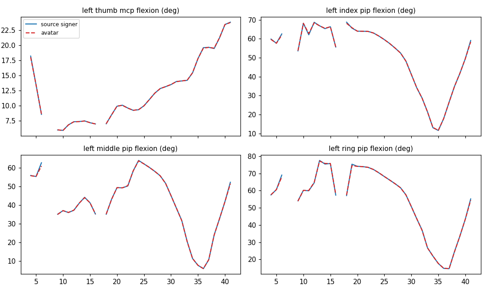
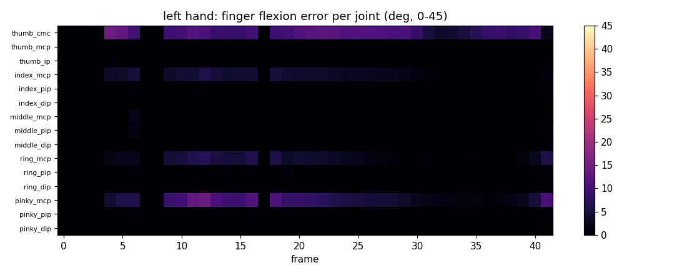
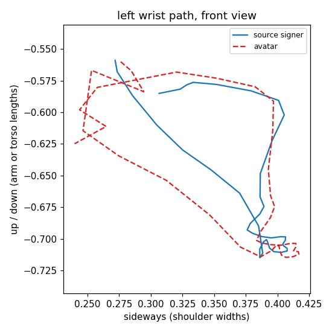
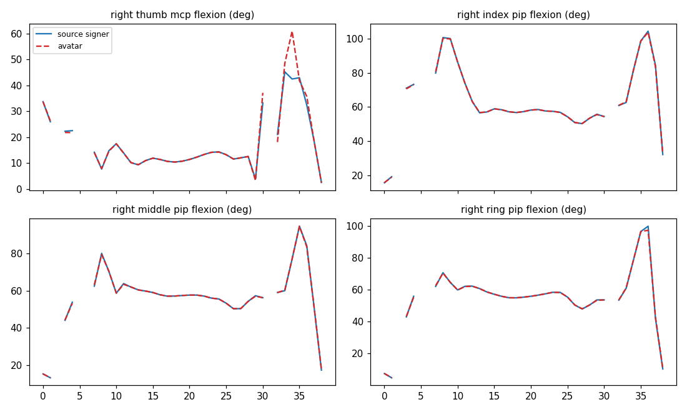
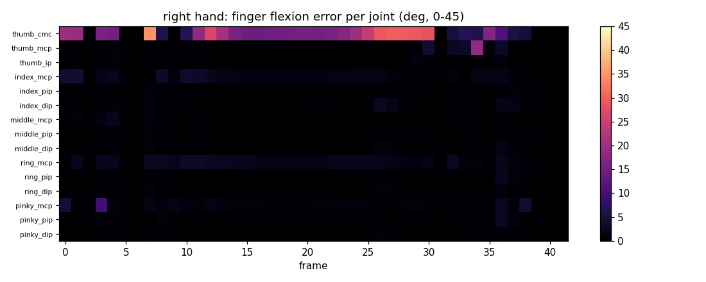
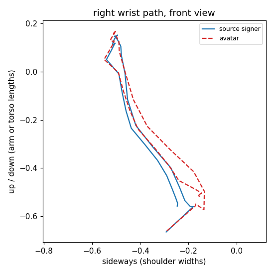
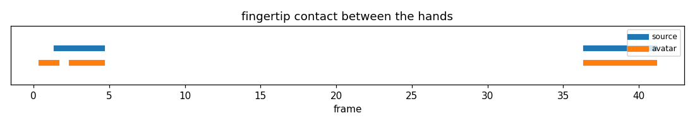

# Motion fidelity report: oxygen_sign_2

Source video: `references/dict_Oxygen_(Sign_2).mp4` · 42 frames at 25.00 fps

> **Geometric similarity only.** These numbers compare the avatar with the landmarks extracted from
> the source video. They cannot show whether the signing is correct ISL. Only a qualified ISL
> interpreter can approve a sign.

## Status

| Check | Result |
| --- | --- |
| license_status | granted |
| motion_qc | pass |
| interpreter_review | not_reviewed |

## Geometric check: PASS

Each limit is checked on its own; there is no overall percentage.

| Check | Value | Limit | Result |
| --- | --- | --- | --- |
| left finger flexion median (deg) | 0.043 | ≤ 5.0 | pass |
| left finger flexion p90 (deg) | 5.735 | ≤ 15.0 | pass |
| left palm orientation median (deg) | 0.358 | ≤ 10.0 | pass |
| left palm orientation p90 (deg) | 0.511 | ≤ 25.0 | pass |
| left wrist position median | 0.011 | ≤ 0.1 | pass |
| right finger flexion median (deg) | 0.119 | ≤ 5.0 | pass |
| right finger flexion p90 (deg) | 2.849 | ≤ 15.0 | pass |
| right palm orientation median (deg) | 0.424 | ≤ 10.0 | pass |
| right palm orientation p90 (deg) | 0.962 | ≤ 25.0 | pass |
| right wrist position median | 0.02 | ≤ 0.1 | pass |
| contact frames missing on avatar (fraction) | 0.125 | ≤ 0.25 | pass |

## Hands

### Left hand (35 frames compared, data: world)

Left out of the hand-shape comparison: 4 image only, 3 impossible bend (frames the avatar deliberately does not copy; see MOTION_VALIDATION.md).

| Measure | Median | 90th percentile | Max |
| --- | --- | --- | --- |
| Finger joint flexion error | 0.043° | 5.735° | 14.322° |
| Finger spread error | 0.639° | 2.385° | 12.321° |
| Palm orientation error (vs chest) | 0.358° | 0.511° | 0.642° |
| Wrist position error (body-relative) | 0.011 | 0.116 | 0.188 |
| Elbow position error (body-relative) | 0.111 | 0.131 | 0.145 |

Hand shape overall: **close** (median joint error 0.043°).

| Joint | Median error | 90th percentile |
| --- | --- | --- |
| thumb_cmc | 9.804° | 12.187° |
| thumb_mcp | 0.017° | 0.065° |
| thumb_ip | 0.017° | 0.036° |
| index_mcp | 2.89° | 4.693° |
| index_pip | 0.03° | 0.615° |
| index_dip | 0.02° | 0.069° |
| middle_mcp | 0.012° | 0.261° |
| middle_pip | 0.055° | 0.186° |
| middle_dip | 0.029° | 0.204° |
| ring_mcp | 2.417° | 5.867° |
| ring_pip | 0.039° | 0.471° |
| ring_dip | 0.028° | 0.247° |
| pinky_mcp | 5.735° | 10.906° |
| pinky_pip | 0.035° | 0.481° |
| pinky_dip | 0.019° | 0.047° |

Wrist speed correlation (original timing): 0.792
DTW diagnostic: original-time mean wrist error 0.043, time-aligned 0.036, median shift 0 frames (the original timing is kept; DTW is for diagnosis only).

### Right hand (35 frames compared, data: world)

Left out of the hand-shape comparison: 1 depth flip, 1 image only, 3 impossible bend (frames the avatar deliberately does not copy; see MOTION_VALIDATION.md).

| Measure | Median | 90th percentile | Max |
| --- | --- | --- | --- |
| Finger joint flexion error | 0.119° | 2.849° | 34.793° |
| Finger spread error | 0.214° | 3.031° | 18.605° |
| Palm orientation error (vs chest) | 0.424° | 0.962° | 2.807° |
| Wrist position error (body-relative) | 0.02 | 0.136 | 0.189 |
| Elbow position error (body-relative) | 0.171 | 0.208 | 0.454 |

Hand shape overall: **close** (median joint error 0.119°).

| Joint | Median error | 90th percentile |
| --- | --- | --- |
| thumb_cmc | 15.896° | 29.155° |
| thumb_mcp | 0.036° | 3.223° |
| thumb_ip | 0.046° | 0.65° |
| index_mcp | 1.411° | 3.489° |
| index_pip | 0.068° | 0.613° |
| index_dip | 0.119° | 1.473° |
| middle_mcp | 0.025° | 0.828° |
| middle_pip | 0.044° | 0.583° |
| middle_dip | 0.057° | 0.758° |
| ring_mcp | 2.158° | 2.922° |
| ring_pip | 0.054° | 0.501° |
| ring_dip | 0.026° | 0.713° |
| pinky_mcp | 0.787° | 2.705° |
| pinky_pip | 0.044° | 0.747° |
| pinky_dip | 0.059° | 0.486° |

Wrist speed correlation (original timing): 0.987
DTW diagnostic: original-time mean wrist error 0.051, time-aligned 0.049, median shift 0 frames (the original timing is kept; DTW is for diagnosis only).

## Contact between the hands

Source frames with fingertip contact: 8; avatar: 8; matching: 7; avatar contact not in the source: 1; source contact missing on the avatar: 1.

## Face

Shape-key values vs source expression scores: median difference 0.0 (this checks the baking path; whether each expression LOOKS right needs the face renders from `tools/facial_validator.py` and the interpreter).

## Images

