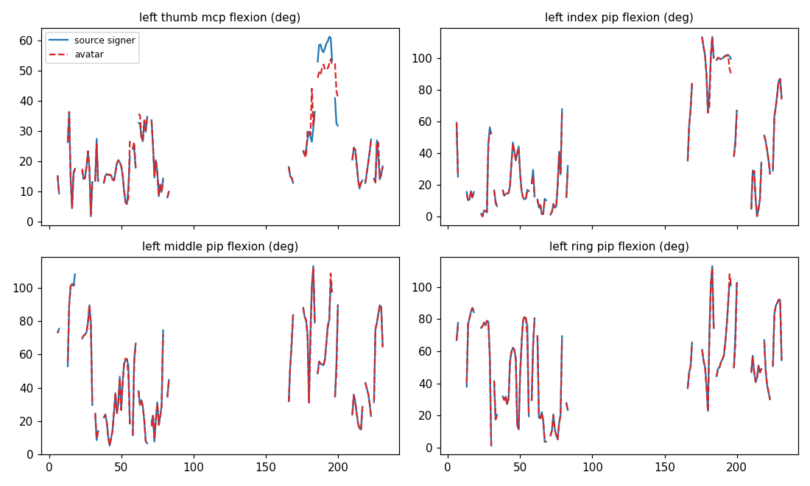
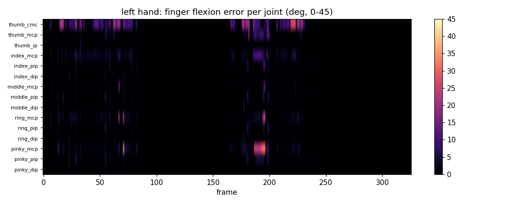
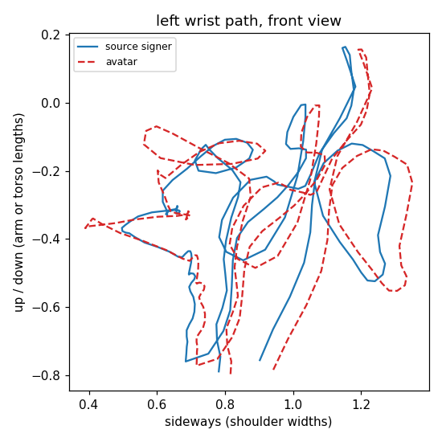
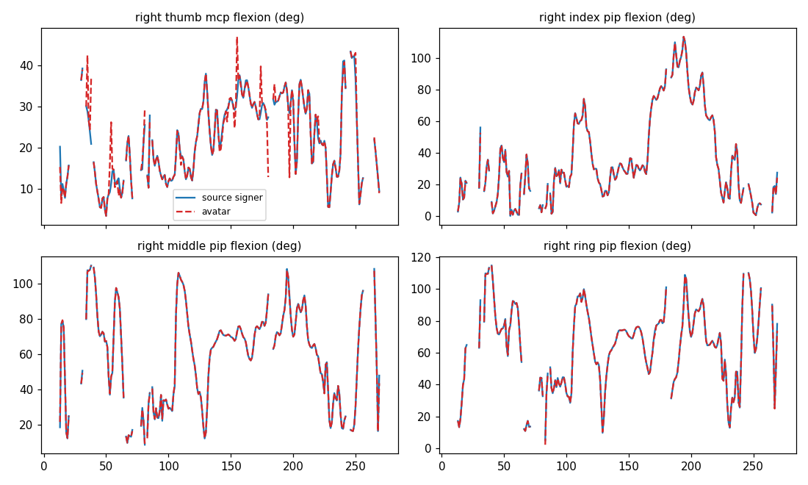
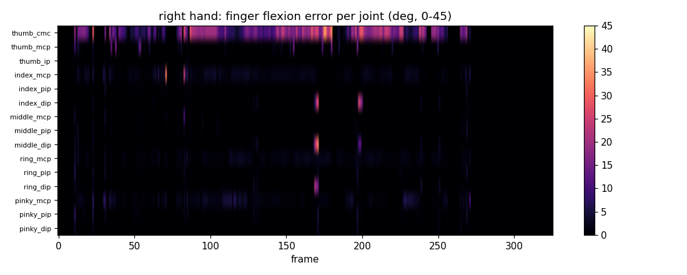
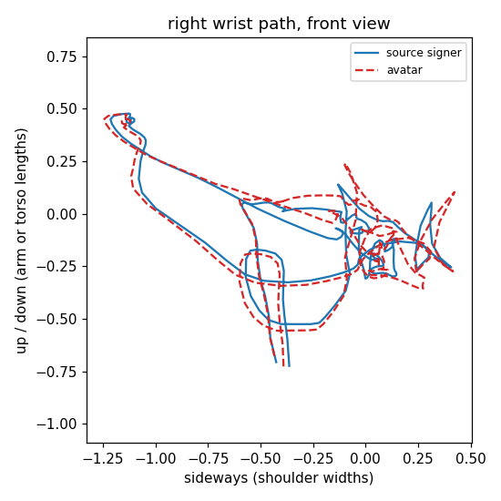
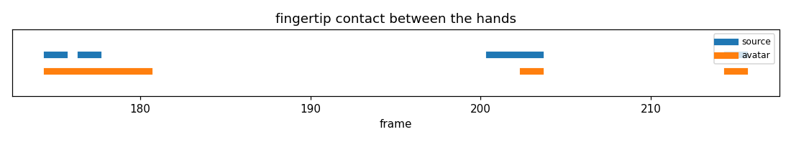

# Motion fidelity report: photosynthesis

Source video: `references/dict_Photosynthesis.mp4` · 326 frames at 24.00 fps

> **Geometric similarity only.** These numbers compare the avatar with the landmarks extracted from
> the source video. They cannot show whether the signing is correct ISL. Only a qualified ISL
> interpreter can approve a sign.

## Status

| Check | Result |
| --- | --- |
| license_status | granted |
| motion_qc | pass_exception |
| interpreter_review | not_reviewed |

## Geometric check: FAIL

Each limit is checked on its own; there is no overall percentage.

| Check | Value | Limit | Result |
| --- | --- | --- | --- |
| left finger flexion median (deg) | 0.144 | ≤ 5.0 | pass |
| left finger flexion p90 (deg) | 4.705 | ≤ 15.0 | pass |
| left palm orientation median (deg) | 0.41 | ≤ 10.0 | pass |
| left palm orientation p90 (deg) | 1.272 | ≤ 25.0 | pass |
| left wrist position median | 0.042 | ≤ 0.1 | pass |
| right finger flexion median (deg) | 0.061 | ≤ 5.0 | pass |
| right finger flexion p90 (deg) | 2.946 | ≤ 15.0 | pass |
| right palm orientation median (deg) | 0.239 | ≤ 10.0 | pass |
| right palm orientation p90 (deg) | 0.656 | ≤ 25.0 | pass |
| right wrist position median | 0.029 | ≤ 0.1 | pass |
| contact frames missing on avatar (fraction) | 0.333 | ≤ 0.25 | FAIL |

## Hands

### Left hand (109 frames compared, data: world)

Left out of the hand-shape comparison: 12 rest pose, 47 impossible bend, 2 depth flip, 6 image only (frames the avatar deliberately does not copy; see MOTION_VALIDATION.md).

| Measure | Median | 90th percentile | Max |
| --- | --- | --- | --- |
| Finger joint flexion error | 0.144° | 4.705° | 34.087° |
| Finger spread error | 1.204° | 11.895° | 59.801° |
| Palm orientation error (vs chest) | 0.41° | 1.272° | 2.697° |
| Wrist position error (body-relative) | 0.042 | 0.118 | 0.234 |
| Elbow position error (body-relative) | 0.092 | 0.122 | 0.163 |

Hand shape overall: **close** (median joint error 0.144°).

| Joint | Median error | 90th percentile |
| --- | --- | --- |
| thumb_cmc | 9.817° | 21.119° |
| thumb_mcp | 0.1° | 6.771° |
| thumb_ip | 0.026° | 0.458° |
| index_mcp | 2.27° | 7.32° |
| index_pip | 0.03° | 1.581° |
| index_dip | 0.021° | 1.026° |
| middle_mcp | 0.02° | 1.41° |
| middle_pip | 0.026° | 1.598° |
| middle_dip | 0.023° | 0.752° |
| ring_mcp | 1.443° | 3.32° |
| ring_pip | 0.026° | 1.646° |
| ring_dip | 0.026° | 0.696° |
| pinky_mcp | 1.493° | 21.326° |
| pinky_pip | 0.048° | 3.57° |
| pinky_dip | 0.036° | 0.738° |

Wrist speed correlation (original timing): 0.941
DTW diagnostic: original-time mean wrist error 0.057, time-aligned 0.052, median shift 0 frames (the original timing is kept; DTW is for diagnosis only).

### Right hand (225 frames compared, data: world)

Left out of the hand-shape comparison: 1 rest pose, 31 impossible bend, 5 image only, 3 depth flip (frames the avatar deliberately does not copy; see MOTION_VALIDATION.md).

| Measure | Median | 90th percentile | Max |
| --- | --- | --- | --- |
| Finger joint flexion error | 0.061° | 2.946° | 34.952° |
| Finger spread error | 0.806° | 6.151° | 31.6° |
| Palm orientation error (vs chest) | 0.239° | 0.656° | 2.242° |
| Wrist position error (body-relative) | 0.029 | 0.1 | 0.235 |
| Elbow position error (body-relative) | 0.113 | 0.167 | 0.321 |

Hand shape overall: **close** (median joint error 0.061°).

| Joint | Median error | 90th percentile |
| --- | --- | --- |
| thumb_cmc | 14.553° | 22.999° |
| thumb_mcp | 0.036° | 1.467° |
| thumb_ip | 0.019° | 0.167° |
| index_mcp | 1.581° | 2.978° |
| index_pip | 0.026° | 0.46° |
| index_dip | 0.024° | 0.591° |
| middle_mcp | 0.01° | 0.305° |
| middle_pip | 0.02° | 0.428° |
| middle_dip | 0.021° | 0.526° |
| ring_mcp | 1.124° | 2.19° |
| ring_pip | 0.021° | 0.521° |
| ring_dip | 0.026° | 0.331° |
| pinky_mcp | 1.024° | 3.729° |
| pinky_pip | 0.03° | 0.676° |
| pinky_dip | 0.031° | 0.26° |

Wrist speed correlation (original timing): 0.962
DTW diagnostic: original-time mean wrist error 0.047, time-aligned 0.045, median shift 0 frames (the original timing is kept; DTW is for diagnosis only).

## Contact between the hands

Source frames with fingertip contact: 6; avatar: 8; matching: 4; avatar contact not in the source: 4; source contact missing on the avatar: 2.

## Face

Shape-key values vs source expression scores: median difference 0.0 (this checks the baking path; whether each expression LOOKS right needs the face renders from `tools/facial_validator.py` and the interpreter).

## Images

