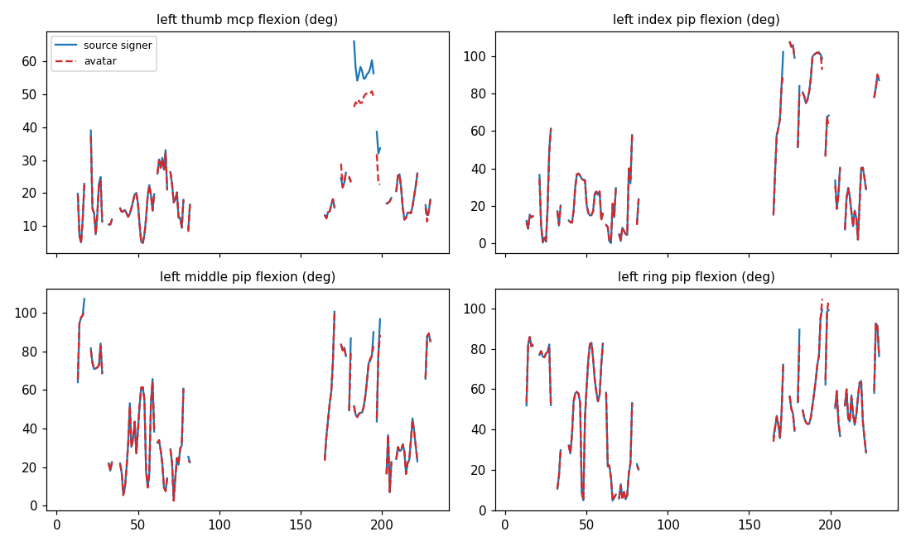
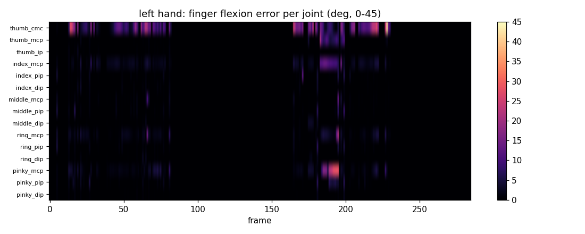
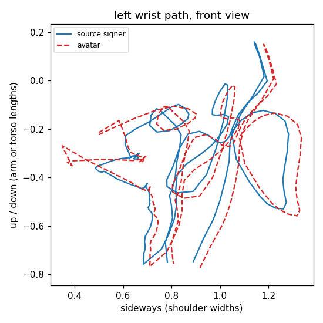
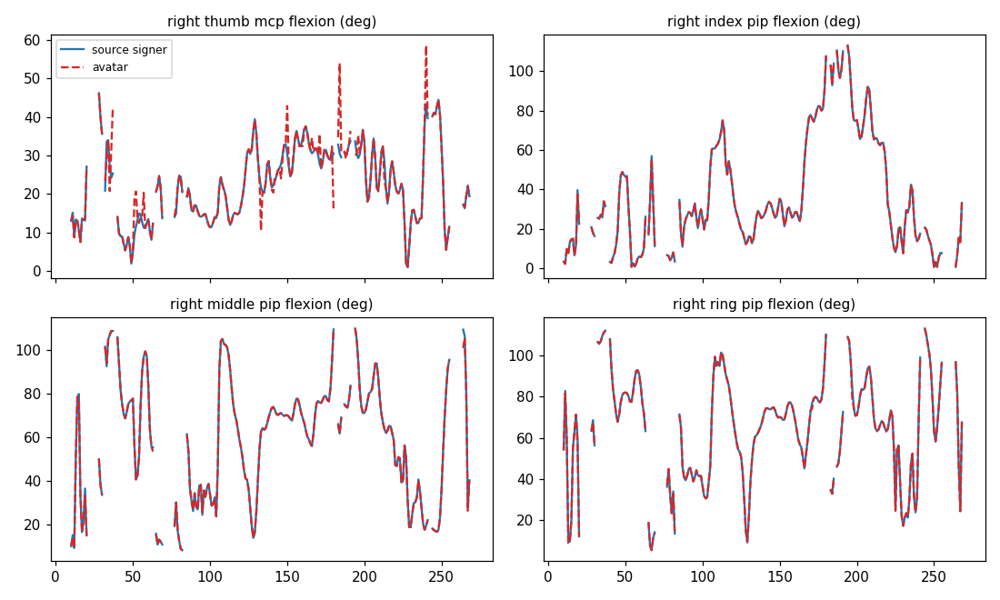
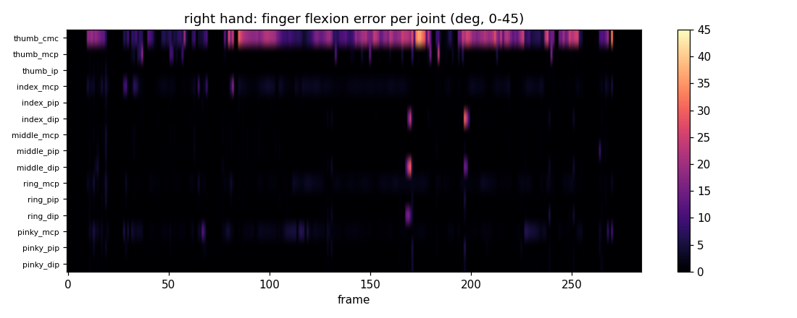
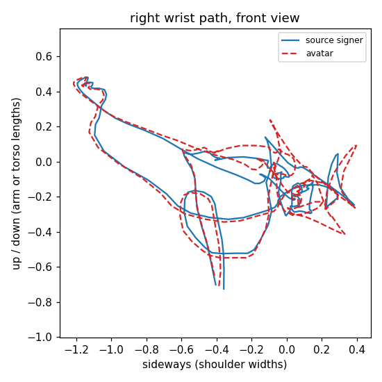
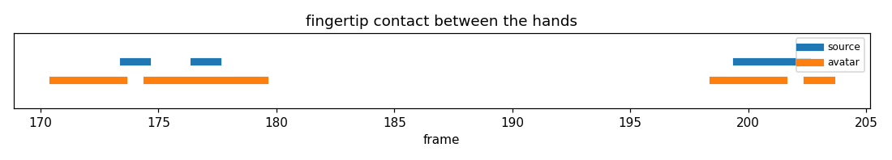

# Motion fidelity report: photosynthesis_process

Source video: `references/dict_Photosynthesis_Process.mp4` · 285 frames at 24.00 fps

> **Geometric similarity only.** These numbers compare the avatar with the landmarks extracted from
> the source video. They cannot show whether the signing is correct ISL. Only a qualified ISL
> interpreter can approve a sign.

## Status

| Check | Result |
| --- | --- |
| license_status | granted |
| motion_qc | pass |
| interpreter_review | not_reviewed |

## Geometric check: FAIL

Each limit is checked on its own; there is no overall percentage.

| Check | Value | Limit | Result |
| --- | --- | --- | --- |
| left finger flexion median (deg) | 0.134 | ≤ 5.0 | pass |
| left finger flexion p90 (deg) | 4.877 | ≤ 15.0 | pass |
| left palm orientation median (deg) | 0.418 | ≤ 10.0 | pass |
| left palm orientation p90 (deg) | 1.238 | ≤ 25.0 | pass |
| left wrist position median | 0.034 | ≤ 0.1 | pass |
| right finger flexion median (deg) | 0.055 | ≤ 5.0 | pass |
| right finger flexion p90 (deg) | 2.789 | ≤ 15.0 | pass |
| right palm orientation median (deg) | 0.204 | ≤ 10.0 | pass |
| right palm orientation p90 (deg) | 0.631 | ≤ 25.0 | pass |
| right wrist position median | 0.028 | ≤ 0.1 | pass |
| contact frames missing on avatar (fraction) | 0.4 | ≤ 0.25 | FAIL |

## Hands

### Left hand (110 frames compared, data: world)

Left out of the hand-shape comparison: 8 rest pose, 49 impossible bend, 1 depth flip, 7 image only (frames the avatar deliberately does not copy; see MOTION_VALIDATION.md).

| Measure | Median | 90th percentile | Max |
| --- | --- | --- | --- |
| Finger joint flexion error | 0.134° | 4.877° | 41.063° |
| Finger spread error | 1.133° | 9.199° | 51.985° |
| Palm orientation error (vs chest) | 0.418° | 1.238° | 3.852° |
| Wrist position error (body-relative) | 0.034 | 0.098 | 0.306 |
| Elbow position error (body-relative) | 0.109 | 0.175 | 0.369 |

Hand shape overall: **close** (median joint error 0.134°).

| Joint | Median error | 90th percentile |
| --- | --- | --- |
| thumb_cmc | 11.234° | 21.44° |
| thumb_mcp | 0.028° | 7.022° |
| thumb_ip | 0.026° | 0.609° |
| index_mcp | 2.424° | 9.934° |
| index_pip | 0.03° | 1.11° |
| index_dip | 0.026° | 0.848° |
| middle_mcp | 0.022° | 1.389° |
| middle_pip | 0.024° | 1.416° |
| middle_dip | 0.03° | 0.638° |
| ring_mcp | 1.381° | 4.3° |
| ring_pip | 0.026° | 1.173° |
| ring_dip | 0.028° | 0.574° |
| pinky_mcp | 1.555° | 8.274° |
| pinky_pip | 0.059° | 3.315° |
| pinky_dip | 0.035° | 0.556° |

Wrist speed correlation (original timing): 0.897
DTW diagnostic: original-time mean wrist error 0.051, time-aligned 0.045, median shift 0 frames (the original timing is kept; DTW is for diagnosis only).

### Right hand (225 frames compared, data: world)

Left out of the hand-shape comparison: 1 rest pose, 32 impossible bend, 3 image only, 2 depth flip (frames the avatar deliberately does not copy; see MOTION_VALIDATION.md).

| Measure | Median | 90th percentile | Max |
| --- | --- | --- | --- |
| Finger joint flexion error | 0.055° | 2.789° | 36.652° |
| Finger spread error | 0.871° | 5.353° | 28.274° |
| Palm orientation error (vs chest) | 0.204° | 0.631° | 1.816° |
| Wrist position error (body-relative) | 0.028 | 0.094 | 0.312 |
| Elbow position error (body-relative) | 0.122 | 0.213 | 0.346 |

Hand shape overall: **close** (median joint error 0.055°).

| Joint | Median error | 90th percentile |
| --- | --- | --- |
| thumb_cmc | 14.378° | 23.403° |
| thumb_mcp | 0.037° | 2.221° |
| thumb_ip | 0.021° | 0.145° |
| index_mcp | 1.598° | 2.875° |
| index_pip | 0.025° | 0.333° |
| index_dip | 0.019° | 0.366° |
| middle_mcp | 0.01° | 0.364° |
| middle_pip | 0.02° | 0.388° |
| middle_dip | 0.024° | 0.408° |
| ring_mcp | 1.074° | 2.167° |
| ring_pip | 0.019° | 0.399° |
| ring_dip | 0.021° | 0.213° |
| pinky_mcp | 0.993° | 3.882° |
| pinky_pip | 0.028° | 0.426° |
| pinky_dip | 0.027° | 0.184° |

Wrist speed correlation (original timing): 0.941
DTW diagnostic: original-time mean wrist error 0.046, time-aligned 0.044, median shift 0 frames (the original timing is kept; DTW is for diagnosis only).

## Contact between the hands

Source frames with fingertip contact: 5; avatar: 12; matching: 3; avatar contact not in the source: 9; source contact missing on the avatar: 2.

## Face

Shape-key values vs source expression scores: median difference 0.0 (this checks the baking path; whether each expression LOOKS right needs the face renders from `tools/facial_validator.py` and the interpreter).

## Images

