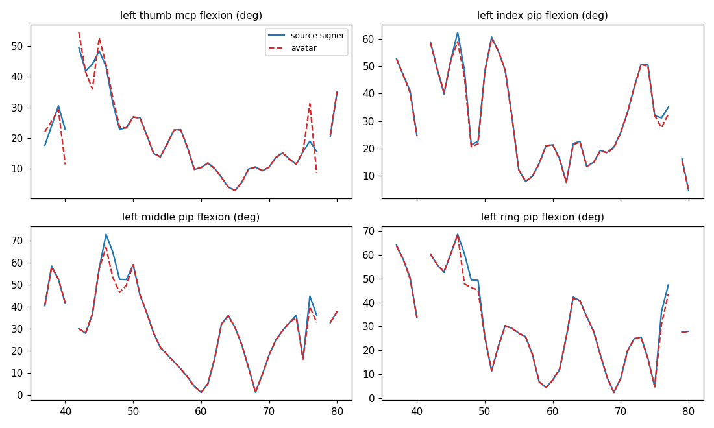
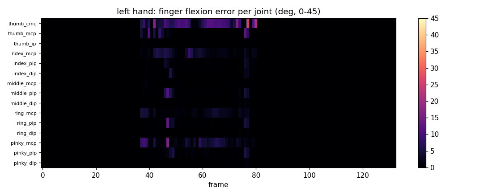
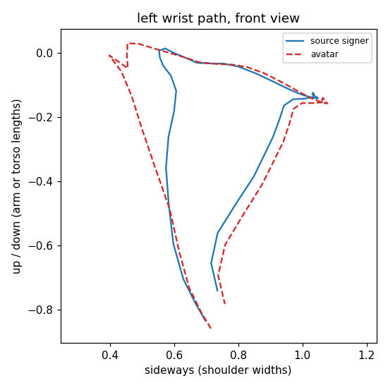
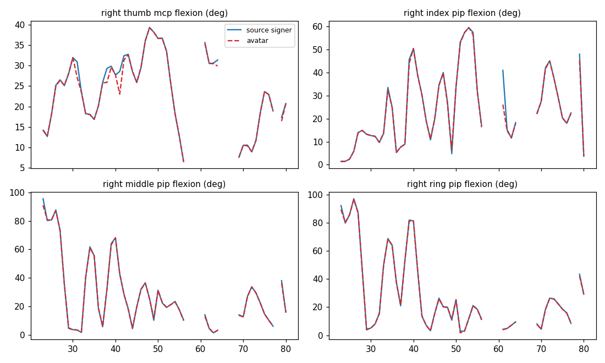
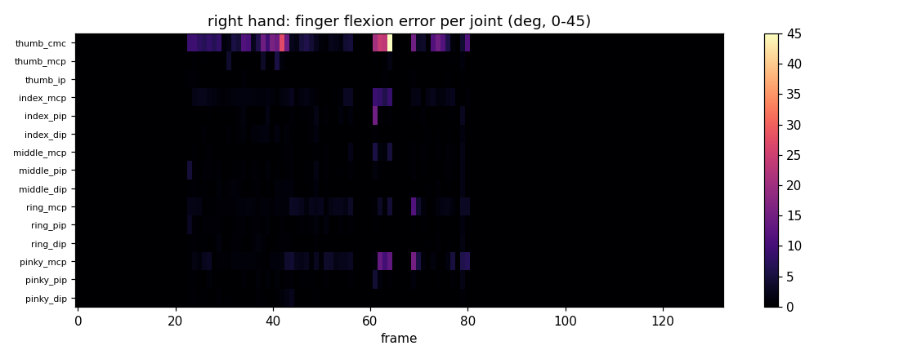
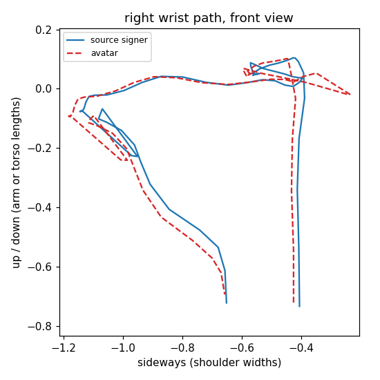
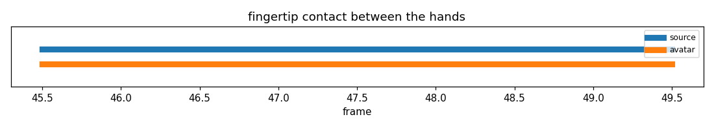

# Motion fidelity report: soil

Source video: `references/dict_Soil.mp4` · 133 frames at 25.00 fps

> **Geometric similarity only.** These numbers compare the avatar with the landmarks extracted from
> the source video. They cannot show whether the signing is correct ISL. Only a qualified ISL
> interpreter can approve a sign.

## Status

| Check | Result |
| --- | --- |
| license_status | granted |
| motion_qc | pass |
| interpreter_review | not_reviewed |

## Geometric check: PASS

Each limit is checked on its own; there is no overall percentage.

| Check | Value | Limit | Result |
| --- | --- | --- | --- |
| left finger flexion median (deg) | 0.153 | ≤ 5.0 | pass |
| left finger flexion p90 (deg) | 4.809 | ≤ 15.0 | pass |
| left palm orientation median (deg) | 0.191 | ≤ 10.0 | pass |
| left palm orientation p90 (deg) | 0.464 | ≤ 25.0 | pass |
| left wrist position median | 0.034 | ≤ 0.1 | pass |
| right finger flexion median (deg) | 0.222 | ≤ 5.0 | pass |
| right finger flexion p90 (deg) | 2.815 | ≤ 15.0 | pass |
| right palm orientation median (deg) | 0.243 | ≤ 10.0 | pass |
| right palm orientation p90 (deg) | 0.815 | ≤ 25.0 | pass |
| right wrist position median | 0.032 | ≤ 0.1 | pass |
| contact frames missing on avatar (fraction) | 0.0 | ≤ 0.25 | pass |

## Hands

### Left hand (42 frames compared, data: world)

Left out of the hand-shape comparison: 7 rest pose, 2 image only (frames the avatar deliberately does not copy; see MOTION_VALIDATION.md).

| Measure | Median | 90th percentile | Max |
| --- | --- | --- | --- |
| Finger joint flexion error | 0.153° | 4.809° | 25.241° |
| Finger spread error | 0.364° | 4.421° | 18.359° |
| Palm orientation error (vs chest) | 0.191° | 0.464° | 2.397° |
| Wrist position error (body-relative) | 0.034 | 0.125 | 0.202 |
| Elbow position error (body-relative) | 0.146 | 0.296 | 0.504 |

Hand shape overall: **close** (median joint error 0.153°).

| Joint | Median error | 90th percentile |
| --- | --- | --- |
| thumb_cmc | 8.869° | 11.922° |
| thumb_mcp | 0.077° | 4.976° |
| thumb_ip | 0.1° | 0.32° |
| index_mcp | 1.702° | 5.193° |
| index_pip | 0.127° | 0.915° |
| index_dip | 0.069° | 0.528° |
| middle_mcp | 0.078° | 0.538° |
| middle_pip | 0.088° | 3.388° |
| middle_dip | 0.044° | 0.188° |
| ring_mcp | 1.427° | 3.787° |
| ring_pip | 0.085° | 3.219° |
| ring_dip | 0.054° | 0.211° |
| pinky_mcp | 2.364° | 7.486° |
| pinky_pip | 0.207° | 1.46° |
| pinky_dip | 0.038° | 0.269° |

Wrist speed correlation (original timing): 0.968
DTW diagnostic: original-time mean wrist error 0.053, time-aligned 0.051, median shift 0 frames (the original timing is kept; DTW is for diagnosis only).

### Right hand (49 frames compared, data: world)

Left out of the hand-shape comparison: 11 impossible bend, 1 image only, 2 rest pose (frames the avatar deliberately does not copy; see MOTION_VALIDATION.md).

| Measure | Median | 90th percentile | Max |
| --- | --- | --- | --- |
| Finger joint flexion error | 0.222° | 2.815° | 59.129° |
| Finger spread error | 0.305° | 4.441° | 16.378° |
| Palm orientation error (vs chest) | 0.243° | 0.815° | 7.071° |
| Wrist position error (body-relative) | 0.032 | 0.08 | 0.169 |
| Elbow position error (body-relative) | 0.112 | 0.201 | 0.333 |

Hand shape overall: **close** (median joint error 0.222°).

| Joint | Median error | 90th percentile |
| --- | --- | --- |
| thumb_cmc | 6.277° | 20.432° |
| thumb_mcp | 0.085° | 1.032° |
| thumb_ip | 0.064° | 0.373° |
| index_mcp | 1.257° | 2.985° |
| index_pip | 0.092° | 1.064° |
| index_dip | 0.111° | 1.2° |
| middle_mcp | 0.095° | 1.201° |
| middle_pip | 0.291° | 0.847° |
| middle_dip | 0.108° | 0.794° |
| ring_mcp | 1.077° | 3.255° |
| ring_pip | 0.216° | 0.752° |
| ring_dip | 0.06° | 0.648° |
| pinky_mcp | 1.098° | 6.811° |
| pinky_pip | 0.165° | 0.787° |
| pinky_dip | 0.059° | 0.579° |

Wrist speed correlation (original timing): 0.963
DTW diagnostic: original-time mean wrist error 0.042, time-aligned 0.04, median shift 0 frames (the original timing is kept; DTW is for diagnosis only).

## Contact between the hands

Source frames with fingertip contact: 4; avatar: 4; matching: 4; avatar contact not in the source: 0; source contact missing on the avatar: 0.

## Face

Shape-key values vs source expression scores: median difference 0.0 (this checks the baking path; whether each expression LOOKS right needs the face renders from `tools/facial_validator.py` and the interpreter).

## Images

