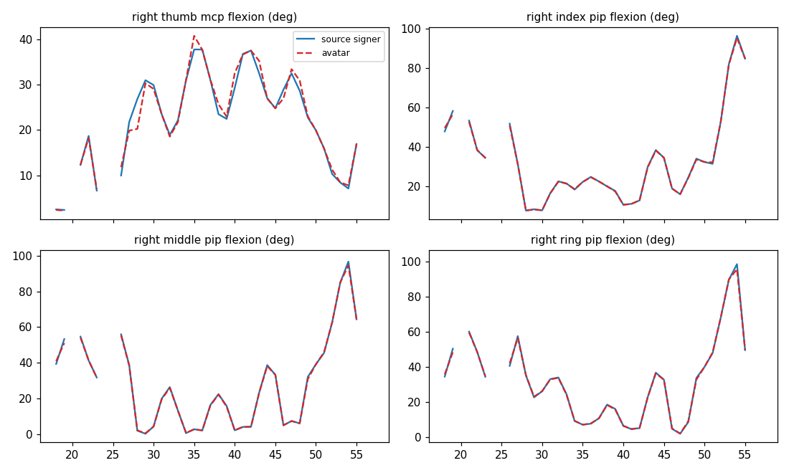
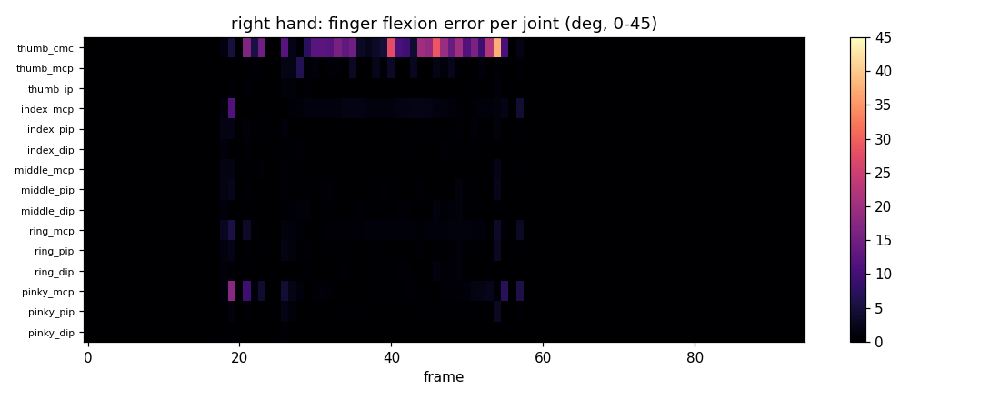
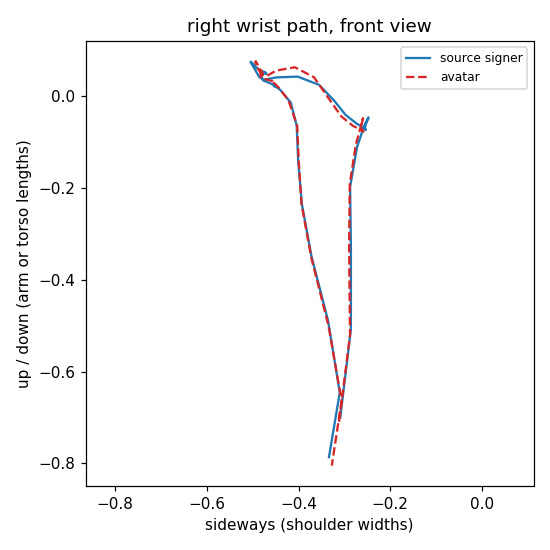
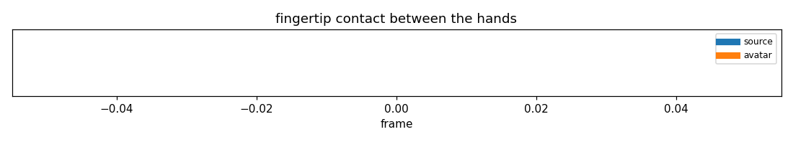

# Motion fidelity report: sugar

Source video: `references/dict_Sugar.mp4` · 95 frames at 25.00 fps

> **Geometric similarity only.** These numbers compare the avatar with the landmarks extracted from
> the source video. They cannot show whether the signing is correct ISL. Only a qualified ISL
> interpreter can approve a sign.

## Status

| Check | Result |
| --- | --- |
| license_status | granted |
| motion_qc | pass |
| interpreter_review | not_reviewed |

## Geometric check: PASS

Each limit is checked on its own; there is no overall percentage.

| Check | Value | Limit | Result |
| --- | --- | --- | --- |
| right finger flexion median (deg) | 0.207 | ≤ 5.0 | pass |
| right finger flexion p90 (deg) | 2.196 | ≤ 15.0 | pass |
| right palm orientation median (deg) | 0.287 | ≤ 10.0 | pass |
| right palm orientation p90 (deg) | 1.124 | ≤ 25.0 | pass |
| right wrist position median | 0.008 | ≤ 0.1 | pass |

## Hands

### Right hand (36 frames compared, data: world)

Left out of the hand-shape comparison: 2 rest pose, 4 depth flip, 4 image only (frames the avatar deliberately does not copy; see MOTION_VALIDATION.md).

| Measure | Median | 90th percentile | Max |
| --- | --- | --- | --- |
| Finger joint flexion error | 0.207° | 2.196° | 37.569° |
| Finger spread error | 0.211° | 7.146° | 23.764° |
| Palm orientation error (vs chest) | 0.287° | 1.124° | 4.21° |
| Wrist position error (body-relative) | 0.008 | 0.015 | 0.021 |
| Elbow position error (body-relative) | 0.074 | 0.116 | 0.226 |

Hand shape overall: **close** (median joint error 0.207°).

| Joint | Median error | 90th percentile |
| --- | --- | --- |
| thumb_cmc | 12.07° | 22.108° |
| thumb_mcp | 0.376° | 2.744° |
| thumb_ip | 0.047° | 0.586° |
| index_mcp | 1.278° | 1.787° |
| index_pip | 0.151° | 0.979° |
| index_dip | 0.1° | 0.363° |
| middle_mcp | 0.049° | 0.471° |
| middle_pip | 0.102° | 1.223° |
| middle_dip | 0.22° | 0.852° |
| ring_mcp | 0.802° | 3.054° |
| ring_pip | 0.192° | 1.26° |
| ring_dip | 0.147° | 0.698° |
| pinky_mcp | 0.605° | 5.696° |
| pinky_pip | 0.106° | 0.988° |
| pinky_dip | 0.039° | 0.168° |

Wrist speed correlation (original timing): 0.999
DTW diagnostic: original-time mean wrist error 0.009, time-aligned 0.009, median shift 0 frames (the original timing is kept; DTW is for diagnosis only).

## Contact between the hands

Source frames with fingertip contact: 0; avatar: 0; matching: 0; avatar contact not in the source: 0; source contact missing on the avatar: 0.

## Face

Shape-key values vs source expression scores: median difference 0.0 (this checks the baking path; whether each expression LOOKS right needs the face renders from `tools/facial_validator.py` and the interpreter).

## Images

