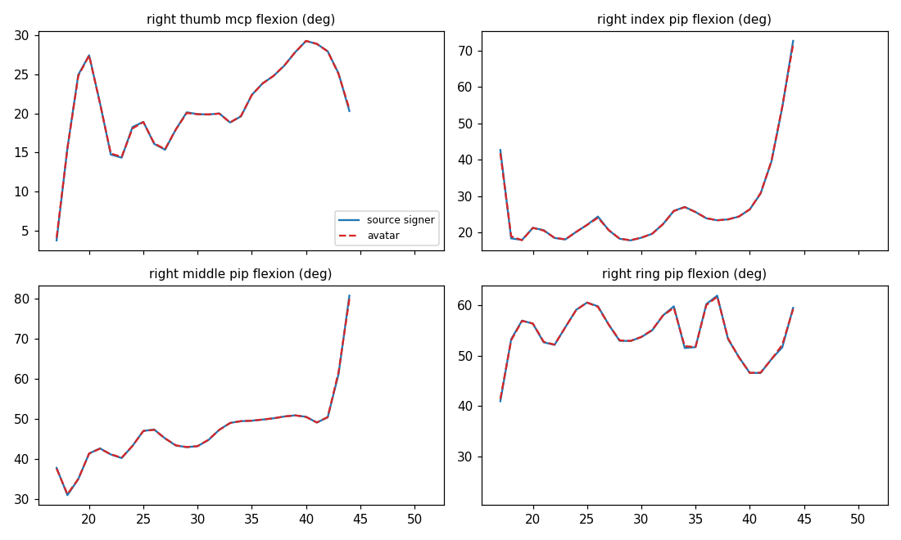
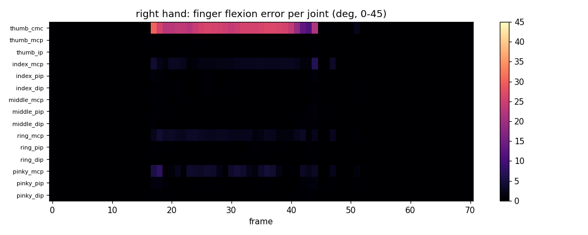
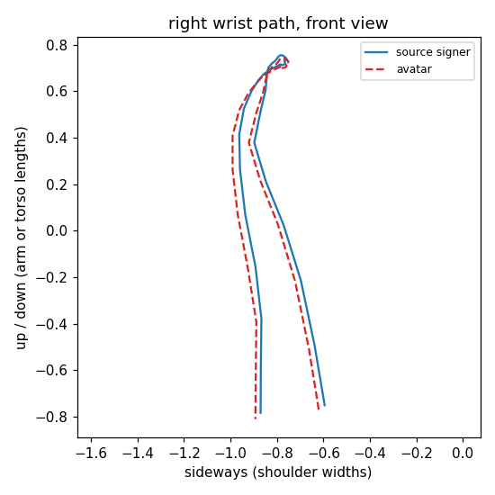

# Motion fidelity report: sun

Source video: `references/dict_Sun.mp4` · 71 frames at 25.00 fps

> **Geometric similarity only.** These numbers compare the avatar with the landmarks extracted from
> the source video. They cannot show whether the signing is correct ISL. Only a qualified ISL
> interpreter can approve a sign.

## Status

| Check | Result |
| --- | --- |
| license_status | granted |
| motion_qc | pass |
| interpreter_review | not_reviewed |

## Geometric check: PASS

Each limit is checked on its own; there is no overall percentage.

| Check | Value | Limit | Result |
| --- | --- | --- | --- |
| right finger flexion median (deg) | 0.075 | ≤ 5.0 | pass |
| right finger flexion p90 (deg) | 3.35 | ≤ 15.0 | pass |
| right palm orientation median (deg) | 0.222 | ≤ 10.0 | pass |
| right palm orientation p90 (deg) | 0.585 | ≤ 25.0 | pass |
| right wrist position median | 0.014 | ≤ 0.1 | pass |

## Hands

### Right hand (30 frames compared, data: world)

Left out of the hand-shape comparison: 3 image only, 2 depth flip (frames the avatar deliberately does not copy; see MOTION_VALIDATION.md).

| Measure | Median | 90th percentile | Max |
| --- | --- | --- | --- |
| Finger joint flexion error | 0.075° | 3.35° | 30.119° |
| Finger spread error | 0.505° | 1.456° | 9.485° |
| Palm orientation error (vs chest) | 0.222° | 0.585° | 0.809° |
| Wrist position error (body-relative) | 0.014 | 0.032 | 0.036 |
| Elbow position error (body-relative) | 0.102 | 0.122 | 0.13 |

Hand shape overall: **close** (median joint error 0.075°).

| Joint | Median error | 90th percentile |
| --- | --- | --- |
| thumb_cmc | 25.001° | 26.589° |
| thumb_mcp | 0.043° | 0.184° |
| thumb_ip | 0.04° | 0.147° |
| index_mcp | 2.221° | 3.35° |
| index_pip | 0.05° | 0.567° |
| index_dip | 0.062° | 0.277° |
| middle_mcp | 0.053° | 0.314° |
| middle_pip | 0.026° | 0.29° |
| middle_dip | 0.021° | 0.358° |
| ring_mcp | 2.519° | 3.315° |
| ring_pip | 0.075° | 0.365° |
| ring_dip | 0.019° | 0.132° |
| pinky_mcp | 2.997° | 4.544° |
| pinky_pip | 0.096° | 1.255° |
| pinky_dip | 0.03° | 0.285° |

Wrist speed correlation (original timing): 0.999
DTW diagnostic: original-time mean wrist error 0.019, time-aligned 0.019, median shift 0 frames (the original timing is kept; DTW is for diagnosis only).

## Contact between the hands

Source frames with fingertip contact: 0; avatar: 0; matching: 0; avatar contact not in the source: 0; source contact missing on the avatar: 0.

## Face

Shape-key values vs source expression scores: median difference 0.0 (this checks the baking path; whether each expression LOOKS right needs the face renders from `tools/facial_validator.py` and the interpreter).

## Images

