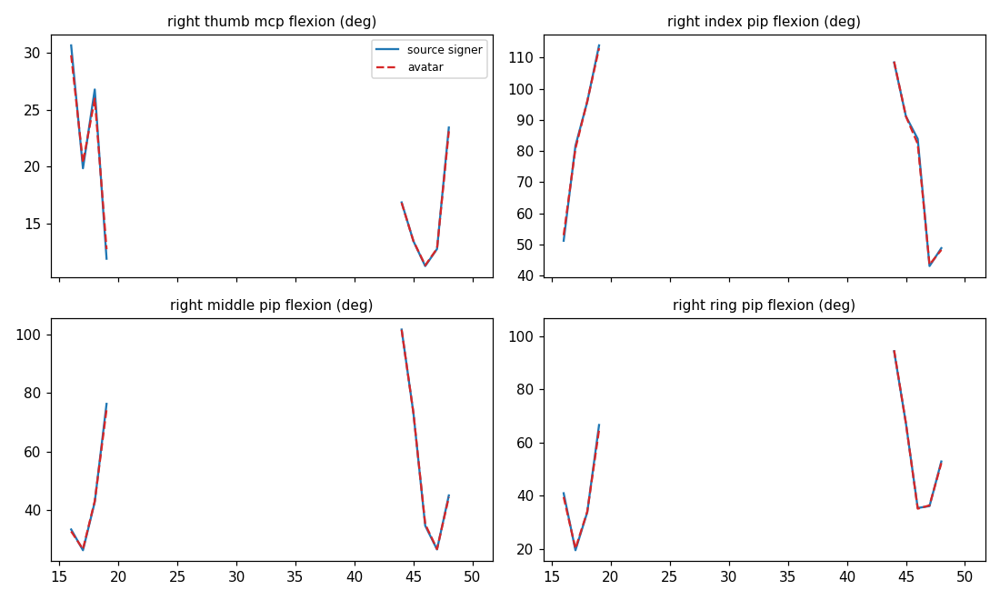
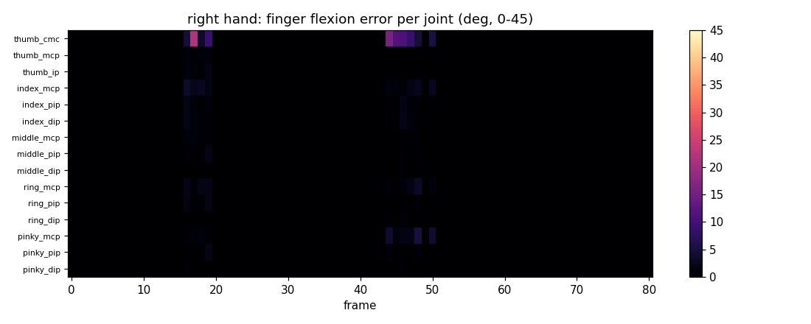
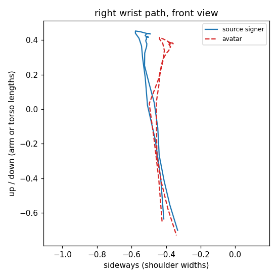

# Motion fidelity report: water

Source video: `references/dict_Water.mp4` · 81 frames at 25.00 fps

> **Geometric similarity only.** These numbers compare the avatar with the landmarks extracted from
> the source video. They cannot show whether the signing is correct ISL. Only a qualified ISL
> interpreter can approve a sign.

## Status

| Check | Result |
| --- | --- |
| license_status | granted |
| motion_qc | pass |
| interpreter_review | not_reviewed |

## Geometric check: FAIL

Each limit is checked on its own; there is no overall percentage.

| Check | Value | Limit | Result |
| --- | --- | --- | --- |
| right finger flexion median (deg) | 0.438 | ≤ 5.0 | pass |
| right finger flexion p90 (deg) | 3.288 | ≤ 15.0 | pass |
| right palm orientation median (deg) | 0.326 | ≤ 10.0 | pass |
| right palm orientation p90 (deg) | 1.297 | ≤ 25.0 | pass |
| right wrist position median | 0.132 | ≤ 0.1 | FAIL |

## Hands

### Right hand (10 frames compared, data: world)

Left out of the hand-shape comparison: 2 rest pose, 2 image only, 23 impossible bend (frames the avatar deliberately does not copy; see MOTION_VALIDATION.md).

| Measure | Median | 90th percentile | Max |
| --- | --- | --- | --- |
| Finger joint flexion error | 0.438° | 3.288° | 21.708° |
| Finger spread error | 0.635° | 4.689° | 39.327° |
| Palm orientation error (vs chest) | 0.326° | 1.297° | 1.297° |
| Wrist position error (body-relative) | 0.132 | 0.145 | 0.148 |
| Elbow position error (body-relative) | 0.186 | 0.204 | 0.223 |

Hand shape overall: **close** (median joint error 0.438°).

| Joint | Median error | 90th percentile |
| --- | --- | --- |
| thumb_cmc | 9.091° | 21.708° |
| thumb_mcp | 0.331° | 0.869° |
| thumb_ip | 0.297° | 1.668° |
| index_mcp | 2.219° | 3.655° |
| index_pip | 0.569° | 1.787° |
| index_dip | 0.593° | 2.027° |
| middle_mcp | 0.393° | 0.885° |
| middle_pip | 0.381° | 1.858° |
| middle_dip | 0.088° | 0.494° |
| ring_mcp | 1.67° | 3.288° |
| ring_pip | 0.306° | 1.797° |
| ring_dip | 0.098° | 0.773° |
| pinky_mcp | 1.443° | 4.947° |
| pinky_pip | 0.305° | 1.815° |
| pinky_dip | 0.093° | 0.551° |

Wrist speed correlation (original timing): 0.997
DTW diagnostic: original-time mean wrist error 0.099, time-aligned 0.099, median shift 0 frames (the original timing is kept; DTW is for diagnosis only).

## Contact between the hands

Source frames with fingertip contact: 0; avatar: 0; matching: 0; avatar contact not in the source: 0; source contact missing on the avatar: 0.

## Face

Shape-key values vs source expression scores: median difference 0.0 (this checks the baking path; whether each expression LOOKS right needs the face renders from `tools/facial_validator.py` and the interpreter).

## Images

