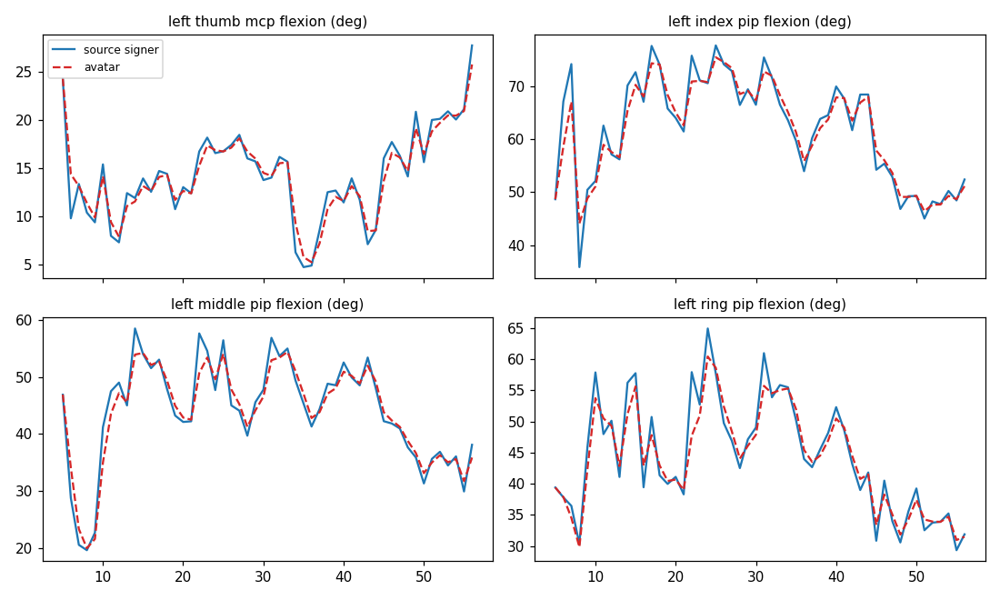
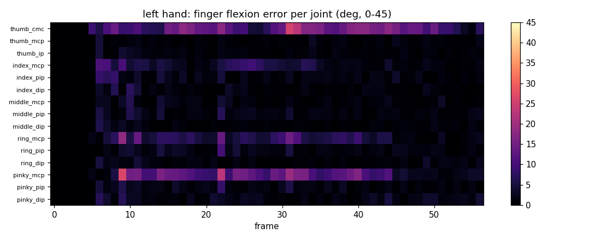
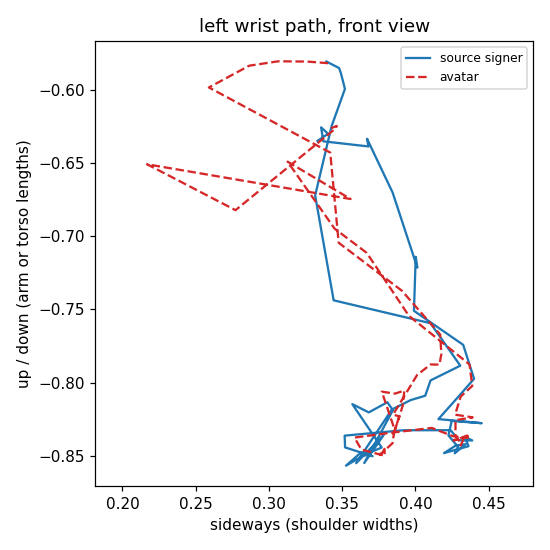
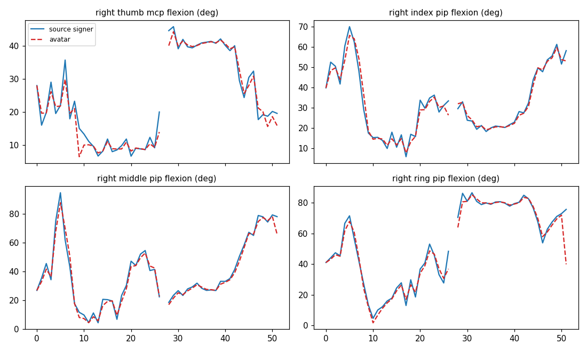
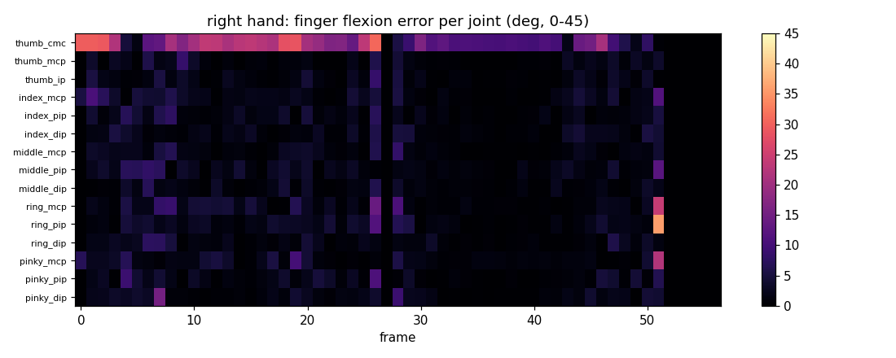
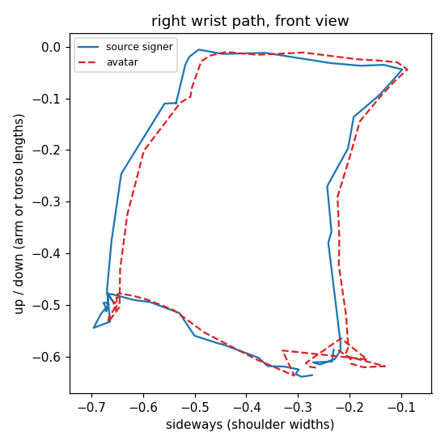
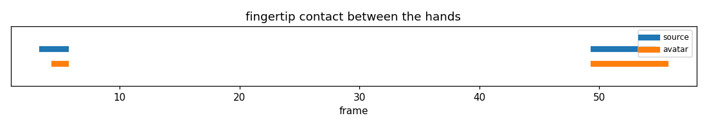

# Motion fidelity report: carbon_dioxide_sign_2

Source video: `references/dict_Carbon_Dioxide_(Sign_2).mp4` · 57 frames at 25.00 fps

> **Geometric similarity only.** These numbers compare the avatar with the landmarks extracted from
> the source video. They cannot show whether the signing is correct ISL. Only a qualified ISL
> interpreter can approve a sign.

## Status

| Check | Result |
| --- | --- |
| license_status | granted |
| motion_qc | pass |
| interpreter_review | not_reviewed |

## Geometric check: PASS

Each limit is checked on its own; there is no overall percentage.

| Check | Value | Limit | Result |
| --- | --- | --- | --- |
| left finger flexion median (deg) | 1.334 | ≤ 5.0 | pass |
| left finger flexion p90 (deg) | 9.018 | ≤ 15.0 | pass |
| left palm orientation median (deg) | 1.762 | ≤ 10.0 | pass |
| left palm orientation p90 (deg) | 6.47 | ≤ 25.0 | pass |
| left wrist position median | 0.021 | ≤ 0.1 | pass |
| right finger flexion median (deg) | 1.334 | ≤ 5.0 | pass |
| right finger flexion p90 (deg) | 6.657 | ≤ 15.0 | pass |
| right palm orientation median (deg) | 2.203 | ≤ 10.0 | pass |
| right palm orientation p90 (deg) | 6.952 | ≤ 25.0 | pass |
| right wrist position median | 0.035 | ≤ 0.1 | pass |
| contact frames missing on avatar (fraction) | 0.143 | ≤ 0.25 | pass |

## Hands

### Left hand (52 frames compared, data: world)

Left out of the hand-shape comparison: 5 image only (frames the avatar deliberately does not copy; see MOTION_VALIDATION.md).

| Measure | Median | 90th percentile | Max |
| --- | --- | --- | --- |
| Finger joint flexion error | 1.334° | 9.018° | 26.447° |
| Finger spread error | 1.483° | 5.349° | 17.515° |
| Palm orientation error (vs chest) | 1.762° | 6.47° | 14.832° |
| Wrist position error (body-relative) | 0.021 | 0.116 | 0.196 |
| Elbow position error (body-relative) | 0.158 | 0.264 | 0.274 |

Hand shape overall: **close** (median joint error 1.334°).

| Joint | Median error | 90th percentile |
| --- | --- | --- |
| thumb_cmc | 12.426° | 17.803° |
| thumb_mcp | 0.625° | 1.705° |
| thumb_ip | 0.773° | 1.756° |
| index_mcp | 2.761° | 7.787° |
| index_pip | 1.255° | 3.619° |
| index_dip | 0.561° | 2.634° |
| middle_mcp | 0.64° | 2.793° |
| middle_pip | 1.225° | 3.932° |
| middle_dip | 0.662° | 1.709° |
| ring_mcp | 5.001° | 9.244° |
| ring_pip | 1.452° | 3.527° |
| ring_dip | 0.893° | 2.228° |
| pinky_mcp | 9.847° | 16.089° |
| pinky_pip | 1.423° | 3.146° |
| pinky_dip | 1.466° | 3.8° |

Wrist speed correlation (original timing): 0.546
DTW diagnostic: original-time mean wrist error 0.041, time-aligned 0.039, median shift 0 frames (the original timing is kept; DTW is for diagnosis only).

### Right hand (51 frames compared, data: world)

Left out of the hand-shape comparison: 2 depth flip, 3 image only (frames the avatar deliberately does not copy; see MOTION_VALIDATION.md).

| Measure | Median | 90th percentile | Max |
| --- | --- | --- | --- |
| Finger joint flexion error | 1.334° | 6.657° | 35.79° |
| Finger spread error | 1.411° | 6.408° | 16.977° |
| Palm orientation error (vs chest) | 2.203° | 6.952° | 12.302° |
| Wrist position error (body-relative) | 0.035 | 0.121 | 0.194 |
| Elbow position error (body-relative) | 0.093 | 0.152 | 0.158 |

Hand shape overall: **close** (median joint error 1.334°).

| Joint | Median error | 90th percentile |
| --- | --- | --- |
| thumb_cmc | 14.047° | 28.041° |
| thumb_mcp | 0.902° | 3.631° |
| thumb_ip | 0.921° | 3.609° |
| index_mcp | 1.802° | 5.276° |
| index_pip | 1.111° | 4.854° |
| index_dip | 1.088° | 4.419° |
| middle_mcp | 1.088° | 3.573° |
| middle_pip | 1.554° | 4.289° |
| middle_dip | 0.839° | 3.454° |
| ring_mcp | 1.552° | 6.618° |
| ring_pip | 1.569° | 4.445° |
| ring_dip | 1.105° | 3.497° |
| pinky_mcp | 1.185° | 5.284° |
| pinky_pip | 0.858° | 4.431° |
| pinky_dip | 1.143° | 4.029° |

Wrist speed correlation (original timing): 0.709
DTW diagnostic: original-time mean wrist error 0.053, time-aligned 0.046, median shift 0 frames (the original timing is kept; DTW is for diagnosis only).

## Contact between the hands

Source frames with fingertip contact: 7; avatar: 7; matching: 6; avatar contact not in the source: 1; source contact missing on the avatar: 1.

## Face

Shape-key values vs source expression scores: median difference 0.0 (this checks the baking path; whether each expression LOOKS right needs the face renders from `tools/facial_validator.py` and the interpreter).

## Images

