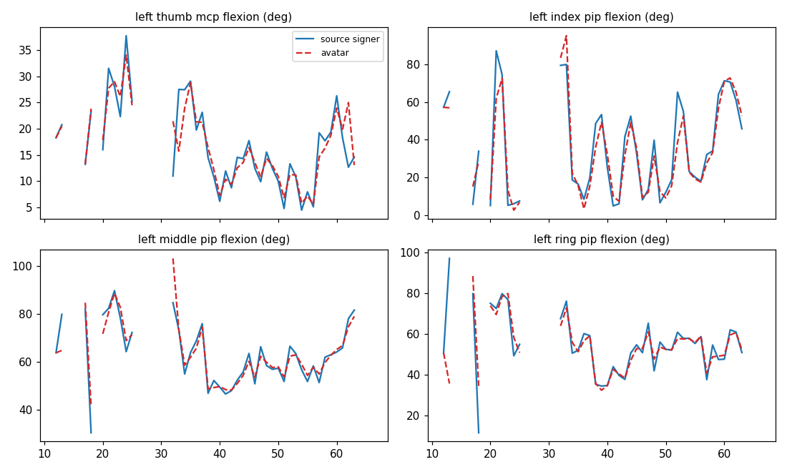
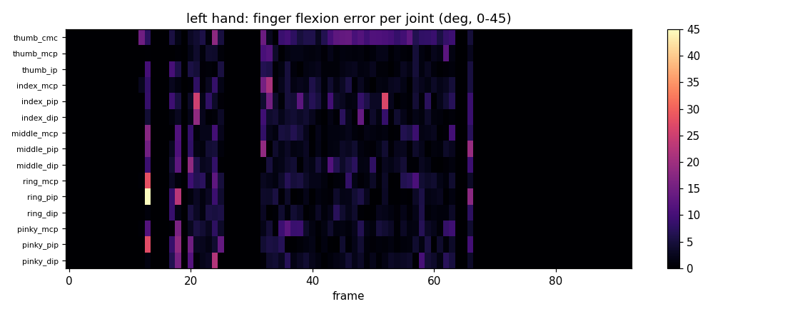
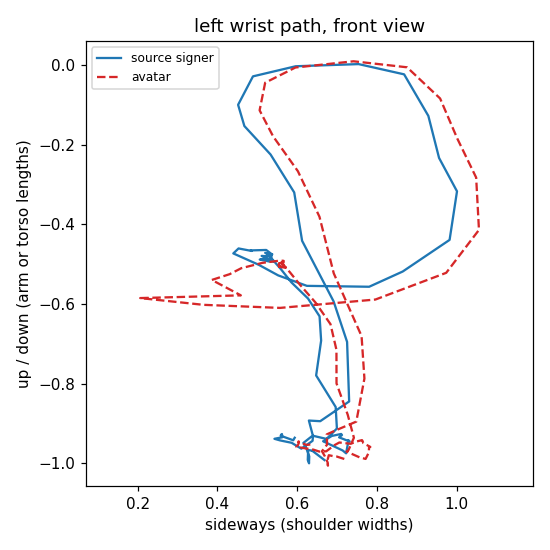
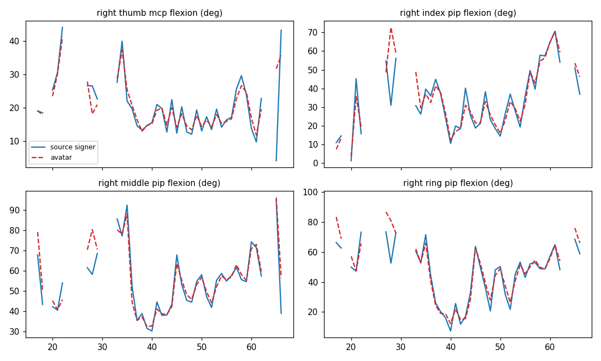
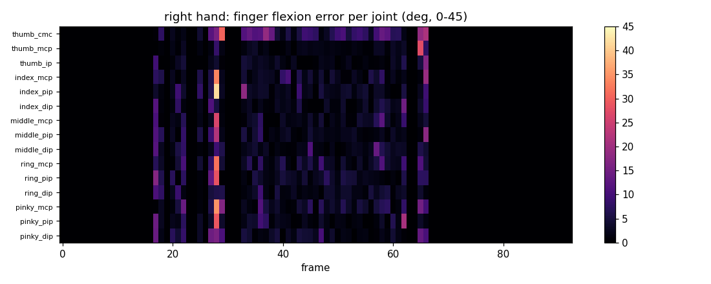
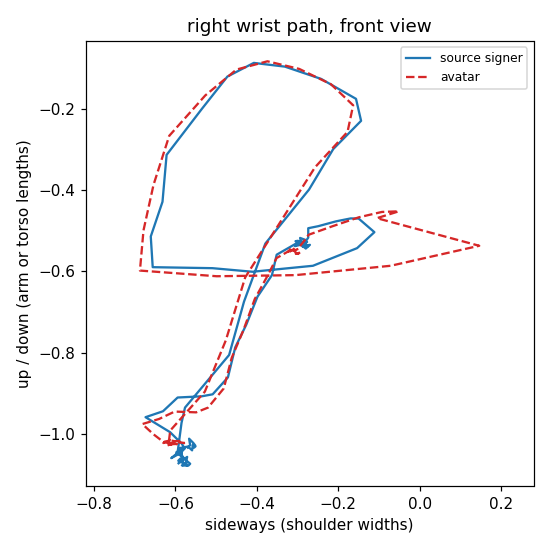
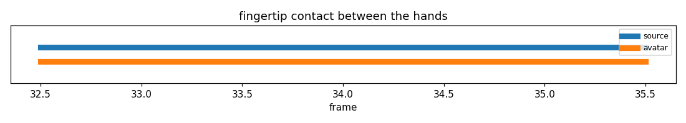

# Motion fidelity report: computer

Source video: `references/dict_Computer.mp4` · 93 frames at 25.00 fps

> **Geometric similarity only.** These numbers compare the avatar with the landmarks extracted from
> the source video. They cannot show whether the signing is correct ISL. Only a qualified ISL
> interpreter can approve a sign.

## Status

| Check | Result |
| --- | --- |
| license_status | granted |
| motion_qc | pass |
| interpreter_review | not_reviewed |

## Geometric check: PASS

Each limit is checked on its own; there is no overall percentage.

| Check | Value | Limit | Result |
| --- | --- | --- | --- |
| left finger flexion median (deg) | 2.387 | ≤ 5.0 | pass |
| left finger flexion p90 (deg) | 9.281 | ≤ 15.0 | pass |
| left palm orientation median (deg) | 2.989 | ≤ 10.0 | pass |
| left palm orientation p90 (deg) | 9.936 | ≤ 25.0 | pass |
| left wrist position median | 0.052 | ≤ 0.1 | pass |
| right finger flexion median (deg) | 2.59 | ≤ 5.0 | pass |
| right finger flexion p90 (deg) | 9.503 | ≤ 15.0 | pass |
| right palm orientation median (deg) | 2.971 | ≤ 10.0 | pass |
| right palm orientation p90 (deg) | 8.567 | ≤ 25.0 | pass |
| right wrist position median | 0.037 | ≤ 0.1 | pass |
| contact frames missing on avatar (fraction) | 0.0 | ≤ 0.25 | pass |

## Hands

### Left hand (43 frames compared, data: world)

Left out of the hand-shape comparison: 5 image only, 2 impossible bend (frames the avatar deliberately does not copy; see MOTION_VALIDATION.md).

| Measure | Median | 90th percentile | Max |
| --- | --- | --- | --- |
| Finger joint flexion error | 2.387° | 9.281° | 61.222° |
| Finger spread error | 1.89° | 10.961° | 87.36° |
| Palm orientation error (vs chest) | 2.989° | 9.936° | 40.768° |
| Wrist position error (body-relative) | 0.052 | 0.097 | 0.373 |
| Elbow position error (body-relative) | 0.228 | 0.281 | 0.331 |

Hand shape overall: **close** (median joint error 2.387°).

| Joint | Median error | 90th percentile |
| --- | --- | --- |
| thumb_cmc | 8.435° | 13.441° |
| thumb_mcp | 1.389° | 3.827° |
| thumb_ip | 1.456° | 5.809° |
| index_mcp | 2.466° | 7.86° |
| index_pip | 3.947° | 9.821° |
| index_dip | 2.263° | 8.49° |
| middle_mcp | 2.067° | 8.996° |
| middle_pip | 1.922° | 7.958° |
| middle_dip | 2.69° | 9.132° |
| ring_mcp | 3.22° | 8.103° |
| ring_pip | 2.027° | 8.618° |
| ring_dip | 1.948° | 5.784° |
| pinky_mcp | 3.131° | 9.281° |
| pinky_pip | 1.625° | 10.0° |
| pinky_dip | 2.713° | 7.139° |

Wrist speed correlation (original timing): 0.874
DTW diagnostic: original-time mean wrist error 0.061, time-aligned 0.058, median shift 0 frames (the original timing is kept; DTW is for diagnosis only).

### Right hand (41 frames compared, data: world)

Left out of the hand-shape comparison: 1 depth flip, 6 image only, 4 impossible bend (frames the avatar deliberately does not copy; see MOTION_VALIDATION.md).

| Measure | Median | 90th percentile | Max |
| --- | --- | --- | --- |
| Finger joint flexion error | 2.59° | 9.503° | 41.768° |
| Finger spread error | 1.589° | 7.238° | 40.577° |
| Palm orientation error (vs chest) | 2.971° | 8.567° | 18.506° |
| Wrist position error (body-relative) | 0.037 | 0.077 | 0.346 |
| Elbow position error (body-relative) | 0.088 | 0.108 | 0.176 |

Hand shape overall: **close** (median joint error 2.59°).

| Joint | Median error | 90th percentile |
| --- | --- | --- |
| thumb_cmc | 7.661° | 15.709° |
| thumb_mcp | 1.631° | 3.292° |
| thumb_ip | 1.648° | 4.714° |
| index_mcp | 2.778° | 7.82° |
| index_pip | 2.926° | 9.154° |
| index_dip | 2.065° | 7.879° |
| middle_mcp | 2.247° | 7.65° |
| middle_pip | 2.231° | 8.186° |
| middle_dip | 2.434° | 7.955° |
| ring_mcp | 3.469° | 9.543° |
| ring_pip | 3.101° | 7.459° |
| ring_dip | 2.606° | 6.075° |
| pinky_mcp | 3.739° | 11.575° |
| pinky_pip | 1.738° | 7.625° |
| pinky_dip | 3.145° | 10.608° |

Wrist speed correlation (original timing): 0.854
DTW diagnostic: original-time mean wrist error 0.049, time-aligned 0.045, median shift 0 frames (the original timing is kept; DTW is for diagnosis only).

## Contact between the hands

Source frames with fingertip contact: 3; avatar: 3; matching: 3; avatar contact not in the source: 0; source contact missing on the avatar: 0.

## Face

Shape-key values vs source expression scores: median difference 0.0 (this checks the baking path; whether each expression LOOKS right needs the face renders from `tools/facial_validator.py` and the interpreter).

## Images

