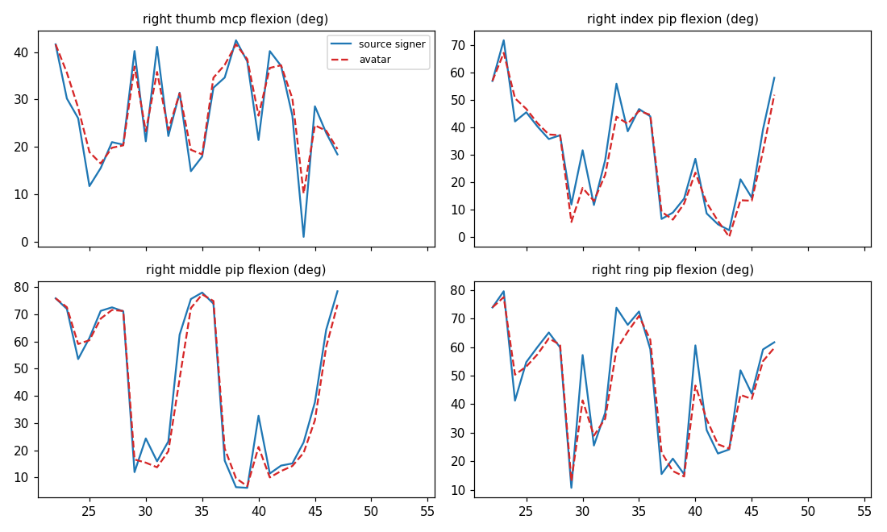
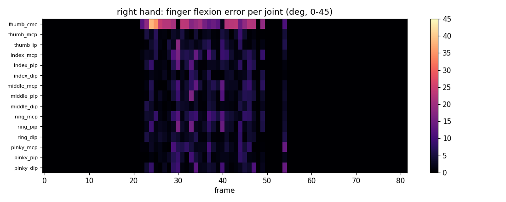
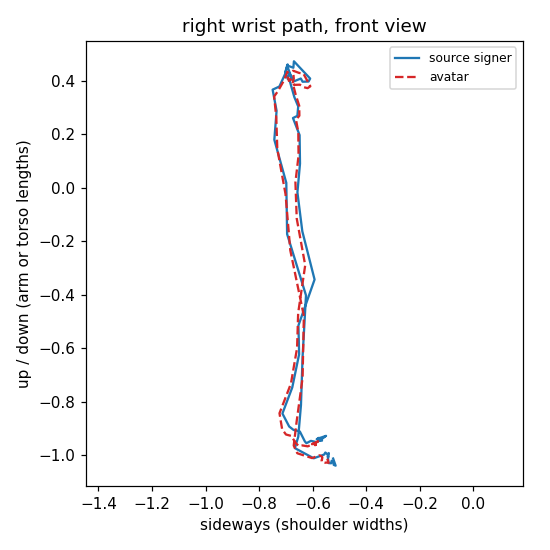

# Motion fidelity report: electricity

Source video: `references/dict_Electricity.mp4` · 82 frames at 25.00 fps

> **Geometric similarity only.** These numbers compare the avatar with the landmarks extracted from
> the source video. They cannot show whether the signing is correct ISL. Only a qualified ISL
> interpreter can approve a sign.

## Status

| Check | Result |
| --- | --- |
| license_status | granted |
| motion_qc | pass |
| interpreter_review | not_reviewed |

## Geometric check: PASS

Each limit is checked on its own; there is no overall percentage.

| Check | Value | Limit | Result |
| --- | --- | --- | --- |
| right finger flexion median (deg) | 2.846 | ≤ 5.0 | pass |
| right finger flexion p90 (deg) | 11.502 | ≤ 15.0 | pass |
| right palm orientation median (deg) | 3.698 | ≤ 10.0 | pass |
| right palm orientation p90 (deg) | 9.662 | ≤ 25.0 | pass |
| right wrist position median | 0.03 | ≤ 0.1 | pass |

## Hands

### Right hand (28 frames compared, data: world)

Left out of the hand-shape comparison: 2 image only (frames the avatar deliberately does not copy; see MOTION_VALIDATION.md).

| Measure | Median | 90th percentile | Max |
| --- | --- | --- | --- |
| Finger joint flexion error | 2.846° | 11.502° | 38.006° |
| Finger spread error | 2.383° | 7.243° | 21.355° |
| Palm orientation error (vs chest) | 3.698° | 9.662° | 23.713° |
| Wrist position error (body-relative) | 0.03 | 0.062 | 0.134 |
| Elbow position error (body-relative) | 0.114 | 0.174 | 0.256 |

Hand shape overall: **close** (median joint error 2.846°).

| Joint | Median error | 90th percentile |
| --- | --- | --- |
| thumb_cmc | 20.396° | 24.561° |
| thumb_mcp | 2.119° | 5.449° |
| thumb_ip | 2.488° | 7.519° |
| index_mcp | 5.287° | 11.502° |
| index_pip | 2.574° | 8.455° |
| index_dip | 1.684° | 6.323° |
| middle_mcp | 4.129° | 10.42° |
| middle_pip | 3.321° | 8.9° |
| middle_dip | 1.785° | 5.58° |
| ring_mcp | 5.103° | 10.55° |
| ring_pip | 3.24° | 14.075° |
| ring_dip | 2.639° | 5.907° |
| pinky_mcp | 2.202° | 9.784° |
| pinky_pip | 1.798° | 7.794° |
| pinky_dip | 2.402° | 11.162° |

Wrist speed correlation (original timing): 0.973
DTW diagnostic: original-time mean wrist error 0.038, time-aligned 0.037, median shift 0 frames (the original timing is kept; DTW is for diagnosis only).

## Contact between the hands

Source frames with fingertip contact: 0; avatar: 0; matching: 0; avatar contact not in the source: 0; source contact missing on the avatar: 0.

## Face

Shape-key values vs source expression scores: median difference 0.0 (this checks the baking path; whether each expression LOOKS right needs the face renders from `tools/facial_validator.py` and the interpreter).

## Images

