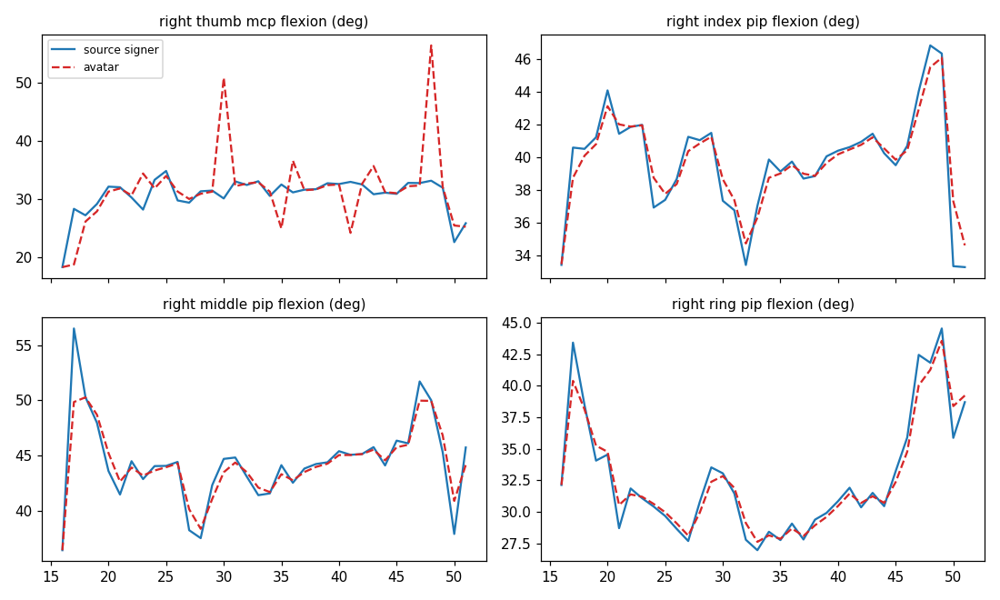
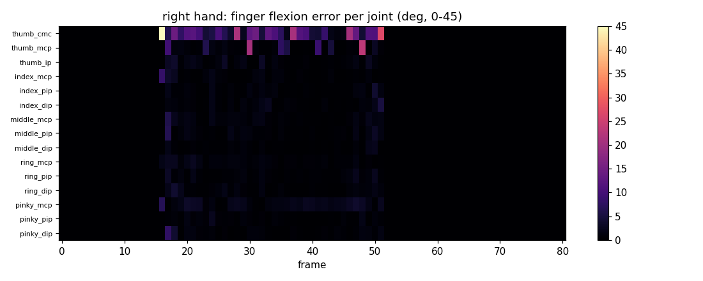
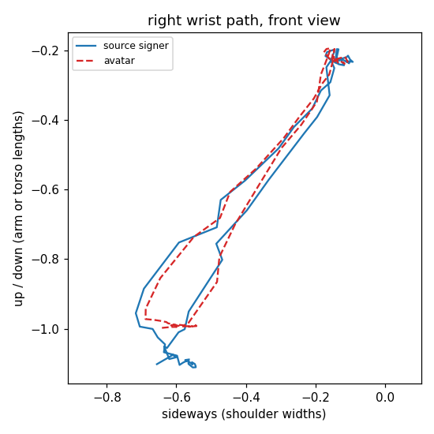

# Motion fidelity report: food

Source video: `references/dict_Food.mp4` · 81 frames at 25.00 fps

> **Geometric similarity only.** These numbers compare the avatar with the landmarks extracted from
> the source video. They cannot show whether the signing is correct ISL. Only a qualified ISL
> interpreter can approve a sign.

## Status

| Check | Result |
| --- | --- |
| license_status | granted |
| motion_qc | pass |
| interpreter_review | not_reviewed |

## Geometric check: PASS

Each limit is checked on its own; there is no overall percentage.

| Check | Value | Limit | Result |
| --- | --- | --- | --- |
| right finger flexion median (deg) | 0.56 | ≤ 5.0 | pass |
| right finger flexion p90 (deg) | 3.036 | ≤ 15.0 | pass |
| right palm orientation median (deg) | 0.991 | ≤ 10.0 | pass |
| right palm orientation p90 (deg) | 3.272 | ≤ 25.0 | pass |
| right wrist position median | 0.03 | ≤ 0.1 | pass |

## Hands

### Right hand (36 frames compared, data: world)

| Measure | Median | 90th percentile | Max |
| --- | --- | --- | --- |
| Finger joint flexion error | 0.56° | 3.036° | 50.286° |
| Finger spread error | 0.547° | 4.701° | 24.288° |
| Palm orientation error (vs chest) | 0.991° | 3.272° | 5.965° |
| Wrist position error (body-relative) | 0.03 | 0.111 | 0.129 |
| Elbow position error (body-relative) | 0.069 | 0.131 | 0.194 |

Hand shape overall: **close** (median joint error 0.56°).

| Joint | Median error | 90th percentile |
| --- | --- | --- |
| thumb_cmc | 10.207° | 21.058° |
| thumb_mcp | 0.636° | 8.807° |
| thumb_ip | 0.474° | 2.841° |
| index_mcp | 0.335° | 1.896° |
| index_pip | 0.364° | 1.331° |
| index_dip | 0.512° | 1.823° |
| middle_mcp | 0.758° | 1.908° |
| middle_pip | 0.454° | 1.737° |
| middle_dip | 0.269° | 0.899° |
| ring_mcp | 0.743° | 1.902° |
| ring_pip | 0.441° | 1.84° |
| ring_dip | 0.437° | 1.834° |
| pinky_mcp | 2.029° | 3.065° |
| pinky_pip | 0.459° | 1.009° |
| pinky_dip | 0.504° | 1.382° |

Wrist speed correlation (original timing): 0.963
DTW diagnostic: original-time mean wrist error 0.048, time-aligned 0.046, median shift 0 frames (the original timing is kept; DTW is for diagnosis only).

## Contact between the hands

Source frames with fingertip contact: 0; avatar: 0; matching: 0; avatar contact not in the source: 0; source contact missing on the avatar: 0.

## Face

Shape-key values vs source expression scores: median difference 0.0 (this checks the baking path; whether each expression LOOKS right needs the face renders from `tools/facial_validator.py` and the interpreter).

## Images

