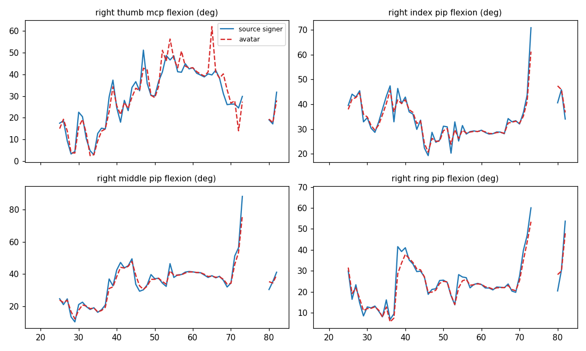
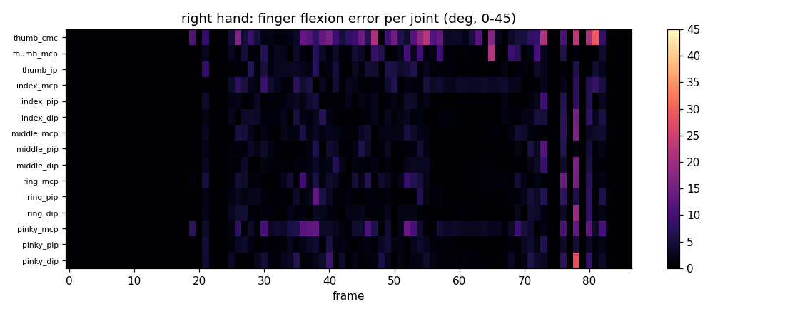
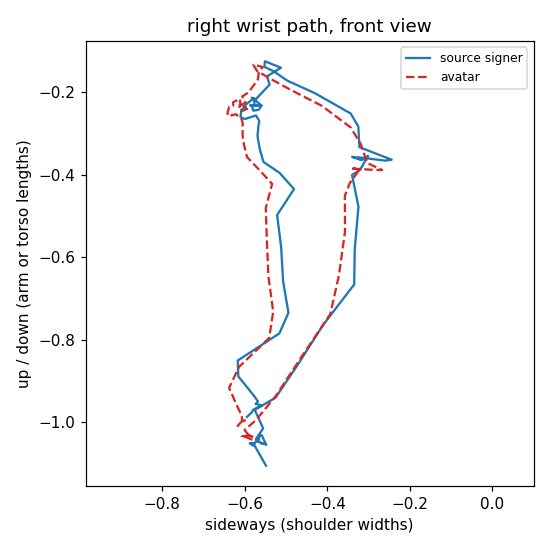

# Motion fidelity report: leaf

Source video: `references/dict_Leaf.mp4` · 87 frames at 25.00 fps

> **Geometric similarity only.** These numbers compare the avatar with the landmarks extracted from
> the source video. They cannot show whether the signing is correct ISL. Only a qualified ISL
> interpreter can approve a sign.

## Status

| Check | Result |
| --- | --- |
| license_status | granted |
| motion_qc | pass |
| interpreter_review | not_reviewed |

## Geometric check: PASS

Each limit is checked on its own; there is no overall percentage.

| Check | Value | Limit | Result |
| --- | --- | --- | --- |
| right finger flexion median (deg) | 1.558 | ≤ 5.0 | pass |
| right finger flexion p90 (deg) | 6.851 | ≤ 15.0 | pass |
| right palm orientation median (deg) | 3.189 | ≤ 10.0 | pass |
| right palm orientation p90 (deg) | 9.531 | ≤ 25.0 | pass |
| right wrist position median | 0.037 | ≤ 0.1 | pass |

## Hands

### Right hand (56 frames compared, data: world)

Left out of the hand-shape comparison: 2 depth flip, 3 image only, 2 impossible bend (frames the avatar deliberately does not copy; see MOTION_VALIDATION.md).

| Measure | Median | 90th percentile | Max |
| --- | --- | --- | --- |
| Finger joint flexion error | 1.558° | 6.851° | 29.232° |
| Finger spread error | 1.674° | 7.596° | 28.257° |
| Palm orientation error (vs chest) | 3.189° | 9.531° | 16.348° |
| Wrist position error (body-relative) | 0.037 | 0.056 | 0.105 |
| Elbow position error (body-relative) | 0.07 | 0.1 | 0.136 |

Hand shape overall: **close** (median joint error 1.558°).

| Joint | Median error | 90th percentile |
| --- | --- | --- |
| thumb_cmc | 8.388° | 21.12° |
| thumb_mcp | 1.543° | 9.064° |
| thumb_ip | 1.409° | 5.921° |
| index_mcp | 2.629° | 6.588° |
| index_pip | 1.101° | 3.994° |
| index_dip | 1.275° | 5.123° |
| middle_mcp | 1.644° | 4.626° |
| middle_pip | 0.848° | 4.872° |
| middle_dip | 0.714° | 3.439° |
| ring_mcp | 1.486° | 6.648° |
| ring_pip | 0.838° | 6.212° |
| ring_dip | 1.07° | 3.321° |
| pinky_mcp | 3.487° | 11.979° |
| pinky_pip | 1.255° | 4.058° |
| pinky_dip | 1.531° | 6.1° |

Wrist speed correlation (original timing): 0.962
DTW diagnostic: original-time mean wrist error 0.041, time-aligned 0.039, median shift 0 frames (the original timing is kept; DTW is for diagnosis only).

## Contact between the hands

Source frames with fingertip contact: 0; avatar: 0; matching: 0; avatar contact not in the source: 0; source contact missing on the avatar: 0.

## Face

Shape-key values vs source expression scores: median difference 0.0 (this checks the baking path; whether each expression LOOKS right needs the face renders from `tools/facial_validator.py` and the interpreter).

## Images

