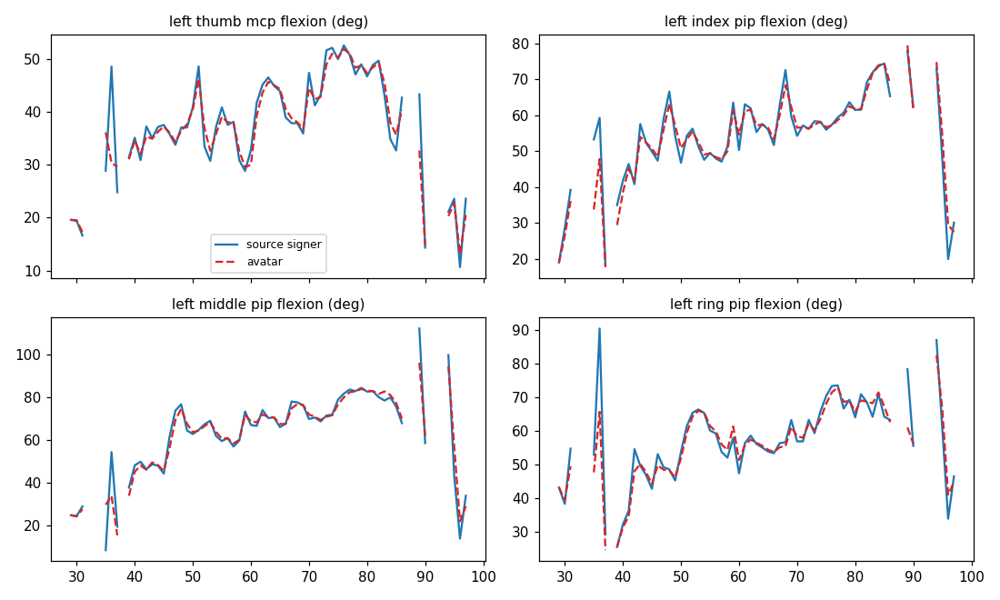
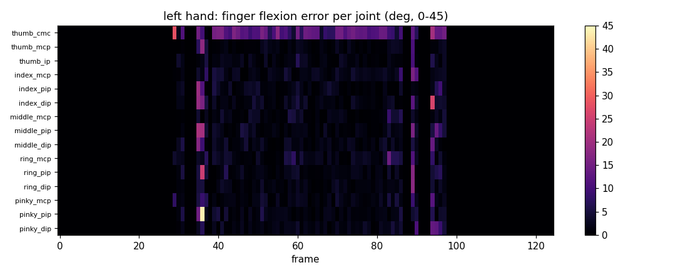
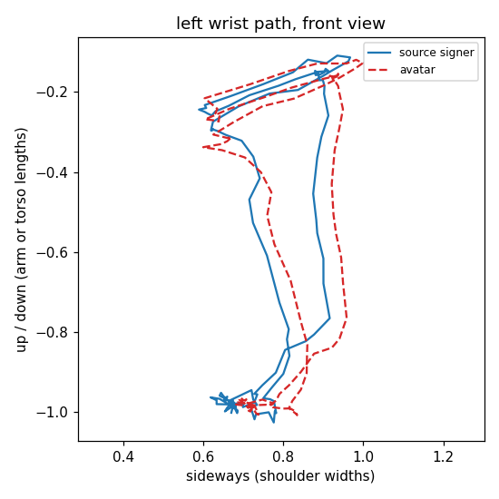
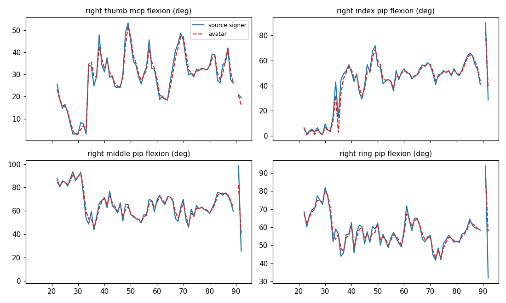
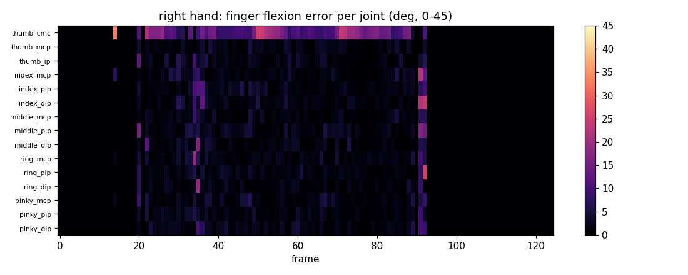
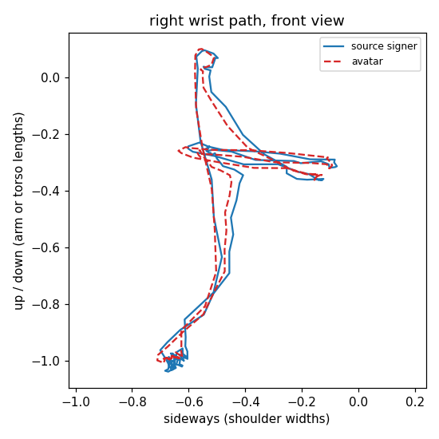
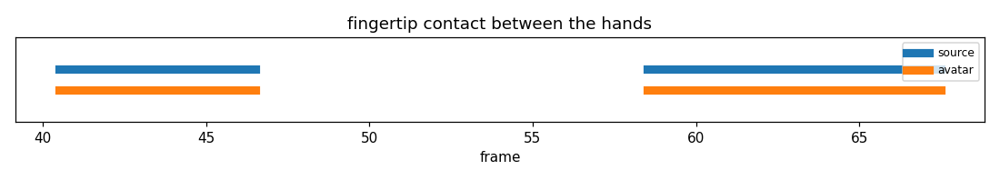

# Motion fidelity report: magnet

Source video: `references/dict_Magnet.mp4` · 125 frames at 25.00 fps

> **Geometric similarity only.** These numbers compare the avatar with the landmarks extracted from
> the source video. They cannot show whether the signing is correct ISL. Only a qualified ISL
> interpreter can approve a sign.

## Status

| Check | Result |
| --- | --- |
| license_status | granted |
| motion_qc | pass |
| interpreter_review | not_reviewed |

## Geometric check: PASS

Each limit is checked on its own; there is no overall percentage.

| Check | Value | Limit | Result |
| --- | --- | --- | --- |
| left finger flexion median (deg) | 1.635 | ≤ 5.0 | pass |
| left finger flexion p90 (deg) | 7.58 | ≤ 15.0 | pass |
| left palm orientation median (deg) | 2.247 | ≤ 10.0 | pass |
| left palm orientation p90 (deg) | 6.059 | ≤ 25.0 | pass |
| left wrist position median | 0.053 | ≤ 0.1 | pass |
| right finger flexion median (deg) | 1.39 | ≤ 5.0 | pass |
| right finger flexion p90 (deg) | 6.78 | ≤ 15.0 | pass |
| right palm orientation median (deg) | 1.982 | ≤ 10.0 | pass |
| right palm orientation p90 (deg) | 4.473 | ≤ 25.0 | pass |
| right wrist position median | 0.036 | ≤ 0.1 | pass |
| contact frames missing on avatar (fraction) | 0.0 | ≤ 0.25 | pass |

## Hands

### Left hand (60 frames compared, data: world)

Left out of the hand-shape comparison: 1 depth flip, 5 image only (frames the avatar deliberately does not copy; see MOTION_VALIDATION.md).

| Measure | Median | 90th percentile | Max |
| --- | --- | --- | --- |
| Finger joint flexion error | 1.635° | 7.58° | 43.502° |
| Finger spread error | 1.084° | 5.684° | 47.682° |
| Palm orientation error (vs chest) | 2.247° | 6.059° | 31.426° |
| Wrist position error (body-relative) | 0.053 | 0.088 | 0.128 |
| Elbow position error (body-relative) | 0.155 | 0.248 | 0.382 |

Hand shape overall: **close** (median joint error 1.635°).

| Joint | Median error | 90th percentile |
| --- | --- | --- |
| thumb_cmc | 12.18° | 15.944° |
| thumb_mcp | 0.858° | 3.074° |
| thumb_ip | 1.238° | 3.233° |
| index_mcp | 2.081° | 4.603° |
| index_pip | 1.325° | 4.317° |
| index_dip | 1.533° | 5.17° |
| middle_mcp | 1.343° | 4.162° |
| middle_pip | 1.442° | 5.346° |
| middle_dip | 1.502° | 4.408° |
| ring_mcp | 2.378° | 6.467° |
| ring_pip | 1.381° | 5.275° |
| ring_dip | 1.163° | 3.593° |
| pinky_mcp | 1.619° | 5.3° |
| pinky_pip | 1.567° | 5.302° |
| pinky_dip | 1.978° | 4.907° |

Wrist speed correlation (original timing): 0.913
DTW diagnostic: original-time mean wrist error 0.059, time-aligned 0.057, median shift 0 frames (the original timing is kept; DTW is for diagnosis only).

### Right hand (72 frames compared, data: world)

Left out of the hand-shape comparison: 4 image only, 1 impossible bend (frames the avatar deliberately does not copy; see MOTION_VALIDATION.md).

| Measure | Median | 90th percentile | Max |
| --- | --- | --- | --- |
| Finger joint flexion error | 1.39° | 6.78° | 33.309° |
| Finger spread error | 1.285° | 5.082° | 23.615° |
| Palm orientation error (vs chest) | 1.982° | 4.473° | 13.714° |
| Wrist position error (body-relative) | 0.036 | 0.077 | 0.121 |
| Elbow position error (body-relative) | 0.071 | 0.11 | 0.139 |

Hand shape overall: **close** (median joint error 1.39°).

| Joint | Median error | 90th percentile |
| --- | --- | --- |
| thumb_cmc | 12.316° | 20.553° |
| thumb_mcp | 1.445° | 3.457° |
| thumb_ip | 1.057° | 4.412° |
| index_mcp | 1.393° | 5.932° |
| index_pip | 1.538° | 4.331° |
| index_dip | 1.304° | 4.75° |
| middle_mcp | 1.093° | 3.367° |
| middle_pip | 1.597° | 4.799° |
| middle_dip | 1.109° | 4.052° |
| ring_mcp | 1.447° | 4.545° |
| ring_pip | 1.256° | 3.798° |
| ring_dip | 0.956° | 2.697° |
| pinky_mcp | 1.233° | 4.775° |
| pinky_pip | 1.244° | 3.691° |
| pinky_dip | 1.68° | 4.231° |

Wrist speed correlation (original timing): 0.935
DTW diagnostic: original-time mean wrist error 0.041, time-aligned 0.038, median shift 0 frames (the original timing is kept; DTW is for diagnosis only).

## Contact between the hands

Source frames with fingertip contact: 15; avatar: 15; matching: 15; avatar contact not in the source: 0; source contact missing on the avatar: 0.

## Face

Shape-key values vs source expression scores: median difference 0.0 (this checks the baking path; whether each expression LOOKS right needs the face renders from `tools/facial_validator.py` and the interpreter).

## Images

