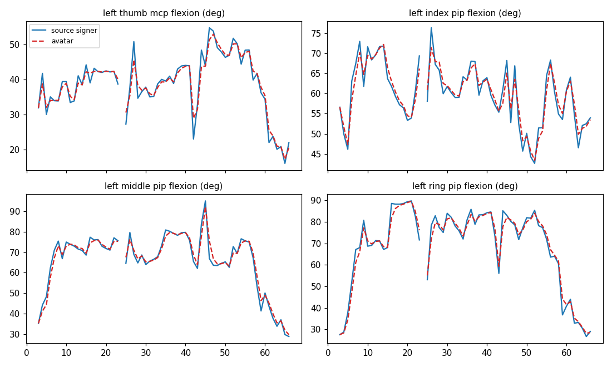
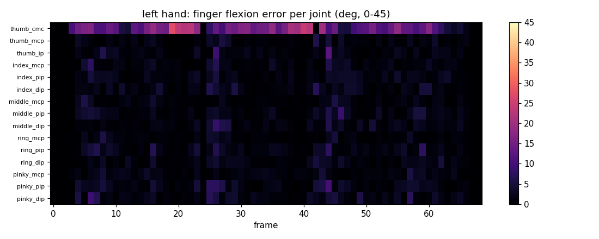
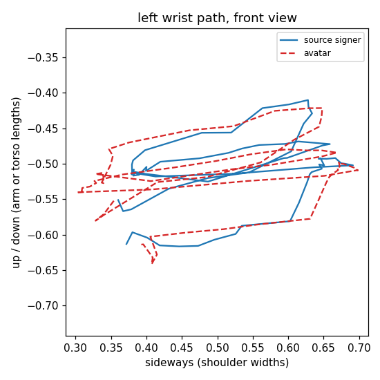
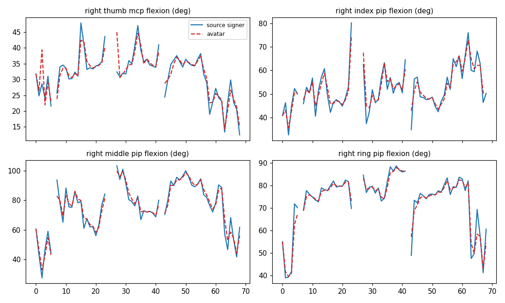
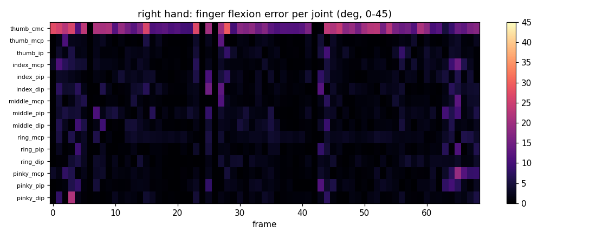
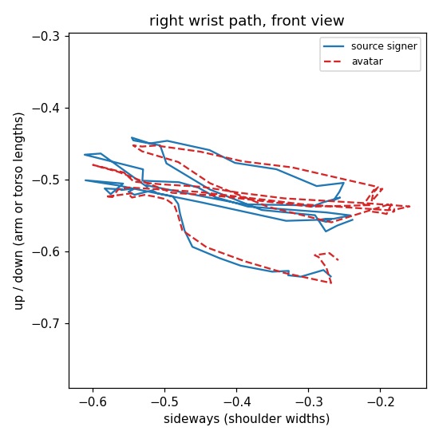
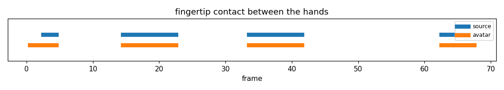

# Motion fidelity report: magnet_sign_2

Source video: `references/dict_Magnet_(Sign_2).mp4` · 69 frames at 25.00 fps

> **Geometric similarity only.** These numbers compare the avatar with the landmarks extracted from
> the source video. They cannot show whether the signing is correct ISL. Only a qualified ISL
> interpreter can approve a sign.

## Status

| Check | Result |
| --- | --- |
| license_status | granted |
| motion_qc | pass |
| interpreter_review | not_reviewed |

## Geometric check: PASS

Each limit is checked on its own; there is no overall percentage.

| Check | Value | Limit | Result |
| --- | --- | --- | --- |
| left finger flexion median (deg) | 1.165 | ≤ 5.0 | pass |
| left finger flexion p90 (deg) | 5.062 | ≤ 15.0 | pass |
| left palm orientation median (deg) | 1.567 | ≤ 10.0 | pass |
| left palm orientation p90 (deg) | 3.678 | ≤ 25.0 | pass |
| left wrist position median | 0.055 | ≤ 0.1 | pass |
| right finger flexion median (deg) | 1.529 | ≤ 5.0 | pass |
| right finger flexion p90 (deg) | 7.983 | ≤ 15.0 | pass |
| right palm orientation median (deg) | 1.697 | ≤ 10.0 | pass |
| right palm orientation p90 (deg) | 4.94 | ≤ 25.0 | pass |
| right wrist position median | 0.067 | ≤ 0.1 | pass |
| contact frames missing on avatar (fraction) | 0.0 | ≤ 0.25 | pass |

## Hands

### Left hand (63 frames compared, data: world)

Left out of the hand-shape comparison: 6 image only (frames the avatar deliberately does not copy; see MOTION_VALIDATION.md).

| Measure | Median | 90th percentile | Max |
| --- | --- | --- | --- |
| Finger joint flexion error | 1.165° | 5.062° | 27.5° |
| Finger spread error | 1.597° | 6.343° | 26.035° |
| Palm orientation error (vs chest) | 1.567° | 3.678° | 5.461° |
| Wrist position error (body-relative) | 0.055 | 0.111 | 0.129 |
| Elbow position error (body-relative) | 0.132 | 0.173 | 0.194 |

Hand shape overall: **close** (median joint error 1.165°).

| Joint | Median error | 90th percentile |
| --- | --- | --- |
| thumb_cmc | 13.268° | 20.898° |
| thumb_mcp | 0.881° | 3.315° |
| thumb_ip | 0.935° | 2.801° |
| index_mcp | 1.038° | 3.238° |
| index_pip | 1.273° | 3.348° |
| index_dip | 1.211° | 3.971° |
| middle_mcp | 0.644° | 2.554° |
| middle_pip | 1.215° | 3.77° |
| middle_dip | 1.105° | 3.346° |
| ring_mcp | 0.611° | 2.63° |
| ring_pip | 1.321° | 4.494° |
| ring_dip | 1.009° | 3.075° |
| pinky_mcp | 1.302° | 2.439° |
| pinky_pip | 1.351° | 4.708° |
| pinky_dip | 1.31° | 5.19° |

Wrist speed correlation (original timing): 0.87
DTW diagnostic: original-time mean wrist error 0.063, time-aligned 0.054, median shift 1 frames (the original timing is kept; DTW is for diagnosis only).

### Right hand (65 frames compared, data: world)

Left out of the hand-shape comparison: 2 image only, 1 impossible bend (frames the avatar deliberately does not copy; see MOTION_VALIDATION.md).

| Measure | Median | 90th percentile | Max |
| --- | --- | --- | --- |
| Finger joint flexion error | 1.529° | 7.983° | 29.225° |
| Finger spread error | 1.833° | 7.409° | 14.87° |
| Palm orientation error (vs chest) | 1.697° | 4.94° | 12.476° |
| Wrist position error (body-relative) | 0.067 | 0.122 | 0.16 |
| Elbow position error (body-relative) | 0.096 | 0.13 | 0.175 |

Hand shape overall: **close** (median joint error 1.529°).

| Joint | Median error | 90th percentile |
| --- | --- | --- |
| thumb_cmc | 16.031° | 24.185° |
| thumb_mcp | 0.851° | 3.24° |
| thumb_ip | 1.405° | 4.1° |
| index_mcp | 1.552° | 5.6° |
| index_pip | 1.586° | 4.938° |
| index_dip | 1.714° | 6.698° |
| middle_mcp | 1.021° | 4.049° |
| middle_pip | 1.772° | 5.705° |
| middle_dip | 1.357° | 5.241° |
| ring_mcp | 2.358° | 4.868° |
| ring_pip | 0.807° | 4.524° |
| ring_dip | 1.365° | 3.695° |
| pinky_mcp | 1.038° | 5.983° |
| pinky_pip | 1.326° | 6.133° |
| pinky_dip | 1.039° | 3.335° |

Wrist speed correlation (original timing): 0.863
DTW diagnostic: original-time mean wrist error 0.065, time-aligned 0.046, median shift 0 frames (the original timing is kept; DTW is for diagnosis only).

## Contact between the hands

Source frames with fingertip contact: 22; avatar: 25; matching: 22; avatar contact not in the source: 3; source contact missing on the avatar: 0.

## Face

Shape-key values vs source expression scores: median difference 0.0 (this checks the baking path; whether each expression LOOKS right needs the face renders from `tools/facial_validator.py` and the interpreter).

## Images

