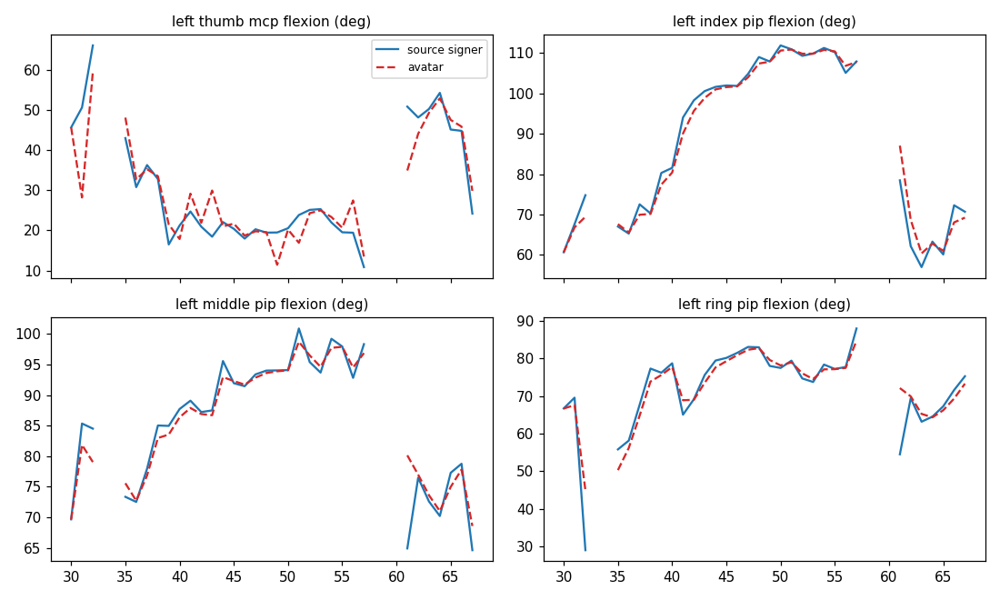
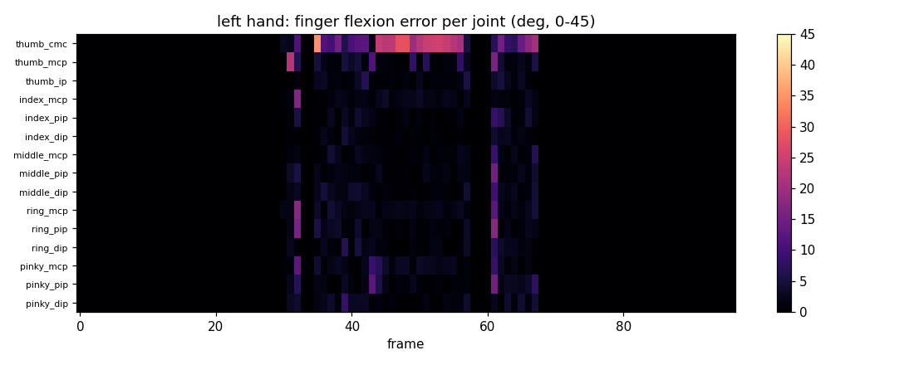
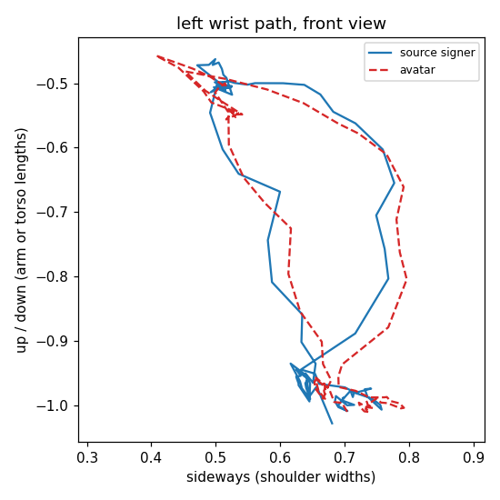
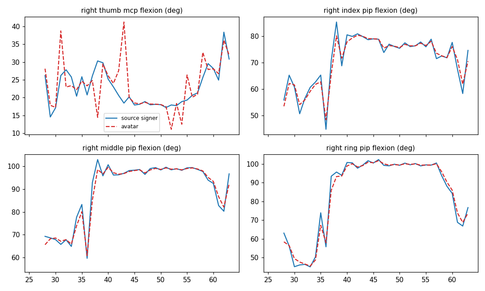
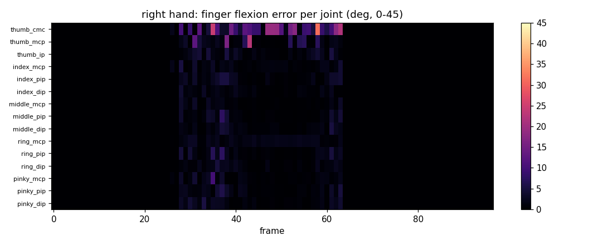
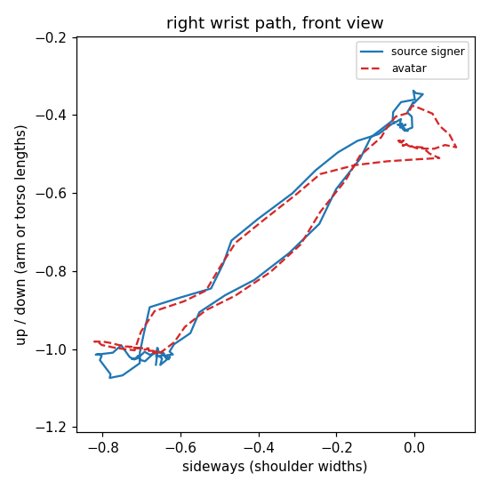
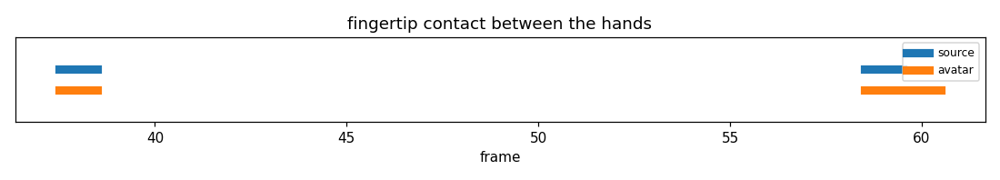

# Motion fidelity report: make

Source video: `references/dict_Make.mp4` · 97 frames at 25.00 fps

> **Geometric similarity only.** These numbers compare the avatar with the landmarks extracted from
> the source video. They cannot show whether the signing is correct ISL. Only a qualified ISL
> interpreter can approve a sign.

## Status

| Check | Result |
| --- | --- |
| license_status | granted |
| motion_qc | pass |
| interpreter_review | not_reviewed |

## Geometric check: PASS

Each limit is checked on its own; there is no overall percentage.

| Check | Value | Limit | Result |
| --- | --- | --- | --- |
| left finger flexion median (deg) | 1.429 | ≤ 5.0 | pass |
| left finger flexion p90 (deg) | 7.051 | ≤ 15.0 | pass |
| left palm orientation median (deg) | 1.816 | ≤ 10.0 | pass |
| left palm orientation p90 (deg) | 5.485 | ≤ 25.0 | pass |
| left wrist position median | 0.041 | ≤ 0.1 | pass |
| right finger flexion median (deg) | 0.936 | ≤ 5.0 | pass |
| right finger flexion p90 (deg) | 4.418 | ≤ 15.0 | pass |
| right palm orientation median (deg) | 0.636 | ≤ 10.0 | pass |
| right palm orientation p90 (deg) | 5.296 | ≤ 25.0 | pass |
| right wrist position median | 0.04 | ≤ 0.1 | pass |
| contact frames missing on avatar (fraction) | 0.0 | ≤ 0.25 | pass |

## Hands

### Left hand (33 frames compared, data: world)

Left out of the hand-shape comparison: 6 image only, 3 depth flip, 1 impossible bend (frames the avatar deliberately does not copy; see MOTION_VALIDATION.md).

| Measure | Median | 90th percentile | Max |
| --- | --- | --- | --- |
| Finger joint flexion error | 1.429° | 7.051° | 34.775° |
| Finger spread error | 4.2° | 14.947° | 105.602° |
| Palm orientation error (vs chest) | 1.816° | 5.485° | 9.284° |
| Wrist position error (body-relative) | 0.041 | 0.071 | 0.157 |
| Elbow position error (body-relative) | 0.183 | 0.357 | 0.388 |

Hand shape overall: **close** (median joint error 1.429°).

| Joint | Median error | 90th percentile |
| --- | --- | --- |
| thumb_cmc | 15.128° | 25.439° |
| thumb_mcp | 1.373° | 8.041° |
| thumb_ip | 0.991° | 3.627° |
| index_mcp | 1.588° | 2.932° |
| index_pip | 0.835° | 4.241° |
| index_dip | 0.702° | 2.442° |
| middle_mcp | 0.892° | 2.697° |
| middle_pip | 1.089° | 3.494° |
| middle_dip | 1.354° | 4.295° |
| ring_mcp | 1.929° | 4.276° |
| ring_pip | 1.28° | 3.837° |
| ring_dip | 1.212° | 3.64° |
| pinky_mcp | 1.893° | 6.733° |
| pinky_pip | 1.51° | 6.714° |
| pinky_dip | 1.326° | 3.864° |

Wrist speed correlation (original timing): 0.883
DTW diagnostic: original-time mean wrist error 0.048, time-aligned 0.043, median shift 1 frames (the original timing is kept; DTW is for diagnosis only).

### Right hand (37 frames compared, data: world)

Left out of the hand-shape comparison: 1 image only (frames the avatar deliberately does not copy; see MOTION_VALIDATION.md).

| Measure | Median | 90th percentile | Max |
| --- | --- | --- | --- |
| Finger joint flexion error | 0.936° | 4.418° | 31.352° |
| Finger spread error | 2.071° | 8.964° | 31.439° |
| Palm orientation error (vs chest) | 0.636° | 5.296° | 8.231° |
| Wrist position error (body-relative) | 0.04 | 0.088 | 0.189 |
| Elbow position error (body-relative) | 0.047 | 0.11 | 0.15 |

Hand shape overall: **close** (median joint error 0.936°).

| Joint | Median error | 90th percentile |
| --- | --- | --- |
| thumb_cmc | 8.819° | 19.23° |
| thumb_mcp | 1.224° | 7.042° |
| thumb_ip | 1.165° | 4.479° |
| index_mcp | 1.066° | 3.146° |
| index_pip | 0.779° | 3.611° |
| index_dip | 0.632° | 2.309° |
| middle_mcp | 0.357° | 2.813° |
| middle_pip | 0.607° | 3.884° |
| middle_dip | 0.926° | 2.518° |
| ring_mcp | 1.852° | 2.389° |
| ring_pip | 0.568° | 4.664° |
| ring_dip | 0.752° | 2.491° |
| pinky_mcp | 0.597° | 3.31° |
| pinky_pip | 0.77° | 3.492° |
| pinky_dip | 0.831° | 3.142° |

Wrist speed correlation (original timing): 0.931
DTW diagnostic: original-time mean wrist error 0.05, time-aligned 0.046, median shift 0 frames (the original timing is kept; DTW is for diagnosis only).

## Contact between the hands

Source frames with fingertip contact: 2; avatar: 3; matching: 2; avatar contact not in the source: 1; source contact missing on the avatar: 0.

## Face

Shape-key values vs source expression scores: median difference 0.0 (this checks the baking path; whether each expression LOOKS right needs the face renders from `tools/facial_validator.py` and the interpreter).

## Images

