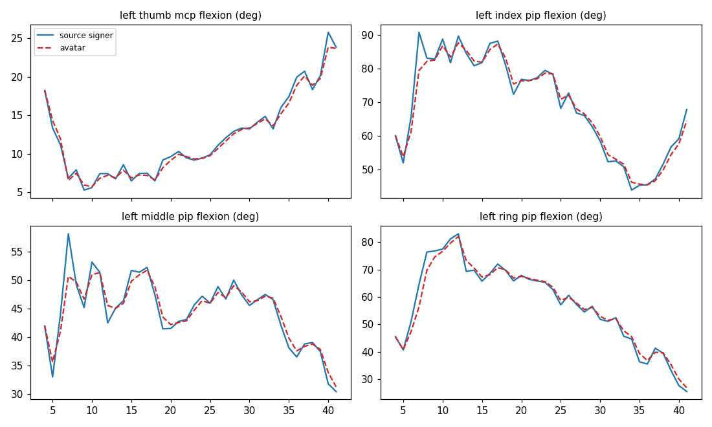
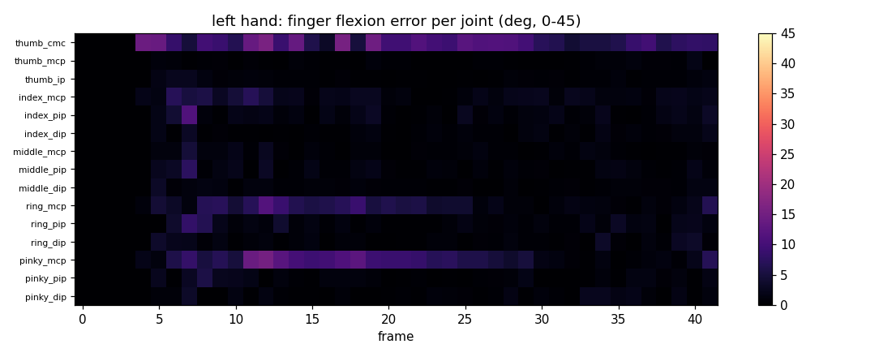
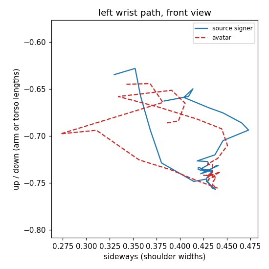
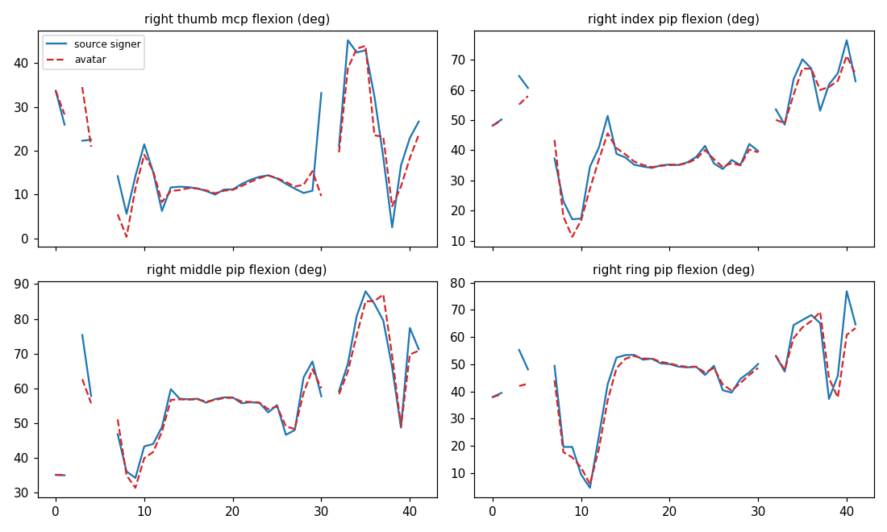
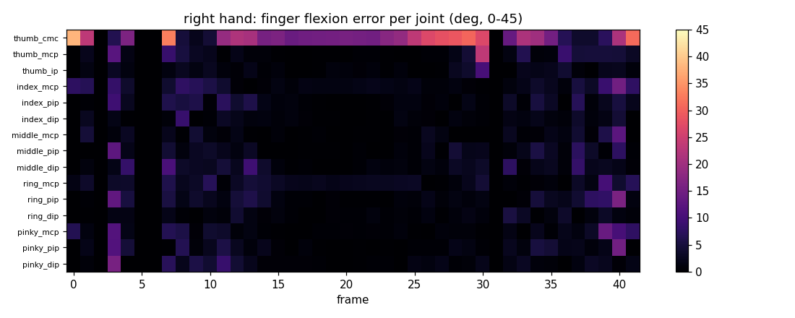
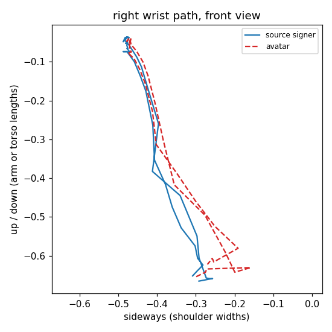
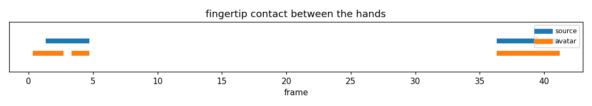

# Motion fidelity report: oxygen_sign_2

Source video: `references/dict_Oxygen_(Sign_2).mp4` · 42 frames at 25.00 fps

> **Geometric similarity only.** These numbers compare the avatar with the landmarks extracted from
> the source video. They cannot show whether the signing is correct ISL. Only a qualified ISL
> interpreter can approve a sign.

## Status

| Check | Result |
| --- | --- |
| license_status | granted |
| motion_qc | pass |
| interpreter_review | not_reviewed |

## Geometric check: PASS

Each limit is checked on its own; there is no overall percentage.

| Check | Value | Limit | Result |
| --- | --- | --- | --- |
| left finger flexion median (deg) | 0.853 | ≤ 5.0 | pass |
| left finger flexion p90 (deg) | 6.596 | ≤ 15.0 | pass |
| left palm orientation median (deg) | 1.113 | ≤ 10.0 | pass |
| left palm orientation p90 (deg) | 3.777 | ≤ 25.0 | pass |
| left wrist position median | 0.015 | ≤ 0.1 | pass |
| right finger flexion median (deg) | 1.4 | ≤ 5.0 | pass |
| right finger flexion p90 (deg) | 8.014 | ≤ 15.0 | pass |
| right palm orientation median (deg) | 3.319 | ≤ 10.0 | pass |
| right palm orientation p90 (deg) | 9.761 | ≤ 25.0 | pass |
| right wrist position median | 0.033 | ≤ 0.1 | pass |
| contact frames missing on avatar (fraction) | 0.125 | ≤ 0.25 | pass |

## Hands

### Left hand (38 frames compared, data: world)

Left out of the hand-shape comparison: 4 image only (frames the avatar deliberately does not copy; see MOTION_VALIDATION.md).

| Measure | Median | 90th percentile | Max |
| --- | --- | --- | --- |
| Finger joint flexion error | 0.853° | 6.596° | 15.828° |
| Finger spread error | 1.275° | 4.948° | 20.709° |
| Palm orientation error (vs chest) | 1.113° | 3.777° | 6.776° |
| Wrist position error (body-relative) | 0.015 | 0.106 | 0.119 |
| Elbow position error (body-relative) | 0.214 | 0.237 | 0.241 |

Hand shape overall: **close** (median joint error 0.853°).

| Joint | Median error | 90th percentile |
| --- | --- | --- |
| thumb_cmc | 9.174° | 14.291° |
| thumb_mcp | 0.387° | 0.984° |
| thumb_ip | 0.451° | 1.34° |
| index_mcp | 2.179° | 5.149° |
| index_pip | 1.236° | 3.113° |
| index_dip | 0.465° | 1.721° |
| middle_mcp | 0.586° | 1.422° |
| middle_pip | 0.685° | 2.614° |
| middle_dip | 0.596° | 1.427° |
| ring_mcp | 3.898° | 7.07° |
| ring_pip | 1.021° | 3.699° |
| ring_dip | 0.671° | 2.853° |
| pinky_mcp | 5.868° | 12.242° |
| pinky_pip | 0.605° | 2.463° |
| pinky_dip | 0.526° | 2.045° |

Wrist speed correlation (original timing): 0.694
DTW diagnostic: original-time mean wrist error 0.036, time-aligned 0.03, median shift 0 frames (the original timing is kept; DTW is for diagnosis only).

### Right hand (38 frames compared, data: world)

Left out of the hand-shape comparison: 1 depth flip, 1 image only (frames the avatar deliberately does not copy; see MOTION_VALIDATION.md).

| Measure | Median | 90th percentile | Max |
| --- | --- | --- | --- |
| Finger joint flexion error | 1.4° | 8.014° | 38.0° |
| Finger spread error | 1.079° | 6.461° | 23.164° |
| Palm orientation error (vs chest) | 3.319° | 9.761° | 24.68° |
| Wrist position error (body-relative) | 0.033 | 0.108 | 0.133 |
| Elbow position error (body-relative) | 0.064 | 0.127 | 0.144 |

Hand shape overall: **close** (median joint error 1.4°).

| Joint | Median error | 90th percentile |
| --- | --- | --- |
| thumb_cmc | 16.311° | 30.52° |
| thumb_mcp | 1.429° | 8.706° |
| thumb_ip | 1.029° | 2.862° |
| index_mcp | 1.999° | 7.886° |
| index_pip | 1.368° | 6.122° |
| index_dip | 0.838° | 3.154° |
| middle_mcp | 0.54° | 4.274° |
| middle_pip | 1.137° | 5.533° |
| middle_dip | 2.034° | 8.265° |
| ring_mcp | 2.639° | 5.999° |
| ring_pip | 1.433° | 7.575° |
| ring_dip | 1.019° | 3.308° |
| pinky_mcp | 0.939° | 7.845° |
| pinky_pip | 1.025° | 5.698° |
| pinky_dip | 1.0° | 5.732° |

Wrist speed correlation (original timing): 0.862
DTW diagnostic: original-time mean wrist error 0.046, time-aligned 0.042, median shift 0 frames (the original timing is kept; DTW is for diagnosis only).

## Contact between the hands

Source frames with fingertip contact: 8; avatar: 8; matching: 7; avatar contact not in the source: 1; source contact missing on the avatar: 1.

## Face

Shape-key values vs source expression scores: median difference 0.0 (this checks the baking path; whether each expression LOOKS right needs the face renders from `tools/facial_validator.py` and the interpreter).

## Images

