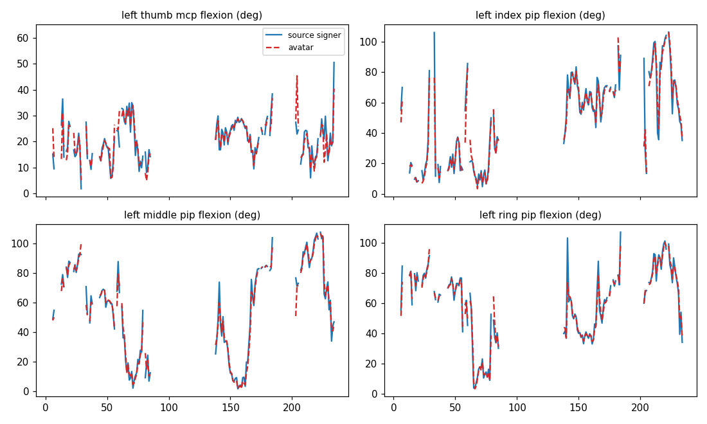
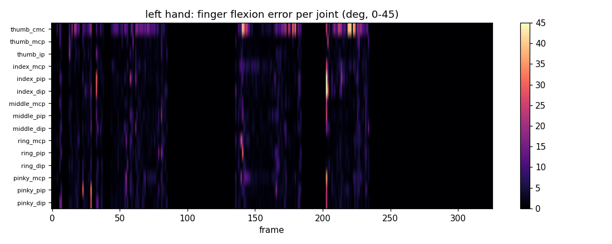
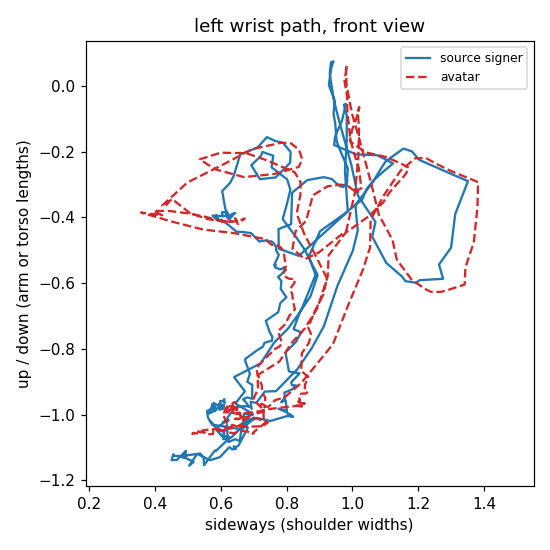
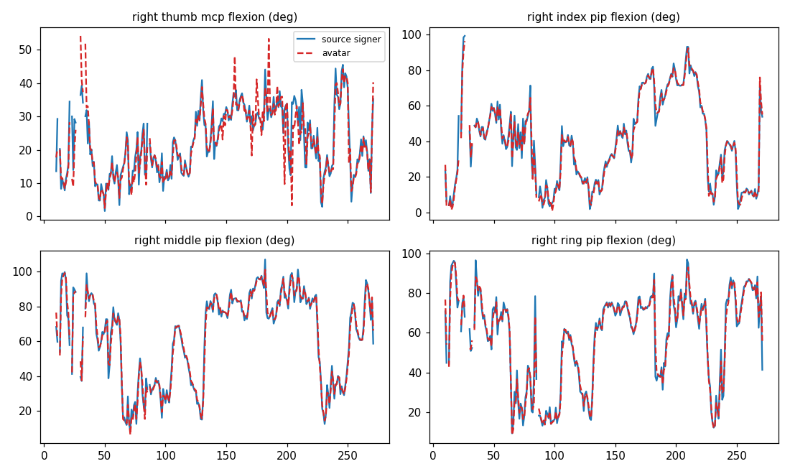
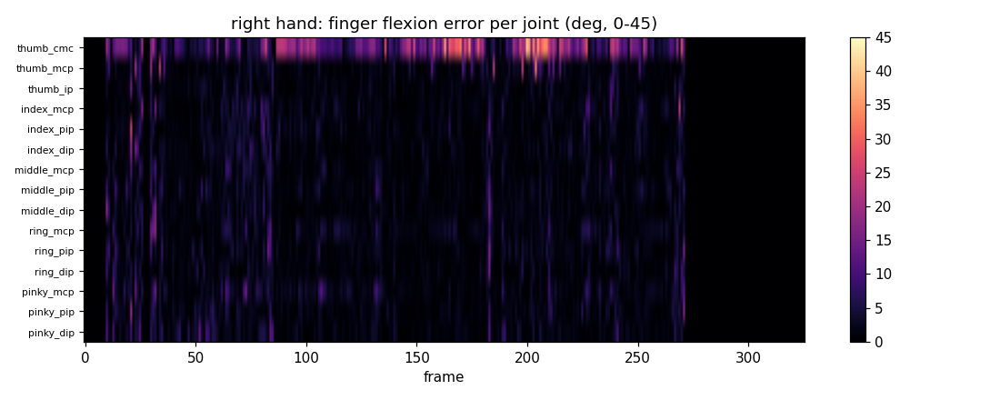
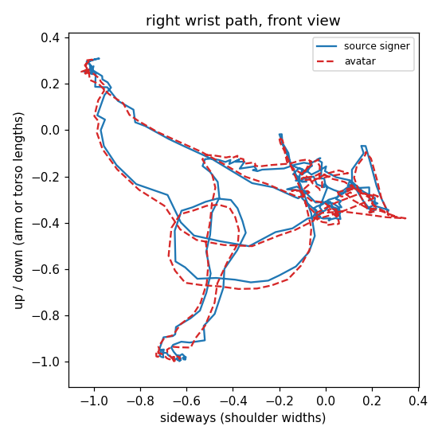
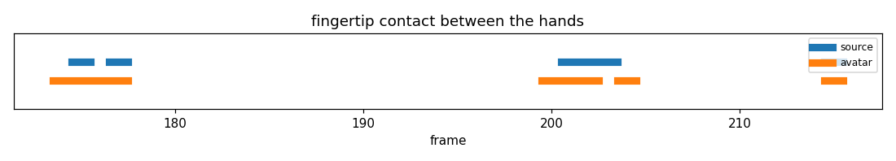

# Motion fidelity report: photosynthesis

Source video: `references/dict_Photosynthesis.mp4` · 326 frames at 24.00 fps

> **Geometric similarity only.** These numbers compare the avatar with the landmarks extracted from
> the source video. They cannot show whether the signing is correct ISL. Only a qualified ISL
> interpreter can approve a sign.

## Status

| Check | Result |
| --- | --- |
| license_status | granted |
| motion_qc | pass_exception |
| interpreter_review | not_reviewed |

## Geometric check: PASS

Each limit is checked on its own; there is no overall percentage.

| Check | Value | Limit | Result |
| --- | --- | --- | --- |
| left finger flexion median (deg) | 1.832 | ≤ 5.0 | pass |
| left finger flexion p90 (deg) | 7.704 | ≤ 15.0 | pass |
| left palm orientation median (deg) | 2.818 | ≤ 10.0 | pass |
| left palm orientation p90 (deg) | 7.176 | ≤ 25.0 | pass |
| left wrist position median | 0.052 | ≤ 0.1 | pass |
| right finger flexion median (deg) | 1.365 | ≤ 5.0 | pass |
| right finger flexion p90 (deg) | 5.84 | ≤ 15.0 | pass |
| right palm orientation median (deg) | 2.38 | ≤ 10.0 | pass |
| right palm orientation p90 (deg) | 5.627 | ≤ 25.0 | pass |
| right wrist position median | 0.025 | ≤ 0.1 | pass |
| contact frames missing on avatar (fraction) | 0.167 | ≤ 0.25 | pass |

## Hands

### Left hand (136 frames compared, data: world)

Left out of the hand-shape comparison: 7 image only, 28 impossible bend, 5 depth flip (frames the avatar deliberately does not copy; see MOTION_VALIDATION.md).

| Measure | Median | 90th percentile | Max |
| --- | --- | --- | --- |
| Finger joint flexion error | 1.832° | 7.704° | 58.038° |
| Finger spread error | 1.937° | 9.398° | 69.308° |
| Palm orientation error (vs chest) | 2.818° | 7.176° | 176.665° |
| Wrist position error (body-relative) | 0.052 | 0.096 | 0.268 |
| Elbow position error (body-relative) | 0.167 | 0.268 | 0.326 |

Hand shape overall: **close** (median joint error 1.832°).

| Joint | Median error | 90th percentile |
| --- | --- | --- |
| thumb_cmc | 10.408° | 21.528° |
| thumb_mcp | 1.169° | 4.936° |
| thumb_ip | 1.572° | 4.888° |
| index_mcp | 2.205° | 6.452° |
| index_pip | 2.115° | 8.331° |
| index_dip | 1.613° | 5.804° |
| middle_mcp | 1.383° | 4.566° |
| middle_pip | 1.601° | 6.316° |
| middle_dip | 1.634° | 6.564° |
| ring_mcp | 1.885° | 5.766° |
| ring_pip | 1.351° | 5.117° |
| ring_dip | 1.545° | 5.555° |
| pinky_mcp | 2.489° | 7.328° |
| pinky_pip | 1.949° | 6.751° |
| pinky_dip | 1.977° | 5.892° |

Wrist speed correlation (original timing): 0.841
DTW diagnostic: original-time mean wrist error 0.062, time-aligned 0.058, median shift 0 frames (the original timing is kept; DTW is for diagnosis only).

### Right hand (255 frames compared, data: world)

Left out of the hand-shape comparison: 6 image only, 1 impossible bend, 3 depth flip (frames the avatar deliberately does not copy; see MOTION_VALIDATION.md).

| Measure | Median | 90th percentile | Max |
| --- | --- | --- | --- |
| Finger joint flexion error | 1.365° | 5.84° | 38.957° |
| Finger spread error | 1.98° | 9.584° | 119.364° |
| Palm orientation error (vs chest) | 2.38° | 5.627° | 25.49° |
| Wrist position error (body-relative) | 0.025 | 0.069 | 0.306 |
| Elbow position error (body-relative) | 0.091 | 0.193 | 0.323 |

Hand shape overall: **close** (median joint error 1.365°).

| Joint | Median error | 90th percentile |
| --- | --- | --- |
| thumb_cmc | 11.478° | 24.293° |
| thumb_mcp | 1.128° | 5.499° |
| thumb_ip | 1.173° | 3.227° |
| index_mcp | 1.295° | 4.939° |
| index_pip | 1.15° | 4.108° |
| index_dip | 1.188° | 4.035° |
| middle_mcp | 0.959° | 4.186° |
| middle_pip | 1.292° | 4.462° |
| middle_dip | 1.132° | 3.532° |
| ring_mcp | 1.668° | 5.015° |
| ring_pip | 1.221° | 4.335° |
| ring_dip | 1.029° | 3.685° |
| pinky_mcp | 1.686° | 5.647° |
| pinky_pip | 1.26° | 3.966° |
| pinky_dip | 1.344° | 4.846° |

Wrist speed correlation (original timing): 0.894
DTW diagnostic: original-time mean wrist error 0.039, time-aligned 0.035, median shift 0 frames (the original timing is kept; DTW is for diagnosis only).

## Contact between the hands

Source frames with fingertip contact: 6; avatar: 9; matching: 5; avatar contact not in the source: 4; source contact missing on the avatar: 1.

## Face

Shape-key values vs source expression scores: median difference 0.0 (this checks the baking path; whether each expression LOOKS right needs the face renders from `tools/facial_validator.py` and the interpreter).

## Images

