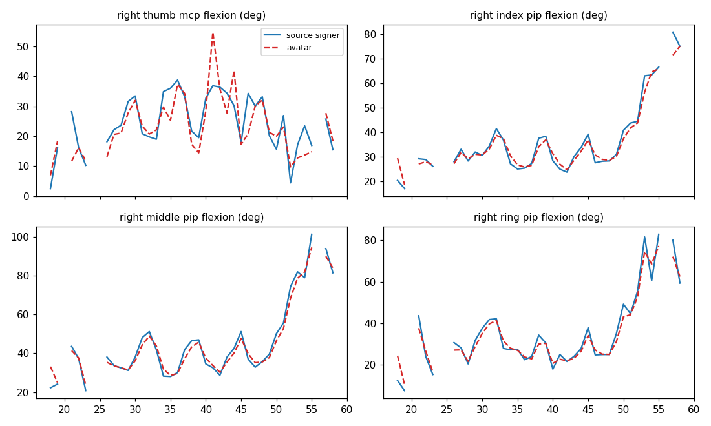
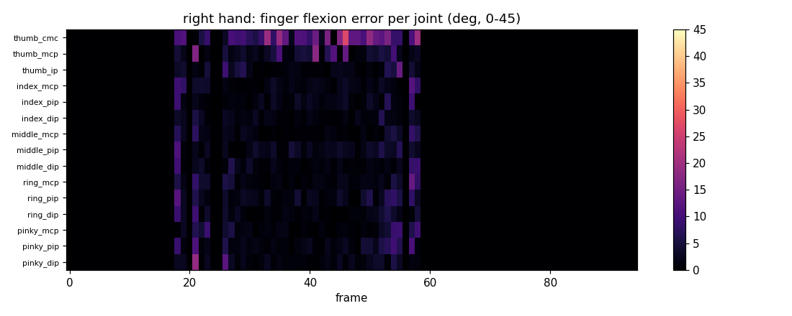
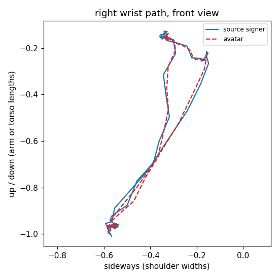

# Motion fidelity report: sugar

Source video: `references/dict_Sugar.mp4` · 95 frames at 25.00 fps

> **Geometric similarity only.** These numbers compare the avatar with the landmarks extracted from
> the source video. They cannot show whether the signing is correct ISL. Only a qualified ISL
> interpreter can approve a sign.

## Status

| Check | Result |
| --- | --- |
| license_status | granted |
| motion_qc | pass |
| interpreter_review | not_reviewed |

## Geometric check: PASS

Each limit is checked on its own; there is no overall percentage.

| Check | Value | Limit | Result |
| --- | --- | --- | --- |
| right finger flexion median (deg) | 1.689 | ≤ 5.0 | pass |
| right finger flexion p90 (deg) | 8.412 | ≤ 15.0 | pass |
| right palm orientation median (deg) | 2.013 | ≤ 10.0 | pass |
| right palm orientation p90 (deg) | 7.94 | ≤ 25.0 | pass |
| right wrist position median | 0.01 | ≤ 0.1 | pass |

## Hands

### Right hand (37 frames compared, data: world)

Left out of the hand-shape comparison: 5 image only, 4 depth flip (frames the avatar deliberately does not copy; see MOTION_VALIDATION.md).

| Measure | Median | 90th percentile | Max |
| --- | --- | --- | --- |
| Finger joint flexion error | 1.689° | 8.412° | 26.887° |
| Finger spread error | 1.4° | 10.675° | 42.038° |
| Palm orientation error (vs chest) | 2.013° | 7.94° | 22.461° |
| Wrist position error (body-relative) | 0.01 | 0.047 | 0.117 |
| Elbow position error (body-relative) | 0.101 | 0.147 | 0.215 |

Hand shape overall: **close** (median joint error 1.689°).

| Joint | Median error | 90th percentile |
| --- | --- | --- |
| thumb_cmc | 10.414° | 19.242° |
| thumb_mcp | 3.141° | 11.745° |
| thumb_ip | 1.643° | 6.385° |
| index_mcp | 1.818° | 8.027° |
| index_pip | 1.322° | 3.453° |
| index_dip | 1.369° | 3.418° |
| middle_mcp | 0.853° | 6.235° |
| middle_pip | 2.468° | 4.696° |
| middle_dip | 1.043° | 6.183° |
| ring_mcp | 1.487° | 5.669° |
| ring_pip | 2.464° | 7.08° |
| ring_dip | 1.074° | 4.745° |
| pinky_mcp | 1.157° | 8.9° |
| pinky_pip | 1.714° | 8.665° |
| pinky_dip | 1.171° | 3.667° |

Wrist speed correlation (original timing): 0.976
DTW diagnostic: original-time mean wrist error 0.017, time-aligned 0.017, median shift 0 frames (the original timing is kept; DTW is for diagnosis only).

## Contact between the hands

Source frames with fingertip contact: 0; avatar: 0; matching: 0; avatar contact not in the source: 0; source contact missing on the avatar: 0.

## Face

Shape-key values vs source expression scores: median difference 0.0 (this checks the baking path; whether each expression LOOKS right needs the face renders from `tools/facial_validator.py` and the interpreter).

## Images

