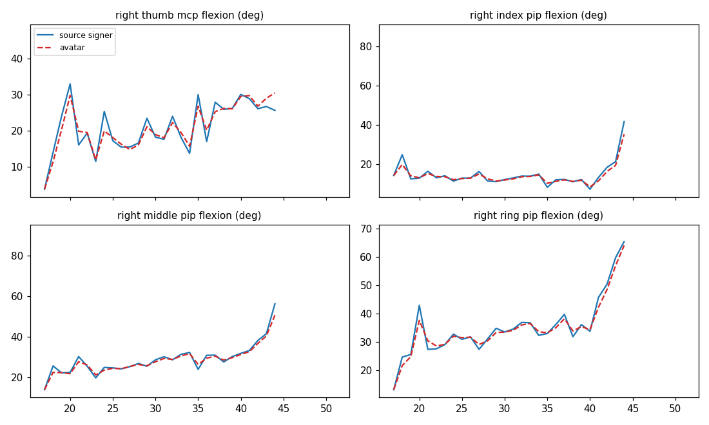
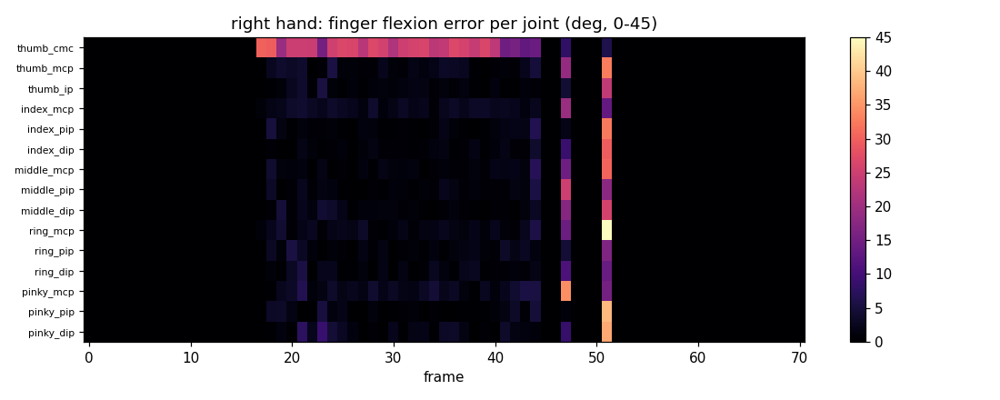
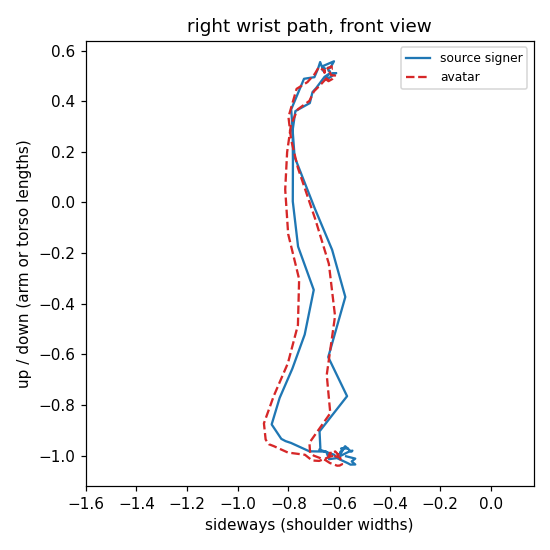

# Motion fidelity report: sun

Source video: `references/dict_Sun.mp4` · 71 frames at 25.00 fps

> **Geometric similarity only.** These numbers compare the avatar with the landmarks extracted from
> the source video. They cannot show whether the signing is correct ISL. Only a qualified ISL
> interpreter can approve a sign.

## Status

| Check | Result |
| --- | --- |
| license_status | granted |
| motion_qc | pass |
| interpreter_review | not_reviewed |

## Geometric check: PASS

Each limit is checked on its own; there is no overall percentage.

| Check | Value | Limit | Result |
| --- | --- | --- | --- |
| right finger flexion median (deg) | 1.279 | ≤ 5.0 | pass |
| right finger flexion p90 (deg) | 14.462 | ≤ 15.0 | pass |
| right palm orientation median (deg) | 1.437 | ≤ 10.0 | pass |
| right palm orientation p90 (deg) | 4.473 | ≤ 25.0 | pass |
| right wrist position median | 0.045 | ≤ 0.1 | pass |

## Hands

### Right hand (30 frames compared, data: world)

Left out of the hand-shape comparison: 3 image only, 2 depth flip (frames the avatar deliberately does not copy; see MOTION_VALIDATION.md).

| Measure | Median | 90th percentile | Max |
| --- | --- | --- | --- |
| Finger joint flexion error | 1.279° | 14.462° | 54.814° |
| Finger spread error | 0.986° | 6.759° | 76.738° |
| Palm orientation error (vs chest) | 1.437° | 4.473° | 169.639° |
| Wrist position error (body-relative) | 0.045 | 0.075 | 0.127 |
| Elbow position error (body-relative) | 0.071 | 0.144 | 0.198 |

Hand shape overall: **close** (median joint error 1.279°).

| Joint | Median error | 90th percentile |
| --- | --- | --- |
| thumb_cmc | 24.617° | 26.78° |
| thumb_mcp | 1.762° | 5.42° |
| thumb_ip | 0.92° | 4.366° |
| index_mcp | 2.549° | 3.989° |
| index_pip | 0.727° | 4.995° |
| index_dip | 0.609° | 3.754° |
| middle_mcp | 1.086° | 7.019° |
| middle_pip | 0.8° | 5.574° |
| middle_dip | 0.913° | 4.648° |
| ring_mcp | 1.969° | 5.668° |
| ring_pip | 1.157° | 4.535° |
| ring_dip | 0.99° | 5.509° |
| pinky_mcp | 2.599° | 6.356° |
| pinky_pip | 0.635° | 4.734° |
| pinky_dip | 1.419° | 8.5° |

Wrist speed correlation (original timing): 0.982
DTW diagnostic: original-time mean wrist error 0.044, time-aligned 0.041, median shift 0 frames (the original timing is kept; DTW is for diagnosis only).

## Contact between the hands

Source frames with fingertip contact: 0; avatar: 0; matching: 0; avatar contact not in the source: 0; source contact missing on the avatar: 0.

## Face

Shape-key values vs source expression scores: median difference 0.0 (this checks the baking path; whether each expression LOOKS right needs the face renders from `tools/facial_validator.py` and the interpreter).

## Images

