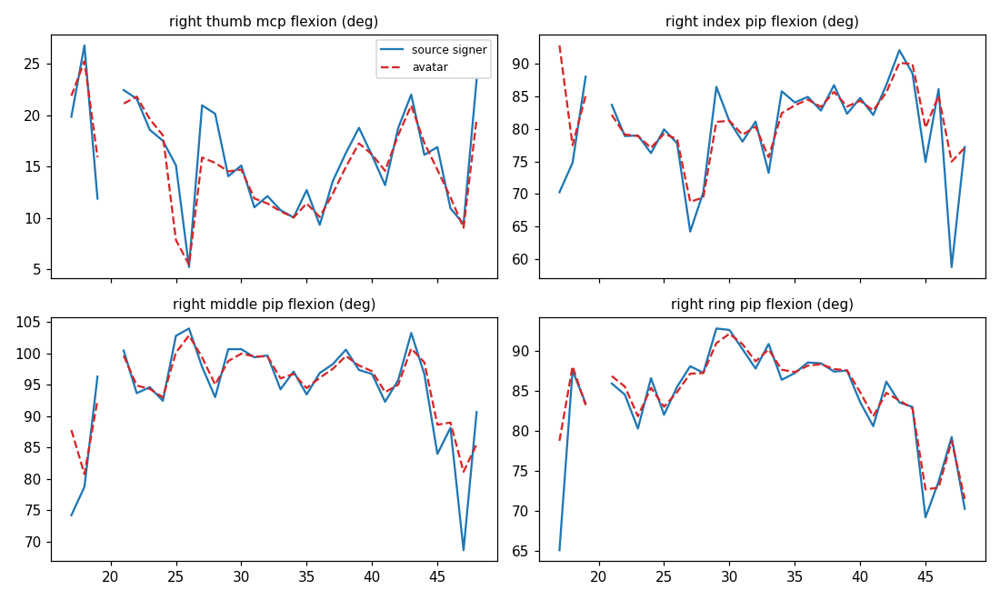
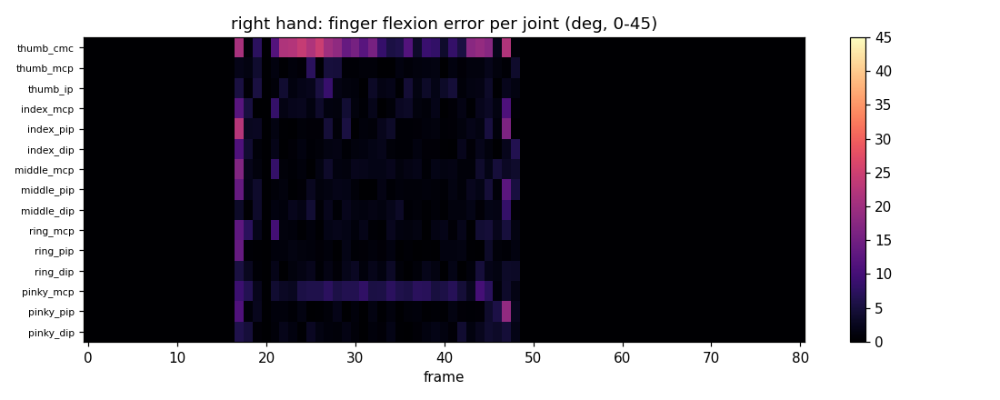
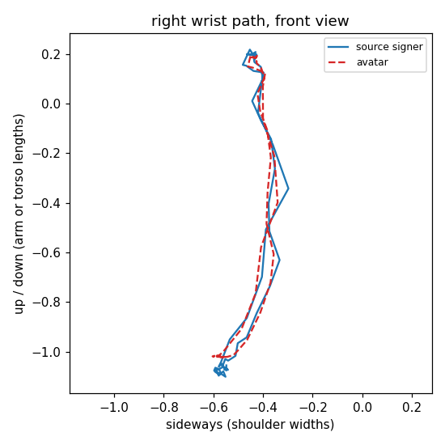

# Motion fidelity report: water

Source video: `references/dict_Water.mp4` · 81 frames at 25.00 fps

> **Geometric similarity only.** These numbers compare the avatar with the landmarks extracted from
> the source video. They cannot show whether the signing is correct ISL. Only a qualified ISL
> interpreter can approve a sign.

## Status

| Check | Result |
| --- | --- |
| license_status | granted |
| motion_qc | pass |
| interpreter_review | not_reviewed |

## Geometric check: PASS

Each limit is checked on its own; there is no overall percentage.

| Check | Value | Limit | Result |
| --- | --- | --- | --- |
| right finger flexion median (deg) | 1.475 | ≤ 5.0 | pass |
| right finger flexion p90 (deg) | 7.268 | ≤ 15.0 | pass |
| right palm orientation median (deg) | 2.672 | ≤ 10.0 | pass |
| right palm orientation p90 (deg) | 6.305 | ≤ 25.0 | pass |
| right wrist position median | 0.044 | ≤ 0.1 | pass |

## Hands

### Right hand (31 frames compared, data: world)

Left out of the hand-shape comparison: 4 impossible bend, 2 image only (frames the avatar deliberately does not copy; see MOTION_VALIDATION.md).

| Measure | Median | 90th percentile | Max |
| --- | --- | --- | --- |
| Finger joint flexion error | 1.475° | 7.268° | 24.644° |
| Finger spread error | 0.795° | 10.271° | 78.661° |
| Palm orientation error (vs chest) | 2.672° | 6.305° | 15.01° |
| Wrist position error (body-relative) | 0.044 | 0.072 | 0.129 |
| Elbow position error (body-relative) | 0.07 | 0.122 | 0.293 |

Hand shape overall: **close** (median joint error 1.475°).

| Joint | Median error | 90th percentile |
| --- | --- | --- |
| thumb_cmc | 12.135° | 21.856° |
| thumb_mcp | 1.085° | 4.028° |
| thumb_ip | 1.839° | 5.303° |
| index_mcp | 1.598° | 5.171° |
| index_pip | 1.04° | 5.271° |
| index_dip | 1.128° | 2.384° |
| middle_mcp | 1.775° | 3.731° |
| middle_pip | 1.111° | 4.657° |
| middle_dip | 1.363° | 3.447° |
| ring_mcp | 1.588° | 4.956° |
| ring_pip | 0.747° | 1.546° |
| ring_dip | 1.59° | 3.327° |
| pinky_mcp | 5.797° | 7.479° |
| pinky_pip | 0.871° | 3.818° |
| pinky_dip | 1.402° | 4.189° |

Wrist speed correlation (original timing): 0.978
DTW diagnostic: original-time mean wrist error 0.044, time-aligned 0.044, median shift 0 frames (the original timing is kept; DTW is for diagnosis only).

## Contact between the hands

Source frames with fingertip contact: 0; avatar: 0; matching: 0; avatar contact not in the source: 0; source contact missing on the avatar: 0.

## Face

Shape-key values vs source expression scores: median difference 0.0 (this checks the baking path; whether each expression LOOKS right needs the face renders from `tools/facial_validator.py` and the interpreter).

## Images

